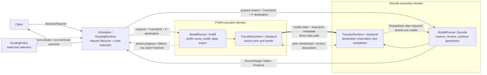
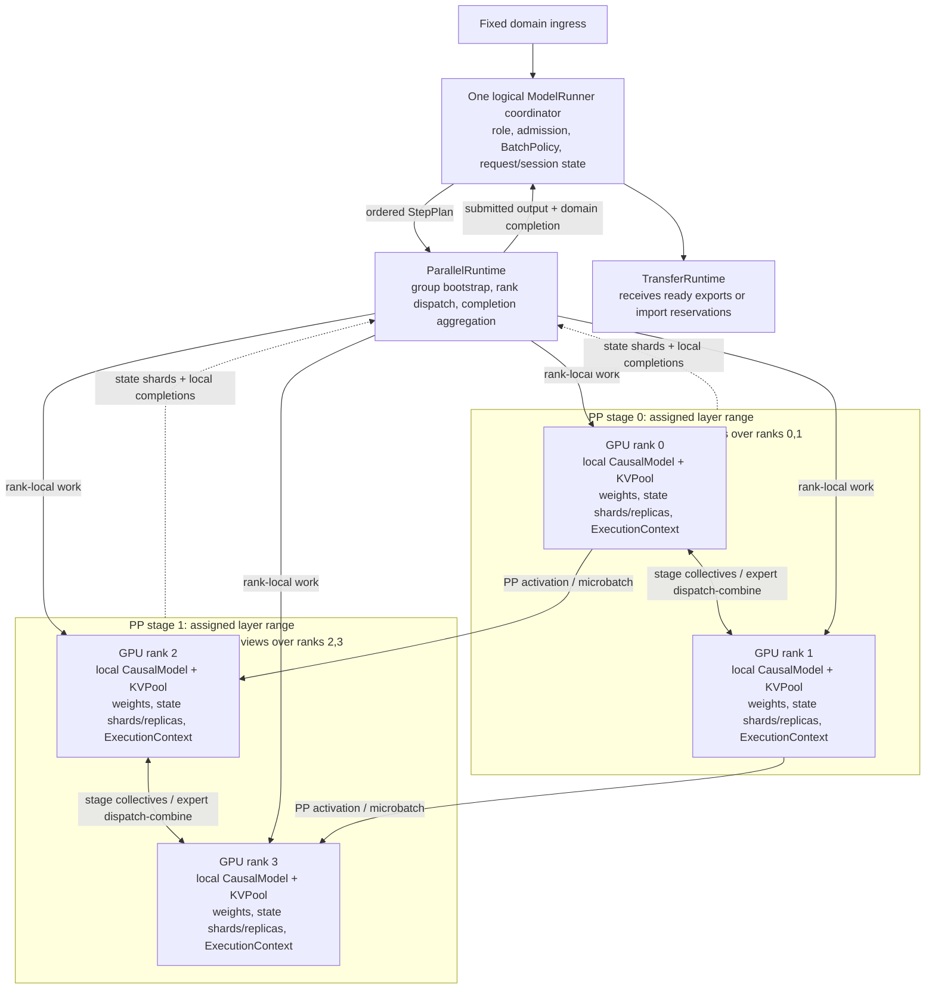

# Parallel execution, routing and state handoff

Status: proposed architecture; not a claim of implemented distributed execution.
This document extends [spec.md](spec.md) and
[prefix_cache_routing.md](prefix_cache_routing.md). Existing request, forwarding,
local KV and GPU-completion contracts remain authoritative. Only the boundaries
explicitly extended below change for distributed execution.

Rust snippets describe state and actions, not compiling implementation. Existing
`Scheduler`, `RoutingRuntime`, `RoutingState`, `RoutingPolicy`, `RequestForwarder`,
`Forwarding`, `ModelRunner`, `BatchPolicy`, `CausalModel`, `KVContext` and `KVPool`
are reused. `SessionRequest`, `RequestId`, `SessionId`, `DestinationId`,
`CacheNamespace`, `RunnerCommand` and `RunnerReply` keep their current meanings.
New coordinator types/methods are private or `pub(crate)` by default. Extension
traits and types carried by public transport/configuration APIs become `pub`
only when those APIs actually require them; resource fields stay private.

## 1. Scope and invariants

- A destination names one independently runnable execution domain's fixed ingress.
  It may span machines. Routing does not select individual GPU ranks.
- A domain has one logical ModelRunner admission/batch coordinator. Rank workers
  cooperate; there are no independent internal DP/Attention-DP request queues.
  Scale independent request scheduling by adding domains.
- Model mathematics, GPU placement, operator parallelism, worker role and request
  routing are separate decisions. P/D roles do not imply a TP or PP layout.
- TP, attention TP, EP and PP are views over physical ranks, not GPU-count factors
  to multiply together. Explicit membership determines actual resource use.
- Local KVPool owns physical buffers/mapping. PrefixCache owns exact cache pins.
  Routing owns bounded locality hints; neither hints nor dispatch prove readiness.
- Source state stays pinned and immutable while GPU producers or transfer readers
  can access it. Destination state is exclusive and unreadable until import commits.
- GPU submission, GPU completion, transfer submission, destination visibility and
  logical state commit are distinct boundaries.

First implementations may be narrower than the interfaces:

| Boundary | First implementation | Extension preserved |
| --- | --- | --- |
| Execution | Existing single GPU; then TP=2 correctness baseline | Explicit attention TP, EP and PP groups |
| Ingress | One fixed ingress per domain | More domain replicas, remote forwarding |
| Role | Unified prefill + decode | Prefill-only and Decode-only domains |
| PD | Same model namespace, dtype, layout and parallel partition shape; whole-state handoff | Supported layout conversion, unequal widths, chunks/overlap |
| PD sessions | Full-input stateless requests; persistent sessions stay on Unified owners | D-owned persistent sessions, owner-driven history export and explicit migration |
| Transfer | One compatible registered transport | Other transports and component-specific codecs |

These are implementation capability limits, not universal protocol constraints.
Unsupported plans fail before expensive execution or transfer. No silent fallback
changes model/state semantics. Different P/D physical GPU IDs are expected even
when the first implementation requires identical logical partition shapes.

### SGLang feature mapping and planned scope

This list names the relevant features and their intended scope here. It is not
SGLang feature parity, and "planned" does not mean implemented by today's engine.

- **Data Parallelism (DP)** — planned between independent execution domains.
  Register multiple domain endpoints with Scheduler/Router; each domain owns its
  requests, state and complete model execution capability.
- **Tensor Parallelism (TP)** — planned within a domain's PP stage; shard tensor
  computations across its ranks. First distributed validation uses TP=2.
- **Attention Tensor Parallelism (Attention TP)** — planned as the attention
  operator's explicit group view. Initially it equals stage TP; a different width
  requires a supported redistribution/replication plan, not implicit internal DP.
- **Expert Parallelism (EP)** — planned for routed experts in MoE models, composed
  with expert TP over the same stage ranks. Dense models require EP=1.
- **Pipeline Parallelism (PP)** — planned layer partitioning and explicit
  stage/microbatch dependencies, with per-stage state ownership.
- **Data Parallelism Attention (DPA)**, also called **Attention DP** — analyzed
  SGLang capability, deliberately **outside the current implementation plan**.
  It creates independent attention scheduling/KV domains within one execution
  domain. No `--attn-dp-size` or internal DP-rank routing API is planned here.
- **Mixture of Experts (MoE)** — planned model support; keep expert selection,
  token dispatch/combine and local expert computation separate. EP is optional
  for a MoE model; TP and EP widths are validated against its expert layout.
- **Prefill/Decode Disaggregation (PD)** — planned role-specific domains, paired
  routing and explicit state handoff. Homogeneous whole-state transfer comes
  first; supported heterogeneous layouts and chunked overlap come later.
- **Cache-aware routing and radix prefix caching** — existing local foundations;
  extend endpoint registration and bounded hints to domain roles. Only the
  destination's exact cache authorizes reuse. Cross-domain KV reuse requires a
  separate transfer, not merely a routing hint.
- **Continuous batching and chunked prefill** — existing local foundations;
  extend the domain's agreed step plan while retaining one admission coordinator.
- **CUDA Graph replay and CPU/GPU submission overlap** — existing local Qwen
  foundations. Distributed/PP-compatible replay and overlap require their own
  dependency, shape and lifetime validation; the current local switch is not proof.
- **Collective communication** — a planned backend boundary for broadcast,
  all-reduce, all-gather, reduce-scatter and required point-to-point operations.
  **NVIDIA Collective Communications Library (NCCL)** is an intended implementation.
- **DeepEP and DeepGEMM** — reference/optional integration targets, not required
  dependencies. DeepEP supplies expert token communication; DeepGEMM supplies
  compatible expert matrix computation. A cuTile expert backend can be selected
  independently when its input/output format matches the dispatcher.
- **Remote Direct Memory Access (RDMA)** — optional state-transfer transport
  capability. NIXL/Mooncake are integration candidates, not mandatory APIs for
  KVPool. Backend availability, GPU/NIC support and state formats are validated.
- **Hierarchical KV Caching (HiCache) and state offload** — an extension boundary for GPU/CPU/remote
  storage, not a commitment to implement all SGLang HiCache features. It shares
  the same ownership, readiness and state-schema contracts.

### Target CLI: final deployment API, not implemented commands

`engine serve` and `engine route` below are **proposed subcommands**. Today's
`engine` binary is a demo; it does not parse these commands. Existing runnable
examples remain in the [engine guide](../rust/engine/README.md). This section is
an interface target, not a claim that the example can currently launch.

`serve` hosts a ModelRunner execution domain; `route` deploys the existing
Scheduler/RoutingRuntime as a service. No additional mandatory Gateway component
is implied. Embedded use of the Rust APIs remains supported. Canonical long flag
names are shown; no SGLang short-flag compatibility is promised.

The following maximal PD example uses a **supported MoE checkpoint** supplied as
`MODEL_DIR`. All four hosts must have the same immutable checkpoint and compatible
backends. `MODEL_DIR` is not a promise that an arbitrary model fits this placement.
Variables denote deployment inputs, not files to read for secret values. Execute
each invocation on its indicated host; do not start all four on one GPU set.

```bash
# Final target syntax only. Define the same array on each participating host.
# Required: MODEL_DIR, P0_HOST, P1_HOST, D0_HOST, D1_HOST.
COMMON=(
  --model-dir "${MODEL_DIR}"
  --served-model-name moe-model
  --dtype bf16
  --quantization none
  --kv-cache-dtype bf16
  --nnodes 2
  --devices 0,1,2,3,4,5,6,7
  --tp-size 8
  --attention-tp-size 8
  --ep-size 8
  --pp-size 2
  --collective-backend nccl
  --attention-backend cutile
  --moe-dispatch-backend deepep
  --expert-backend cutile
  --batch-policy mixed-chunk
  --max-batch-tokens 4096
  --max-running-requests 128
  --max-seq-len 8192
  --pp-microbatch-tokens 1024
  --pp-max-in-flight-microbatches 4
  --kv-pool naive
  --kv-capacity-tokens 32768
  --prefix-cache radix
  --prefix-cache-tokens 16384
  --cuda-graph
  --overlap
  --transfer-backend nixl
  --transfer-device mlx5_0
  --transfer-mode whole
  --transfer-layout-policy exact
  --transfer-max-in-flight 16
  --log-format json
  --metrics
)

# P node 0: one domain coordinator/ingress, PP stage 0 by uniform placement.
engine serve "${COMMON[@]}" \
  --domain-id prefill-a --role prefill \
  --host "${P0_HOST}" --port 30000 --node-rank 0 \
  --dist-init-addr "${P0_HOST}:5000" \
  --transfer-bootstrap-addr "${P0_HOST}:8998"

# P node 1: member of prefill-a, not another independently routed domain.
engine serve "${COMMON[@]}" \
  --domain-id prefill-a --role prefill \
  --host "${P1_HOST}" --port 30000 --node-rank 1 \
  --dist-init-addr "${P0_HOST}:5000" \
  --transfer-bootstrap-addr "${P0_HOST}:8998"

# D node 0: a separate collective world and a separate state owner.
engine serve "${COMMON[@]}" \
  --domain-id decode-a --role decode \
  --host "${D0_HOST}" --port 30001 --node-rank 0 \
  --dist-init-addr "${D0_HOST}:5000" \
  --transfer-bootstrap-addr "${D0_HOST}:8998"

# D node 1: member of decode-a.
engine serve "${COMMON[@]}" \
  --domain-id decode-a --role decode \
  --host "${D1_HOST}" --port 30001 --node-rank 1 \
  --dist-init-addr "${D0_HOST}:5000" \
  --transfer-bootstrap-addr "${D0_HOST}:8998"
```

This plan uses 16 physical ranks/domain: two PP stages, eight ranks/stage.
Each stage's TP/Attention TP/EP groups view the same eight ranks; expert TP=1.
P and D together use 32 distinct GPUs across the four example hosts. Only each
node-0 coordinator registers its domain ingress. Non-coordinator API ports do
not become additional routing targets. Startup validates all node/device claims.
MoE dispatch transfers token activations inside each domain; NIXL transfers model
state between domains. These backend flags select separate mechanisms.
For a dense checkpoint such as the discussed Qwen3.5-27B, use EP=1 and
`--moe-dispatch-backend none`; an expert backend is not loaded for absent experts.

The command deliberately chooses `whole`/`exact` for handoff. PP, MoE, NIXL,
CUDA Graph and overlap still require the selected implementations to support their
combination. In particular, PP-aware lookahead/replay is a later capability;
unsupported combinations are rejected, never silently downgraded.

```bash
# Run on the routing host after the two domains have registered as ready.
engine route \
  --host 0.0.0.0 --port 8000 \
  --mode pd \
  --prefill-worker "prefill-a=http://${P0_HOST}:30000" \
  --decode-worker "decode-a=http://${D0_HOST}:30001" \
  --policy cache-aware \
  --prefill-policy cache-aware \
  --decode-policy least-load \
  --max-prefix-bytes 4096 \
  --max-index-bytes 67108864 \
  --max-pending-requests 1024 \
  --max-cleanup-transfers 256 \
  --request-timeout-seconds 300 \
  --max-retries 0 \
  --log-format json \
  --metrics
```

Worker aliases resolve to registration-scoped DestinationId values; they are not
caller-assigned request IDs or rank numbers. Endpoints advertise their actual role,
model namespace, topology summary and transfer capabilities; CLI declarations do
not override an incompatible registration. CacheNamespace is derived from model,
adapter and input semantics, not an arbitrary flag that can authorize reuse.

The final option semantics and extension points are:

| Options | Contract |
| --- | --- |
| `--role unified\|prefill\|decode` | Domain-wide scheduling role. Role changes require drainage and fresh registration. |
| `--nnodes`, `--node-rank`, `--devices`, `--dist-init-addr` | Physical placement/bootstrap; local devices refer to process-visible IDs. |
| `--tp-size`, `--attention-tp-size`, `--ep-size`, `--pp-size` | Uniform-stage shorthand for ParallelConfig; no internal DPA is inferred. |
| `--topology-file TOPOLOGY_JSON` | Alternative explicit per-stage/rank plan for non-uniform layouts; mutually exclusive with the width/placement shorthand it replaces. |
| `--dtype`, `--quantization`, `--kv-cache-dtype` | Model/storage format choices, accepted only when loader, kernels and state codecs support them. `checkpoint` quantization may select supported checkpoint metadata; no silent FP32 expansion. |
| `--collective-backend`, `--attention-backend`, `--moe-dispatch-backend`, `--expert-backend` | Construction-time plugin selection, with explicit format/hardware compatibility validation. |
| `--max-batch-tokens`, `--batch-policy` | Domain-local logical input-token budget and request/chunk selection; TP replication does not multiply that budget. |
| `--max-running-requests`, `--transfer-max-in-flight` | Bounds on admitted logical requests, including import reservations, and the transfer subset. Physical KV/scratch admission remains authoritative. |
| `--max-seq-len`, `--kv-capacity-tokens`, `--prefix-cache-tokens` | Independent context, pool and cache-retention limits; do not promise every request can simultaneously reach maximum length. |
| `--kv-pool`, `--prefix-cache` | Replaceable local storage/cache implementations; `naive` and `radix` are the initial choices. A future paged pool needs its own compatible format capability. |
| `--pp-microbatch-tokens`, `--pp-max-in-flight-microbatches`, `--cuda-graph`, `--overlap` | Executor scheduling/replay controls, not permission for arbitrary independent rank schedules. |
| `--transfer-mode whole\|chunked`, `--transfer-layout-policy exact\|convert` | Homogeneous whole-state transfer first; conversion and chunking require negotiated codecs and progress/visibility support on both peers. |
| `--transfer-backend`, `--transfer-device`, `--transfer-bootstrap-addr` | Peer registration and bulk-state transport, distinct from model collectives and client HTTP. |
| `--mode unified\|pd\|auto` | A Unified route, a P/D pair, or capability-aware choice before dispatch. No fallback/retry after partial acceptance. |
| `--worker`, `--prefill-worker`, `--decode-worker` | Repeatable endpoint registrations. More endpoints implement outer-domain DP; no `--dp-size` or `--dp-aware` flag creates internal scheduling domains. |
| `--policy`, `--prefill-policy`, `--decode-policy` | Default policy and optional phase-specific overrides. `random-prefix` reuses current longest-prefix/random-tie behavior; `cache-aware`/`least-load` are future policy implementations. |
| `--max-prefix-bytes`, `--max-index-bytes` | Bounded advisory index, not prompt/context limits. Transport queues and response buffers have separate bounds. |
| `--max-pending-requests`, `--max-cleanup-transfers`, `--request-timeout-seconds`, `--max-retries` | Lifecycle/backpressure controls. Initially only zero transparent retries are supported; timeout never proves transfer drainage. |
| `--log-format json`, `--metrics` | Structured logs and existing observer/metrics recording. No Prometheus exporter deployment is required by this plan. |

For Unified serving, use `--role unified`, route mode `unified`, and repeat
`--worker name=http://HOST:PORT` for independent domains. With mode `auto`, register
Unified endpoints as well as P/D endpoints if persistent-session traffic is needed.
The displayed PD-only deployment initially accepts stateless full-input requests;
it does not invent a Unified owner for session deltas. A P/D pair may use different
future topology files, provided the negotiated transfer capabilities support the
resulting component mappings; merely specifying `convert` is not proof of support.

## 2. Architecture between execution domains

Routing is part of the existing Scheduler; no new mandatory gateway process is
introduced. The two worker roles are independent execution domains, each holding
its own full-model weight set distributed over that domain's ranks.



The gateway receives control events, not tensor payloads. Request text moves in
forwarding commands; engine-owned token history/state can move directly between
P and D. Replies initially return through Scheduler's existing delivery path.
A future transport may change delivery without changing routing/state ownership.

For the discussed SGLang example, `TP=16`, `PP=1`, `nnodes=2` describes **one**
16-GPU P domain across two nodes, plus another 16-GPU D domain. With disjoint
resources this uses 32 GPUs, not four independent 16-GPU replicas. Their separate
`dist-init-addr` values identify separate collective worlds. API ports, collective
rendezvous and state-transfer bootstrap endpoints are different addresses/roles.
Port differences alone do not isolate GPUs when P/D are colocated on a host.
SGLang's internal Attention DP in that example is source context, not a feature
adopted by this proposal's single-coordinator domains.

## 3. Inside one execution domain: topology and control

This diagram illustrates four physical GPUs with PP=2 and two ranks/stage.
Within each stage the TP, attention TP and EP groups can name the same two ranks;
for example EP=2 gives one local routed-expert partition per rank. These are the
same four GPUs throughout, not separate GPU allocations for each group.



The fixed ingress is a control-plane entry, not an arbitrary PP starting stage.
A full forward starts at the model's first stage. Only the executor schedules
stage/microbatch dependencies; the router never chooses layers or CTAs.

### Topology state and actions

```rust
/// Immutable once published; IDs/membership are scoped to this domain incarnation.
struct ParallelPlan {
    placements: Vec<RankPlacement>,
    stages: Vec<StagePlan>,
    /// Rank-to-rank activation edges, including any supported redistribution.
    pipeline_edges: Vec<PipelineEdge>,
}

struct RankPlacement {
    rank: RankId,
    node: NodeId,
    device: DeviceId,
}

struct StagePlan {
    layers: Range<usize>,
    ranks: Vec<RankId>,
    tp: GroupId,
    attention_tp: GroupId,
    expert_ep: GroupId,
    expert_tp: GroupId,
    /// Explicit communication memberships; views can overlap or alias.
    groups: Vec<CommunicationGroup>,
}

struct ParallelRuntime<B> {
    plan: Arc<ParallelPlan>,
    backend: B,
    /// Communicators, rank workers and in-flight local GPU completions.
    groups: HashMap<GroupId, GroupHandle>,
    ranks: HashMap<RankId, RankWorker>,
    in_flight: HashMap<StepId, SubmittedStep>,
}

impl ParallelPlan {
    /// Validate layer coverage, unique GPU placement, group membership and model/backend constraints.
    pub(crate) fn resolve(model: &ModelConfig, placement: Placement, parallel: ParallelConfig)
        -> Result<Self>;
}

impl<B: CollectiveBackend> ParallelRuntime<B> {
    /// Materialize this plan; publish ingress only after required ranks are ready.
    pub(crate) async fn bootstrap(plan: ParallelPlan, backend: B) -> Result<Self>;
    /// Enqueue one agreed logical step; return outputs with aggregate completion.
    pub(crate) fn enqueue_step(&mut self, step: StepPlan) -> Result<SubmittedStep>;
    /// Stop admission; drain submitted work and transfers before releasing rank resources.
    pub(crate) async fn shutdown(self) -> Result<()>;
}
```

Identity types and handle internals are abbreviated. `CommunicationGroup` records
its members and purpose. `StepPlan` carries a `StepId`, agreed request membership,
`compute_end` boundaries, stage/microbatch dependencies and sampling ownership.
`SubmittedStep` carries predictions and a domain-scoped completion, aggregating
all required rank-local `SubmittedGpuWorkWithCompletion` results. A rank's
`compute_stream_id` or `ExecutionContext` is never a domain-wide completion token.
Per-step fences are recorded at submission; completing step N must not wait for
unrelated later work queued on those streams.

`ParallelConfig` supplies layer/stage partitioning and TP/attention-TP/EP widths
per stage; omitted attention TP defaults to stage TP. Expert TP is derived from
stage width and EP, with exact divisibility required. PP degree is the stage count.
`Placement` maps the resulting ranks to actual node/device resources; it is not
inferred by multiplying every operator's width. This keeps future supported
non-uniform stage layouts expressible without an internal DP scheduler.

Validation requires:

- PP ranges cover required layers exactly once; PP edges define activation flow.
  For uniform stages, physical GPU count is PP stages times ranks/stage. With
  no MoE DP, stage width is EP width times expert-TP width. Attention grouping
  is another view of those ranks, not another GPU-count multiplier.
- Attention head/KV/state and expert partitions match model dimensions. Replication
  is explicit: GQA head slices and replicated MLA latents are both representable.
- With no internal Attention DP, a narrower attention group must have an explicit
  supported replication/redistribution plan for the **same logical step**. A width
  ratio never silently creates more independent schedulers. Initially require
  attention TP membership to equal stage TP membership.
- Each rank executes a compatible collective order, including required empty work.
  Rank failure invalidates affected domain work; partial completion cannot commit it.
- Collective transport, MoE token dispatch/combine and local expert GEMM are
  separate replaceable mechanisms, with validated data-format compatibility.

Physical placement is resolved at startup. Request routing does not allocate GPUs.
PP microbatch scheduling is not implemented by copying today's single-stream loop:
its explicit dependencies belong to ParallelRuntime. Single-GPU execution retains
current full-forward batching and one-round-lookahead semantics. PP extensions may
pipeline already planned microbatches; they do not let rank workers change admission.

## 4. Scheduler and routing: metadata, policy and transport

Scheduler keeps its current public request/session/stream API. RoutingState and
RoutingRuntime are its components, not competing global schedulers.

```rust
/// Existing public handle; clones share admission IDs and pending delivery state.
pub struct Scheduler {
    command_tx: Sender<RunnerCommand>,
    requests: Requests,
    observers: Arc<[Arc<dyn SchedulerObserver>]>,
    next_id: Arc<AtomicU64>,
    next_session_id: Arc<AtomicU64>,
}

impl Scheduler {
    /// Existing concurrent entry point; phase/rank selection is not a caller parameter.
    pub fn execute_stream(&self, request: SessionRequest) -> Result<ResponseStream>;
    /// Existing collecting convenience API over the same stream.
    pub async fn execute(&self, request: SessionRequest) -> Result<LLMResponse>;
    /// Return only after the chosen owner acknowledges session creation/closure.
    pub async fn open_session(&self) -> Result<SessionId>;
    /// Existing idle-session close acknowledgement; no implicit migration.
    pub async fn close_session(&self, session: SessionId) -> Result<()>;
}

enum WorkerRole { Unified, Prefill, Decode }

enum ExecutionRoute {
    Unified { target: DestinationId },
    Disaggregated { prefill: DestinationId, decode: DestinationId },
}

/// One attempt; never reuse its identity for another receive allocation.
struct TransferId { request: RequestId, attempt: u32 }

struct DestinationState {
    namespace: CacheNamespace,
    role: WorkerRole,
    topology: ParallelSummary,
    transfer: TransferCapabilities,
    available: bool,
}

/// Extend existing metadata; existing reply/timing fields are omitted.
struct PendingRequest {
    route: ExecutionRoute,
    transfer: Option<TransferId>,
    phase: RequestPhase,
}

enum RequestPhase { Admitted, Executing, Handoff, Decoding, Draining, Terminal }

struct RoutingRuntime<F, P> {
    state: RoutingState,
    forwarding: Forwarding<F>,
    unified_policy: P,
    prefill_policy: P,
    decode_policy: P,
    /// Extend the existing reverse index to include BOTH P and D.
    requests_by_destination: HashMap<DestinationId, HashSet<RequestId>>,
    /// Metadata-only peer drain acknowledgements remaining after client terminal.
    cleanup: HashMap<TransferId, HashSet<DestinationId>>,
}

impl<F: RequestForwarder, P: RoutingPolicy> RoutingRuntime<F, P> {
    /// Framework filters role/namespace/compatibility/availability before policy selection.
    fn plan(&self, request: &SessionRequest) -> Result<ExecutionRoute>;
    /// Submit control commands; never wait here for a forward or a state copy.
    fn dispatch(&mut self, request: SessionRequest, route: ExecutionRoute) -> Result<()>;
    /// Apply source-tagged progress, terminal and disconnect events exactly once.
    fn on_event(&mut self, event: ForwardEvent);
}
```

Reuse `RoutingPolicy::select(&[DestinationCandidate]) -> Option<DestinationCandidate>`
for the initial planner: once for Unified, or compatible P/D candidate sets for PD.
The three policy instances can share the default selection behavior; CLI phase
overrides supply separate instances without changing ownership or driving loops.
A later joint-pair policy can replace selection if transfer cost matters. The
framework still owns compatibility, session affinity, accounting and forwarding.
A policy cannot make an incompatible pair valid. Queue/capacity observations are
advisory; workers reserve authoritative capacity and can reject admission.

`RoutingState` retains its bounded prefix directory, session placement and endpoint
registration metadata. `DestinationId` resolves through RequestForwarder; it does
not encode a GPU, PP stage, role or endpoint implementation. A restarted endpoint
gets a new registration identity so old events cannot mutate new state.

Extend existing RunnerCommand/ForwardEvent transports with typed internal PD
control messages and acknowledgements; do not introduce another public generation
API or carry control progress as client text. P has a phase-completion event;
only the final execution owner produces the request's client terminal outcome.
Forwarding acceptance retains its current meaning: acceptance is not GPU completion,
import readiness or even remote admission. Partial dispatch failure triggers
best-effort abort of the accepted peer and tracks cleanup.
Dropping a response stream keeps the existing delivery-only behavior; it does
not by itself cancel execution or prove a submitted operation has drained.

**Memory invariant:** PendingRequest, policies, hints and retry bookkeeping never
retain full prompts, histories, tensors or closures holding them. Keep the existing
4096-byte default routing-prefix cap and total index budget. Queue payloads have
separate bounded admission. P/D peers exchange engine-owned history directly;
gateway terminal delivery and engine resource drainage are separate lifecycles.
Once any partial command has been accepted, transparent retry is disabled initially.

## 5. ModelRunner: role, request state and the driving loop

```rust
/// One logical coordinator per domain; rank-local models/pools remain local.
struct ModelRunner<M, P, X, T> {
    role: WorkerRole,
    model: Arc<M>,
    pool: Arc<P>,
    batch_policy: BatchPolicy,
    execution: X,
    transfer: TransferRuntime<T>,
    sessions: SessionDirectory<P>,
    waiting: VecDeque<AdmittedRequest>,
    active: Vec<ActiveRequest<P>>,
}

impl<M, P, X, T> ModelRunner<M, P, X, T> {
    /// Existing event loop owns admission, phase transitions, step planning and completion handling.
    pub async fn run(self, cancel: CancellationToken);
    /// Validate role, namespace, schema and local capacity before accepting phase work.
    fn admit(&mut self, command: RunnerCommand) -> Result<()>;
    /// Delegate membership/compute_end selection to BatchPolicy, then enqueue an agreed step.
    fn schedule_step(&mut self) -> Result<()>;
    /// Commit local progress only after required execution completions succeed.
    fn on_step_complete(&mut self, step: StepId, result: Result<()>);
    /// Take an immutable, pinned export after all relevant GPU producers have completed.
    fn export_state(&mut self, request: RequestId, transfer: TransferId) -> Result<()>;
    /// Reserve an exclusive destination; capacity is charged while transfer is pending.
    fn reserve_import(&mut self, manifest: &StateManifest) -> Result<LocalStateLease>;
    /// Consume a ready import into request state; this is not commit_append().
    fn install_import(&mut self, state: ReadyState) -> Result<()>;
}
```

The fields summarize coordinator responsibilities; `model`/`pool` stand for the
existing local path, or rank-local instances reached through execution. They are
not centrally stored remote tensors. `SessionDirectory`, `AdmittedRequest` and
`ActiveRequest` summarize existing Runner state rather than new required wrappers.
The local `SchedulingPolicy` stays distinct from BatchPolicy and ParallelPlan:
it chooses CUDA streams, not requests, destinations or GPU group membership.

| Role | Accepted work | Completion behavior |
| --- | --- | --- |
| Unified | Existing Execute/session commands | Local prefill + decode; normal Delta/Finished |
| Prefill | Internal prefill request with transfer destination | Prefill and first prediction; export and phase completion; no duplicate client Finished |
| Decode | Import preparation; continuation after ready import | Resume generation; normal Delta/Finished |

CausalModel retains local math/forward and state-view responsibilities. Roles do
not require separate model implementations. Existing KVContext append/commit and
PrefixCache pin/publication contracts remain intact. A model/pool-specific adapter
provides export/reservation/install operations; its first implementation can be
private concrete methods instead of a mandatory serialization trait on every KVPool.
It must also describe non-KV state when the model requires it.

SessionRequest inputs are deltas for existing sessions. They cannot be sent to a
new P domain as though they were complete histories. First PD requests are stateless
(`session_id=None`); open_session/persistent-session traffic stays on Unified-capable
owners. Decode-only domains do not silently accept new prompt deltas as local
prefill. A later persistent-PD capability can establish D as the acknowledged
session owner and transfer full history from that owner to P for another turn.
Open/close acknowledgements retain the current contract. No session lock or state
is migrated implicitly by a routing hint.

## 6. State handoff: schema, ownership and completion

```rust
/// Engine-to-engine metadata; never a CPU gateway tensor payload.
struct StateManifest {
    transfer: TransferId,
    namespace: CacheNamespace,
    source: DestinationId,
    destination: DestinationId,
    progress: ModelProgress,
    components: Vec<StateComponent>,
}

/// Logical sequence progress; model state covers exactly the declared input prefix.
struct ModelProgress {
    history_len: usize,
    ready_len: usize,
    generated_tokens: usize,
}

struct TransferRuntime<T> {
    backend: T,
    events: TransferEventStream,
    /// Includes owned source pins/destination reservations until safe drainage.
    entries: HashMap<TransferId, TransferEntry>,
}

enum TransferPhase { Preparing, Producing, Copying, Ready, Draining, Released }

impl<T: TransferBackend> TransferRuntime<T> {
    /// Validate manifest and register reserved destination regions with the backend.
    pub(crate) fn prepare_import(&mut self, manifest: StateManifest, lease: LocalStateLease)
        -> Result<ReceiveDescriptor>;
    /// Retain source ownership and enqueue a compatible transfer to the prepared receiver.
    pub(crate) fn submit_export(&mut self, manifest: StateManifest, lease: LocalStateLease,
        receiver: ReceiveDescriptor) -> Result<()>;
    /// Only successful destination visibility for ALL required shards can produce ReadyState.
    pub(crate) fn on_backend_event(&mut self, event: TransferEvent);
    /// Move the completed destination owner out once; constructor/fields are private.
    pub(crate) fn take_ready(&mut self, transfer: TransferId) -> Result<ReadyState>;
    /// Request cancellation; retain leases until local/remote access is drained.
    pub(crate) fn abort(&mut self, transfer: TransferId);
}

trait TransferBackend: Send + Sync {
    /// Take the backend's independent event stream once during composition.
    fn take_events(&mut self) -> impl Stream<Item = TransferEvent> + Send + 'static;
    /// Validate support and register local memory without committing model progress.
    fn register(&self, manifest: &StateManifest, regions: LocalRegions)
        -> Result<ReceiveDescriptor>;
    /// Submission only; report transport and destination-visibility outcomes through events.
    fn submit(&self, manifest: &StateManifest, source: LocalRegions,
        destination: &ReceiveDescriptor) -> Result<()>;
    /// Report when the operation can no longer read/write its registered regions.
    fn abort(&self, transfer: TransferId);
}
```

`TransferEntry` contains manifest, phase, required/completed shard receipts,
owned local leases and terminal error/drain status. Network callbacks feed events
into the domain loop; they never mutate KVContext or sessions directly. The
logical TransferRuntime aggregates rank-local transfer receipts. Source and
destination have separate entries keyed by the same TransferId; readiness events
are scoped to both endpoint registrations and the attempted receive allocation.

`StateComponent` describes kind (KV, MLA latent, recurrent/convolution state, etc.),
layer range, dtype, layout version, logical extents and shard/replica mapping.
The worker channel also carries the needed token history/first prediction and
sampling/decoder metadata. These are owned payloads or engine-to-engine transfers,
not gateway-retained request state. In the simple greedy prefill handoff:
`ready_len = prompt_len`, `history_len = prompt_len + 1`; the first prediction is
not yet part of computed KV. Sampling budget, EOS and emission position must agree
so the first token is neither generated twice nor omitted. D owns text emission:
it emits the transferred first prediction once and resumes with
`remaining = max_new_tokens - generated_tokens`; EOS/budget exhaustion can finish
without another forward. Zero-output requests skip PD entirely. Later components can
express recurrent-state checkpoints independently of token-addressed KV ranges.

`ReceiveDescriptor` is an opaque, versioned, transport-specific capability bound
to transfer/destination/schema. It is not a raw CUDA pointer or a reusable SlotId.
Backend-specific addresses/registration keys stay inside this descriptor and the
worker data path. Source slots need not equal destination slots. Layout conversion
is an explicit adapter capability; mismatches are rejected initially, not reinterpreted.

`LocalStateLease` summarizes existing resource ownership: source prefix pins and
read owners, or exclusive target reservations. It prevents eviction, slot reuse
and conflicting appends. Ownership transfers into TransferRuntime only on accepted
registration/submission; synchronous rejection returns it or safely releases it.
Backend synchronous rejection must mean no asynchronous access was accepted;
partial acceptance instead reports an event and retains ownership until drained.
Owned leases do not keep ModelRunner or a mutable KVContext borrowed across the
network wait, so unrelated requests can continue.
`ReadyState` moves that target ownership to ModelRunner only after visibility,
validation and all required shard receipts. Failed imports are never published to
PrefixCache or represented by an advanced KVContext ready_len.

Import installation binds received mappings/state and commits declared progress;
it does not claim an ordinary local append completed. A transient network failure,
timeout or dropped Future alone is not proof that remote writes have stopped.
Aborted/unreachable transfers retain or quarantine their allocation until backend
revocation/drain is proven. No blind timeout-based slot recycling is permitted.
If safe drainage cannot be established, quarantine the affected allocation/domain;
do not make an unrelated gateway request wait synchronously for that recovery.
Source request pins can be released after send readers drain; independently held
prefix-cache ownership may remain. An imported snapshot does not move a live mutable
source session: any such ownership change needs an explicit frozen-session protocol.

First handoff is whole-state and requires zero unresolved local append reservations
and relevant GPU work drained. Future chunked transfers add ordered component/range
receipts and a committed-prefix frontier under the same TransferId. Partial receipt
may release a compatible chunk only under a declared capability; it never authorizes
arbitrary full-context decode. Backend support, not a numeric width alone, authorizes
heterogeneous TP/PP conversion or changes in replica multiplicity.

## 7. Control flow and IoC ownership

| Component | Authoritative state | Control-flow owner | Injected extension |
| --- | --- | --- | --- |
| Scheduler | Request IDs, pending delivery, one terminal outcome | Scheduler/RoutingRuntime event loop | Observers, RequestForwarder |
| Routing | Destinations, roles/capabilities, session placement, bounded hints | RoutingRuntime filters, calls policy, forwards and applies events | Read-only RoutingPolicy |
| Parallel topology/execution | Immutable placements/group membership; step submissions | Builder resolves; ParallelRuntime bootstraps and drives rank/stage work | Collective backend, rank-local model/kernel backends |
| ModelRunner/role | Tokens, session owners, batch membership, phase progress | ModelRunner::run/drive | BatchPolicy, CausalModel, KVPool |
| State handoff | Transfer phases, reservations, pins, shard receipts | TransferRuntime called by domain event loop | Transport and model-specific state adapters |

Bootstrap validates configuration and selects implementations, then workers publish
healthy compatible ingress. Request-time policies never construct communicators.
Composition reuses RunnerBuilder's model/pool/stream-policy factories. Proposed
role configuration and parallel/transfer factories are additional construction
hooks, not another request-driving API. They receive validated configuration and
produce components; Scheduler and ModelRunner still own the loops that call them.
TransferRuntime is a component of the domain runner, not a new mandatory central
service. The same process may host these logical components; topology can later
place their transports across processes/machines without moving ownership decisions.
Model/kernel callbacks submit local work; they do not choose destinations, batches
or when a transferred context becomes runnable. No user-supplied policy can bypass
capacity checks, completion barriers or exactly-once terminal bookkeeping.

## 8. Unified and PD lifecycles

```text
Unified:
  Scheduler admits/assigns RequestId -> choose destination -> Execute
  -> Runner admits -> BatchPolicy -> agreed forward -> completion -> commit
  -> repeat generation -> Delta/Finished -> release request-owned state
```

```mermaid
sequenceDiagram
    participant S as Scheduler / RoutingRuntime
    participant P as Prefill ModelRunner
    participant X as Direct state-transfer path
    participant D as Decode ModelRunner
    S->>S: Admit; choose compatible P/D; create TransferId
    S->>D: Prepare receive intent (IDs and peer, no full history retained by S)
    S->>P: Full-input request + TransferId + D
    P->>P: Exact prefix lookup; reserve; prefill
    P->>P: Wait required GPU completion; commit; freeze state
    P->>D: Manifest + engine-owned history/first prediction
    D->>D: Validate; reserve destination and charge capacity
    D-->>P: ReceiveDescriptor
    P->>X: Submit pinned export
    X->>D: Write registered destination regions
    D->>D: All required receipts + GPU visibility; take ReadyState; install
    D-->>S: Ready/accepted phase progress
    D->>D: Join normal forward-boundary batching; generate
    D-->>S: Delta(s), then Finished
    S->>S: Deliver one terminal result
    X-->>P: Source readers drained
    P->>P: Release request export pins; retain independently cached prefix if any
```

This first lifecycle allows destination allocation after the complete manifest;
receive intent can be sent early, but it is not a reservation or readiness proof.
Early reservation and prefill/transfer overlap can be added without changing the
external route shape. Client finish and transfer cleanup may occur at different
times. Keep a metadata-only cleanup record until both peers acknowledge drainage;
removing PendingRequest must not drop live transfer ownership.

## 9. Failure, compatibility and acceptance

| Event | Required behavior |
| --- | --- |
| D has no capacity | Reject/queue within bounded admission; keep source pinned only within explicit limits; do not mark a request runnable |
| Layout/namespace/width unsupported | Reject before transfer; no implicit dtype/layout conversion |
| One rank/receive shard fails | Fail the affected logical step/import; drain peers before releasing leases |
| Duplicate/stale event | Match TransferId, endpoint registration and receive allocation; do not commit or finish twice |
| Cancellation after submission | Stop future work/delivery as appropriate; abort peers and drain existing accesses |
| P disconnects after D is already runnable | D may continue from installed state; source cleanup is still tracked; do not invalidate a successful import |
| D fails before client terminal | Fail the request once, abort P, release only proven-drained resources; no automatic migration/retry |

A session owner changes only after explicit destination acknowledgement and frozen
state/history handoff. Role/namespace changes require a drained domain and fresh
registration; do not mutate a live topology behind cached route/transfer handles.
Globally unique RequestId/SessionId allocation across independent Scheduler
processes is required before scale-out; cloning today's AtomicU64 counter is not
cross-process ID coordination. TransferId adds an attempt identity to RequestId.

Implementation acceptance, in order:

1. Preserve existing single-GPU public API, sessions, prefix reuse, streaming and
   overlap tests; role defaults to Unified.
2. Resolve a two-rank plan and compare TP=2 with single-GPU logits/tokens, checking
   per-rank cache mappings, collective order and completion/resource ownership.
3. Two same-schema domains: prefill -> whole-state transfer -> decode matches the
   Unified path, including the first token, EOS and token budget. Verify eventual
   slot/pin recovery, while retained prefix-cache ownership remains valid.
4. Delay one rank/transfer deterministically; no early decode, prefix publication,
   release or false client completion. Reuse the Gate pattern from AGENTS.md where
   the boundary is a CUDA stream; network completion needs an equivalent controlled
   transport test double, not a sleep or a Gate presented as a network API.
5. Inject capacity rejection, wrong schema, partial dispatch failure, stale events,
   cancellation and disconnected peers; verify one terminal outcome and safe drainage.
6. Enable PP, alternate transfer backends, supported unequal layouts and chunked
   overlap separately, with numerical/lifetime checks and capability-gated plans.

## 10. SGLang source references

These are local source-reading references, not a verified deployment of the
32-GPU example. SGLang's internal Attention DP is deliberately not adopted here.

- [Configuration resolution](../../sglang/python/sglang/srt/arg_groups/pipeline.py),
  [parallel widths](../../sglang/python/sglang/srt/runtime_context.py),
  [communication groups](../../sglang/python/sglang/srt/distributed/parallel_state.py).
- [PD pair selection and bootstrap metadata](../../sglang/sgl-model-gateway/src/routers/http/pd_router.rs).
- [Sender/receiver interfaces and component schema](../../sglang/python/sglang/srt/disaggregation/base/conn.py).
- [Prefill export/in-flight lifecycle](../../sglang/python/sglang/srt/disaggregation/prefill.py),
  [Decode reservation/receive lifecycle](../../sglang/python/sglang/srt/disaggregation/decode.py).
