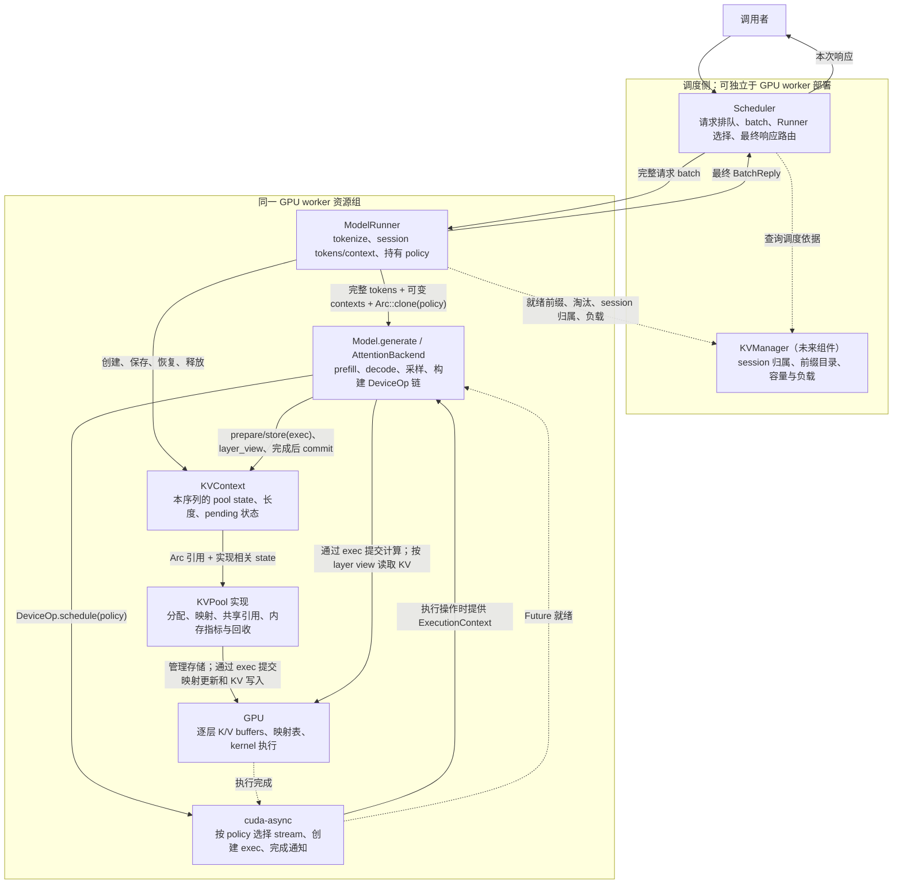
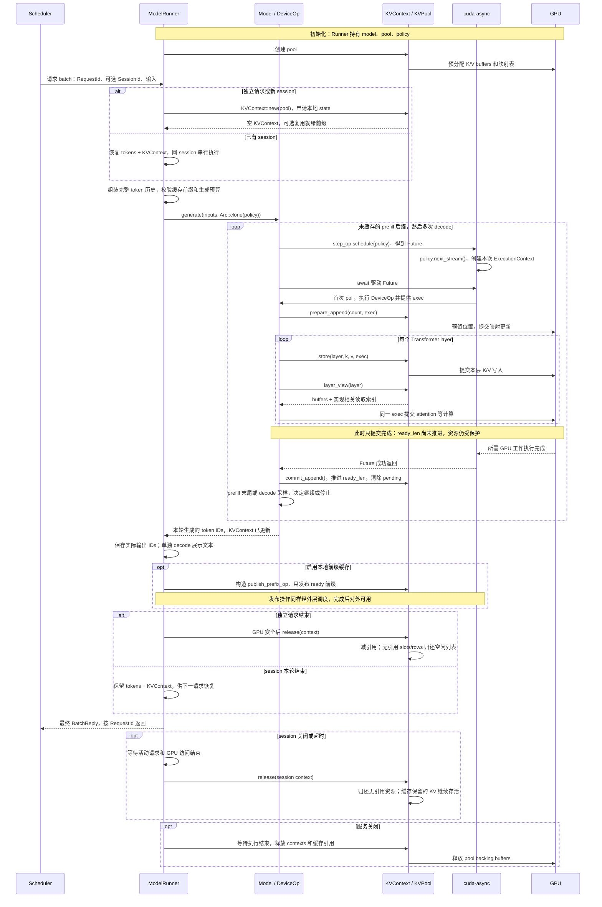
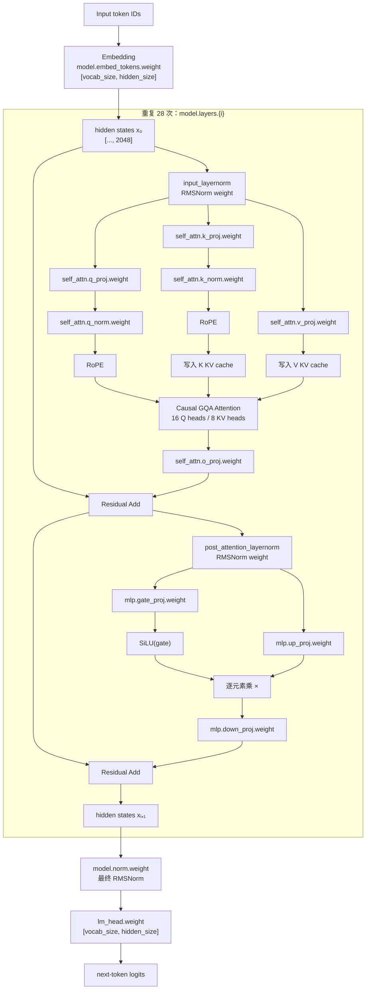

# features
- 在[cutile-grout](../../cutile-grout)基础上，添加上[mini-sglang](../../mini-sglang/)的radix cache功能，这样就能实现一个full-fledged infrence框架，同时性能还不错

# Execution boundary

本节描述目标设计，非已实现 API。第一版采用单 GPU、单执行 batch、无界 channel、
追加式 session 和非流式响应。`RequestId` 标识一次调用；`SessionId` 跨调用保留历史。

## 整体架构与职责



Runner/KVPool/KVContext 的执行状态保持本地；KVManager 只参与目录和路由，不进入
逐层读写路径。`NaiveKVPool` 与未来的 paged 实现共用接口，但须搭配兼容的 attention
backend。`ExecutionContext` 属于一次 submission，由库提供，不是 Runner 永久持有的对象。

## 请求与 KV 的完整生命周期



失败/取消时先确认 GPU 不再访问，再 `abort_append`、回滚本轮 token/KV 状态或
释放 context；设备失效时标记不可用，不能把提交成功当执行成功。`release` 归还的是
本地资源使用权，通常不释放 backing buffers；服务关闭时才统一释放。

# KV Cache state and APIs

Rust-like pseudocode omits backend implementations and uses schematic signatures.
`Tensor`, `DeviceSlots` and `RadixTree` are backend placeholders;
`DeviceSlots<'a>` is a borrowed slot view. Fields shown below are private.

```rust
type TokenId = u32;
type SlotId = i32;
type RowId = usize;
struct RequestId(u64);
struct SessionId(u64);

use cuda_async::device_operation::{DeviceOp, ExecutionContext};
use cuda_async::scheduling_policies::SchedulingPolicy;
```

## KVPool: common allocation and storage contract

Select one concrete pool/backend pair at startup. Context mappings and layer views
are associated types; the common interface exposes token ranges, not slot/page IDs.

```rust
trait KVPool: Sized + Send + Sync {
    type ContextState: Send; // Private mapping, physical capacity, and ownership.
    type LayerView<'a> where Self: 'a;

    fn max_seq_len(&self) -> usize;
    fn alloc_state(&self) -> Result<Self::ContextState>;

    /// 返回表示空间预留和必要 GPU 操作提交成功，不表示 GPU 执行完成。
    /// 同一 exec 内后续操作可依赖 stream 顺序；错误时保留已提交资源到安全边界。
    fn prepare_append(&self, state: &mut Self::ContextState,
        positions: Range<usize>, exec: &ExecutionContext) -> Result<()>;

    fn layer_view<'a>(&'a self, state: &'a Self::ContextState, layer: usize,
        ready_len: usize, pending: Option<Range<usize>>) -> Self::LayerView<'a>;

    /// 仅提交预留位置的写入，不等待、不分配新空间、不推进 ready_len。
    fn store(&self, state: &Self::ContextState, layer: usize,
        positions: Range<usize>, k: &Tensor, v: &Tensor, exec: &ExecutionContext)
        -> Result<()>;

    fn truncate_state(&self, state: &mut Self::ContextState, keep: usize);
    /// 前置条件：调用者已确认相关 GPU 访问结束，再释放引用/回收资源。
    fn release_state(&self, state: Self::ContextState);

    /// 仅完成独立映射/共享引用的准备，并提交必要的索引或末页复制。
    /// 返回的 state 不是 GPU 已就绪凭证；由外层 DeviceOp 完成后才对外使用。
    fn fork_state(&self, parent: &Self::ContextState, ready_len: usize,
        exec: &ExecutionContext) -> Result<Self::ContextState>;

    /// Empty context only. Match + protect + bind; return matched token count.
    /// A pool without a prefix index returns 0 without changing state.
    fn reuse_prefix(&self, state: &mut Self::ContextState, tokens: &[TokenId],
        max_reuse_len: usize, exec: &ExecutionContext) -> Result<usize>;

    /// 旧数据的 GPU 访问已结束；保留有效数据，必要重映射只提交到 exec。
    /// A pool without a prefix index does nothing.
    fn publish_prefix(&self, state: &mut Self::ContextState,
        ready_tokens: &[TokenId], exec: &ExecutionContext) -> Result<()>;

    /// Return bytes actually reclaimed; no slot/page unit leaks to callers.
    fn evict(&self, target_bytes: usize) -> usize;

    /// Host-side accounting snapshot; no GPU synchronization or KV readback.
    fn metrics(&self) -> KVPoolMetrics;
}
```

## 提交与执行完成契约

复用 `cuda_async` 已有的 `ExecutionContext` 和 `DeviceOp`，不新增自定义 stream
或等待器。`exec.get_cuda_stream()` 取得实际 stream；该层只提交，不自行调用
`.schedule()` 或 `.sync_on()`。调度与等待在外层操作链完成。

| API | 返回时保证 | 不保证 |
|---|---|---|
| `prepare_append` / `store` | 资源已保护，必要更新/写入已提交到 exec | GPU 已完成、KV 已可跨请求共享 |
| `fork_state` / prefix 绑定或重映射 | CPU 状态已准备，必要 GPU 复制/更新已提交 | 返回的映射已执行完成 |
| `layer_view` | 返回 buffers 和索引的视图 | 隐式等待或复制历史 KV |
| `commit_append` | 将已完成的 pending 范围标记为 ready | 自己等待 GPU |
| `abort_append` / `truncate` / `release` | 在 GPU 安全前提下修改账本并回收 | 取消已提交的 kernel |
| `metrics` | CPU 分配账本快照 | GPU 完成状态或实际有效数据量 |

- **提交完成**：CPU 准备/预留成功，需要的 GPU 工作已入队。同一 exec 中的
  后续操作可以依赖 stream 顺序；其他 stream 必须建立依赖或等完成后再使用。
- **执行完成**：外层 `DeviceFuture` 成功完成，或 `.sync_on()` 成功返回。此后
  才推进 `ready_len`、对外发布新 KV、释放旧映射引用。只有已提交不足以做这些事。
- GPU 操作提交前使用 `exec.retain(...)` 或库已有的租约机制保护资源。仅保留
  `Arc<KVPool>` 不够：还必须防止涉及的 slots/rows 在执行期间被回收重用。
- `ExecutionContext` 对应一次 submission；完成后不能重复使用。Runner 保存
  policy，具体 exec 由每次 DeviceOp 执行提供；不跨生成调用保存一个永久 exec。
- 同一更新链的索引修改、K/V 写入和 attention 使用同一 exec。不要各自交给
  round-robin policy 后假设它们自然有序；也不要在 `DeviceOp::execute` 内嵌套同步执行。
- 出错或取消不等于已提交工作结束；未确认安全前保留 pending 和资源保护。
  pool 锁只保护 CPU 状态，不跨 GPU 等待。

等待方式可以延后到外层选择，完成契约固定不变：

```rust
let child = parent.fork_op().schedule(&policy)?.await?; // 异步等待，完成后得到可用 child。
let child = parent.fork_op().sync_on(&stream)?;        // 阻塞等待，同样完成后才返回。
// 两行是同一操作的两种执行选择，不是连续调用的要求。
```

以上机制依据本地 `../cutile-rs/cuda-async/src/device_operation.rs` 的
`DeviceOp` / `ExecutionContext`。落地时核对 engine 锁定的 cuda-async 版本；
伪代码不假定 `ExecutionContext` 存在 `.wait().await` 方法。

## Memory metrics: the same byte accounting for every pool

```rust
struct BufferMetrics {
    allocated_bytes: usize,       // GPU backing storage owned by this pool.
    assigned_bytes: usize,        // Capacity held by contexts/cache/in-flight work.
    free_bytes: usize,            // Unassigned capacity available to this allocator.
    internal_unused_bytes: usize, // Subset of assigned: unused row cells/page tails.
}

struct KVPoolMetrics {
    index: BufferMetrics,         // Naive slot_table or a paged mapping table.
    layers: BufferMetrics,        // K + V across all layers; count shared storage once.
}
// Per buffer: allocated_bytes = assigned_bytes + free_bytes.
// internal_unused_bytes <= assigned_bytes; do not add it again to the total.
// Total KV GPU bytes = index.allocated_bytes + layers.allocated_bytes.
```

Free capacity remains allocated on the GPU; it is not memory returned to CUDA.
`assigned_bytes` includes cached and pending KV, not just active requests.
For index tables, an active row is assigned even when some cells are unfilled;
those cells are internal unused capacity, not free rows for another context.
Paged pools report unused allocated page tails in the same field. Counters update
with allocation, fork, prefix retention, truncation, and final reclamation.
This snapshot covers KV buffers and mappings, excluding model weights, attention
workspace, host metadata, and CUDA allocator overhead. Compare identical workloads
and sampling points; memory metrics alone do not measure attention speed.

## KVContext<P>: common progress, implementation-specific mapping

```rust
struct KVContext<P: KVPool> {
    pool: Arc<P>,
    state: P::ContextState,       // No common row/slot/page layout assumption.
    ready_len: usize,             // All-layer KV completed for [0, ready_len).
    allocated_len: usize,         // Logical reserved end, not physical page capacity.
    pending: Option<Range<usize>>,
}

impl<P: KVPool> KVContext<P> {
    /// state=pool.alloc_state()?, ready_len=allocated_len=0, pending=None.
    fn new(pool: Arc<P>) -> Result<Self>;

    fn prepare_append(&mut self, count: usize, exec: &ExecutionContext) -> Result<()> {
        require!(self.pending.is_none() && count > 0);
        let end = self.ready_len.checked_add(count).ok_or(ContextFull)?;
        require!(end <= self.pool.max_seq_len());
        let positions = self.ready_len..end;
        self.pool.prepare_append(&mut self.state, positions.clone(), exec)?;
        self.allocated_len = end;
        self.pending = Some(positions); // ready_len is unchanged.
        Ok(())
    }

    fn layer_view(&self, layer: usize) -> P::LayerView<'_> {
        self.pool.layer_view(&self.state, layer, self.ready_len, self.pending.clone())
    }

    fn store(&mut self, layer: usize, k: &Tensor, v: &Tensor, exec: &ExecutionContext)
        -> Result<()> {
        let positions = self.pending.clone().ok_or(NoPendingAppend)?;
        self.pool.store(&self.state, layer, positions, k, v, exec)
    }

    /// 前置条件：外层已确认本次全部层和索引更新执行成功。
    fn commit_append(&mut self) -> Result<()> {
        require!(self.pending.is_some());
        self.ready_len = self.pending.take().unwrap().end;
        Ok(())
    }

    /// 前置条件：本次 GPU 访问已结束，包含失败路径。
    fn abort_append(&mut self) -> Result<()> {
        self.pool.truncate_state(&mut self.state, self.ready_len);
        self.pending = None;
        self.allocated_len = self.ready_len;
        Ok(())
    }

    /// Idle，GPU 安全，keep<=ready_len；调用 pool.truncate_state 并更新两个长度。
    fn truncate(&mut self, keep: usize) -> Result<()>;

    /// DeviceOp 内调用 pool.fork_state(..., exec)，保护共享数据和必要复制的资源。
    /// 完成结果可对外使用；child 的 ready/allocated_len=父 ready_len，pending=None。
    fn fork_op(&self) -> impl DeviceOp<Output = Self> + '_;

    /// 只用于空闲空 context；匹配上限 tokens.len()-1（输入非空）。
    /// 保护命中数据并提交绑定；返回匹配长度，ready_len 留给调用者完成后提交。
    fn reuse_prefix_op(&mut self, tokens: &[TokenId])
        -> impl DeviceOp<Output = usize> + '_;

    /// 旧映射的访问已结束，ready_len<=tokens.len()；必要重映射完成前不释放旧引用，
    /// 新缓存条目仅在依赖操作完成后可被其他 context 命中；发布流程须显式处理完成通知，
    /// 不能在 DeviceOp::execute 返回时就把待发布条目标为可用。
    fn publish_prefix_op(&mut self, tokens: &[TokenId])
        -> impl DeviceOp<Output = ()> + '_;

    /// 前置条件：相关 GPU 访问均已结束，再 pool.release_state(state)。
    /// Drop/取消也必须遵守延迟回收，不能以对象销毁代替执行完成。
    fn release(self);

}
```

| Action | Before | After |
|---|---|---|
| `new` | No context | `ready=allocated=0`, no pending |
| `prepare_append(n)` | Idle, `ready=r` | Reserve `r..r+n`, set pending and allocated |
| `store(layer, ...)` | Pending | Enqueue writes; lengths unchanged |
| `commit_append` | 全部层已执行完成 | `ready=allocated`，清除 pending；不再等待 |
| `abort_append` | Pending，GPU 已停止访问 | 释放逻辑后缀，`allocated=ready` |
| `truncate(k)` | Idle，GPU 安全 | 释放后缀引用，`ready=allocated=k` |
| `fork_op` 完成 | 父 context Idle | 子 context 就绪，共享历史，独立进度 |
| `release` | 持有 context，GPU 安全 | 释放 context 的存储引用 |

`0 <= ready_len <= allocated_len <= max_seq_len` holds in token units. Physical
page capacity lives in `P::ContextState`. Failed GPU completion invalidates the
context until access has safely ended; drop must defer cleanup if needed.

## NaiveKVPool: baseline per-token slot implementation

The existing layout stays as the first concrete implementation. It reserves GPU
buffers at startup and tracks individual free slots; no page allocator is implied.

```rust
struct NaiveKVPool {
    // 按 layer + slot 存储，通过 (context, token_position) -> slot 映射，让 fork 后的 context 共享前缀 KV。
    // 若每个 context 独占一块连续存储区域，fork 就需要复制历史 KV；限制来自独占存储，而非 context 维度本身。
    layers: Vec<(Tensor, Tensor)>, // Per-layer K/V: [slots, kv_heads, head_dim].
    /* slot table
                          token_position
                      0    1    2    3    4  ...
    context_row 0   [10,  11,  12,  13,   ? ...]
    context_row 1   [10,  11,  12,  20,  21 ...]
    context_row 2   [30,  45,   ?,   ?,   ? ...]
    */
    slot_table: Tensor,           // GPU i32: [context_row, token_position] -> slot.
    max_seq_len: usize,
    allocation: Mutex<NaiveAllocationState>,
}

struct NaiveAllocationState {
    free_rows: Vec<RowId>,
    free_slots: Vec<SlotId>,
    slot_refs: Vec<usize>,        // Context and prefix-cache references.
    prefixes: RadixTree,          // Optional local token-prefix -> slots index.
    bound_positions: usize,      // Sum of mapped logical positions across live rows.
                                 // Shared prefixes count once per row here.
}

struct NaiveContextState { row: RowId }

struct NaiveLayerView<'a> {
    k: &'a Tensor,
    v: &'a Tensor,
    slots: DeviceSlots<'a>,       // Borrowed GPU row, not copied K/V values.
    ready_len: usize,
    pending: Option<Range<usize>>,
}

impl NaiveKVPool {
    fn new(layout, num_slots, num_rows) -> Arc<Self>;
    fn reserve_slots(&self, count: usize) -> Result<DeviceSlots>;
    /// Private helpers: update free_slots and slot_refs; refs==0 returns a slot.
    fn release_slots(&self, slots: DeviceSlots);
}

impl KVPool for NaiveKVPool {
    type ContextState = NaiveContextState;
    type LayerView<'a> = NaiveLayerView<'a>;

    fn metrics(&self) -> KVPoolMetrics {
        let state = self.allocation.lock();
        let rows = self.slot_table.shape()[0];
        let slots = self.layers[0].0.shape()[0];
        let row_bytes = self.max_seq_len * size_of::<SlotId>();
        let layer_bytes = sum_unique_storage_bytes(&self.layers);
        let bytes_per_slot = layer_bytes / slots; // All layers' K/V per token.
        let active_rows = rows - state.free_rows.len();

        KVPoolMetrics {
            index: BufferMetrics {
                allocated_bytes: rows * row_bytes,
                assigned_bytes: active_rows * row_bytes,
                free_bytes: state.free_rows.len() * row_bytes,
                internal_unused_bytes:
                    (active_rows * self.max_seq_len - state.bound_positions)
                    * size_of::<SlotId>(),
            },
            layers: BufferMetrics {
                allocated_bytes: layer_bytes,
                assigned_bytes: (slots - state.free_slots.len()) * bytes_per_slot,
                free_bytes: state.free_slots.len() * bytes_per_slot,
                internal_unused_bytes: 0, // Dense baseline: no partially used pages.
            },
        }
    }

    // alloc_state: take a free row.
    // prepare_append: reserve count=positions.len() slots; enqueue row updates.
    // layer_view: buffers for layer + this row's indices and logical lengths.
    // store: scatter K/V through slot_table[row, positions].
    // truncate_state/release_state: drop slot refs; release_state also returns row.
    // fork_state: new row, copy ready indices, increment refs for shared slots.
    // Prefix methods retain/deduplicate only ready KV; evict unreferenced cache.
    // Other trait methods follow the common contracts above.
    // Update bound_positions on bind/append/fork/truncate/release; keep pending
    // positions counted until GPU-safe reclamation actually removes the mapping.
}

// 1. 选择模型的某一层。
let (k_buffer, v_buffer) = &naive_pool.layers[layer_id];
// 2. 将上下文里的逻辑位置转换成实际 slot。
let slot = naive_pool.slot_table[context_row, token_position];
// 3. 读取这个 token 在该层的 K/V。
let token_k = k_buffer[slot]; // [kv_heads, head_dim]
let token_v = v_buffer[slot];
```

Only changed row entries are uploaded. Shared prefix slots are immutable. A future
PagedKVPool can supply page tables/tail capacity in its own ContextState and block
tables/page size in its LayerView without changing Runner's context lifecycle.

## ModelRunner: restore sessions, lend contexts, save or release

```rust
struct ModelRunner<M, P: KVPool> {
    batch_req_rx: UnboundedReceiver<BatchIn<GenerateRequest>>,
    batch_reply_tx: UnboundedSender<BatchReply>,
    model: M,
    pool: Arc<P>,
    policy: Arc<dyn SchedulingPolicy>, // 每次操作选择执行上下文，不复用已完成的 exec。
    sessions: HashMap<SessionId, SessionState<P>>,
}

struct SessionState<P: KVPool> {
    tokens: Arc<Vec<TokenId>>,    // Actual input + generated IDs, including EOS.
    kv: KVContext<P>,
}

struct GenerateRequest {
    session_id: Option<SessionId>,
    input: String,
    sampling: SamplingConfig,
}

struct ModelInput<'a, P: KVPool> {
    token_ids: &'a [TokenId],     // Full context at invocation start.
    kv: &'a mut KVContext<P>,
    sampling: &'a SamplingConfig,
}

impl<M: Model<P>, P: KVPool> ModelRunner<M, P> {
    /// sessions[id] = { tokens: empty, kv: KVContext::new(Arc::clone(&pool))? }.
    fn open_session(&mut self) -> Result<SessionId>;

    /// Clone tokens' Arc; parent.kv.fork_op().schedule(&policy)?.await. Parent must be idle.
    async fn fork_session(&mut self, parent: SessionId) -> Result<SessionId>;

    /// Remove entry, kv.release() after GPU completion. Defer active turns to a safe boundary.
    async fn close_session(&mut self, id: SessionId) -> Result<()>;

    /// Per-request transitions are below; lend distinct contexts to one generate.
    /// Defer duplicate session IDs within a batch; one active turn per session.
    async fn execute_batch(&mut self, batch: BatchIn<GenerateRequest>) -> BatchReply;

    /// Receive batch -> execute_batch -> send final reply, matching current code.
    /// Shutdown: reject new work, await GPU, release sessions/cache/pool safely.
    async fn run(self, cancel: CancellationToken);
}

trait Model<P: KVPool>: Send + Sync {
    /// Each ModelOutput contains RequestId + this invocation's generated IDs.
    /// Model owns prefill/decode + sampling, and updates borrowed KVContext.
    /// policy 由 Runner 注入；本次生成的操作链使用它调度，不另选全局默认 policy。
    fn generate(
        &self,
        batch: BatchIn<ModelInput<'_, P>>,
        policy: Arc<dyn SchedulingPolicy>,
    ) -> impl Future<Output = Result<Vec<ModelOutput>, EngineError>> + Send;
}
```

Runner 持有 policy，并在每次调用时通过 `Arc::clone(&self.policy)` 传给 Model。
这里只复制共享引用，不创建新 policy 或新 stream。Model 内部对操作链调用
`.schedule(&policy)`；cuda-async 再按该 policy 选择 stream、创建本次
`ExecutionContext`，并传给操作链中的 KVPool 和 attention。

The attention backend must consume the selected pool's view; changing storage does
not make an incompatible kernel accept a new layout. Bind compatible types at
startup, rather than introducing runtime trait objects or migrating live contexts.

```rust
trait AttentionBackend<P: KVPool> {
    fn forward(&self, q: &Tensor, kv: P::LayerView<'_>, exec: &ExecutionContext)
        -> Result<Tensor>;
}
// Initial pair: NaiveKVPool + an attention backend reading NaiveLayerView.
// Future pair: PagedKVPool + a backend directly reading its paged view.
```

`SamplingConfig`, request/result envelopes, and channels reuse the engine concepts.
New names above are interface sketches. Session state lives across calls; temporary
stateless state is released after one call. Model never receives SessionId.

## Request lifecycle: state transitions in call order

```rust
// Per-request flow. Real execute_batch assembles distinct states, calls generate
// once for the batch, then matches each result to its state by RequestId.
let mut state = match request.session_id {
    Some(id) => sessions.take_exclusively(id)?, // Unknown session is an error.
    None => SessionState {
        tokens: Arc::new(vec![]), kv: KVContext::new(Arc::clone(&pool))?,
    },
};
let old_tokens_len = state.tokens.len();
let old_ready_len = state.kv.ready_len;

let result = async {
    // Exact token deltas; handle chat-template/BOS rules, reject history edits.
    Arc::make_mut(&mut state.tokens).extend(encode_turn(request.input)?);
    validate_input_and_generation_budget(&state.tokens, &request.sampling)?;
    // Stateless，可选：先对 reuse_prefix_op 调用 schedule(&policy)?.await?，
    // 成功后由调用者将返回的 matched_len 提交到 ready_len/allocated_len。
    // All input cached without logits: truncate to input_len-1 before replay.
    self.model.generate(batch_of(ModelInput {
        token_ids: state.tokens.as_slice(), kv: &mut state.kv,
        sampling: &request.sampling,
    }), Arc::clone(&self.policy)).await
}.await; // Encoding and validation failures enter the same cleanup branch.

match result {
    Ok(output) => {
        Arc::make_mut(&mut state.tokens).extend_from_slice(&output.token_ids);
        // Optional publication; on error, skip caching, preserving valid state.
        // Session: sessions[id] = state;
        // Stateless: state.kv.release() after GPU completion.
        // Decode this turn's output IDs only; route final reply by RequestId.
    }
    Err(error) => {
        // Wait; abort pending append, then truncate to min(old_ready_len, ready_len).
        // This allows a replayed tail to remain uncached after an unsuccessful turn.
        // Truncate tokens to old_tokens_len, then restore session or release.
        // A device-invalidated context is failed/rebuilt, never silently reused.
    }
}
// Successful generation is saved even if response delivery fails.
```

Inside `Model::generate`, repeat for the uncached prefill suffix and decode:

```rust
// build_step_op 是本 spec 的操作构建示意，不是新增 cuda-async API。
// 该 DeviceOp 执行时，从已有框架取得本次 &ExecutionContext：
kv.prepare_append(input_count, exec)?;
for layer in model.layers() {
    let (q, k, v) = layer.project_and_apply_position_encoding(inputs);
    kv.store(layer.id(), &k, &v, exec)?;
    let view = kv.layer_view(layer.id());
    inputs = layer.attention_and_ffn(q, view, exec);
}
// 以上发生在同一 DeviceOp/操作链内：只提交，不等待、不提交 ready_len。

// 外层（不在 DeviceOp::execute 内）：policy 是 generate 的显式参数，来自 Runner。
let result = build_step_op(&mut kv, inputs).schedule(&policy)?.await;
match result {
    Ok(output) => { kv.commit_append()?; /* 采样/决定下一步 */ }
    Err(error) => { /* 先确认 GPU 安全，再 abort_append；设备失效时标记不可用 */ }
}
// 可选择 .sync_on(&stream) 阻塞等待；成功后的 commit 契约不变。
// prefill 中间 chunk 不采样；最后采样的 token 可能尚无自己的 KV。
```

Full input `[A,B,C,D,X,Y]` with `ready_len=3` prefills `[D,X,Y]`. Existing token
IDs stay on CPU and are borrowed, not recopied or fully uploaded each step.
Fork copies token history only on `Arc::make_mut` when shared; KV forks share
immutable slots. Cancellation/close never frees memory still used by kernels.

## Future KVManager: routing metadata inside Scheduler

```rust
struct KVManager {
    runners: HashMap<RunnerId, RunnerReport>,
    session_owner: HashMap<SessionId, (RunnerId, Incarnation)>,
    prefixes: PrefixDirectory, // (model namespace, token path/chained hashes)
                              // -> ready prefix length + Runner/incarnation.
}
impl KVManager {
    fn route(&self, namespace, session_id, prefix_key) -> Result<RunnerId>;
    /// Publish / evict / load updates.
    fn observe(&mut self, report: RunnerReport);
}
// RunnerReport: endpoint, incarnation, event sequence/freshness, free KV, queue load.
```

Scheduler owns final routing decisions; KVManager can be its directory component
and may later run as a separate service. Routing exposes no slots or GPU pointers.
Destination revalidates/protects prefix hits; stale stateless hits can recompute.
Session requests go to their owner;
migration needs history and KV transfer. Namespace separates model/adapter/position
semantics; transfers also check dtype/layout/shards. Prefix routing needs tokenizer
semantics shared with Runner. Remote transfer and step-level continuous batching
remain future extensions. Publish only ready prefixes; evict only unused slots.

# Model loader

## model overview


## model weights
each layer is a mmap file mapping for a file : layer_name => file offset + len => Vec<bf16>+shape => copy to device tensor => tensor.reshape


LayerWeights {
    input_layernorm: Arc<Tensor<f16>>,
    post_attention_layernorm: Arc<Tensor<f16>>,
    q_norm: Arc<Tensor<f16>>,
    k_norm: Arc<Tensor<f16>>,
    qkv_proj: Arc<Tensor<f16>>,
    o_proj: Arc<Tensor<f16>>,
    gate_up_proj: Arc<Tensor<f16>>,
    down_proj: Arc<Tensor<f16>>,
}

model_weights {
    embed_tokens: Arc<tensor>,
    layers: [LayerWeights; 28],
    norm: Arc<tensor>,
    lm_head: Arc<tensor>,
    inv_freq: Arc<tensor>

}
