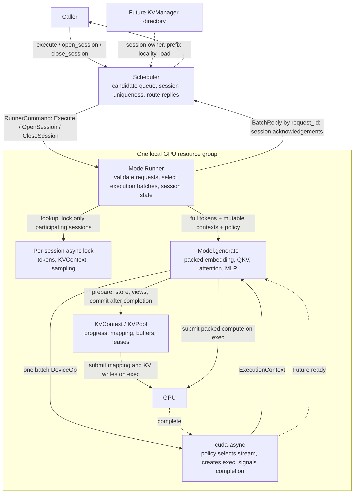
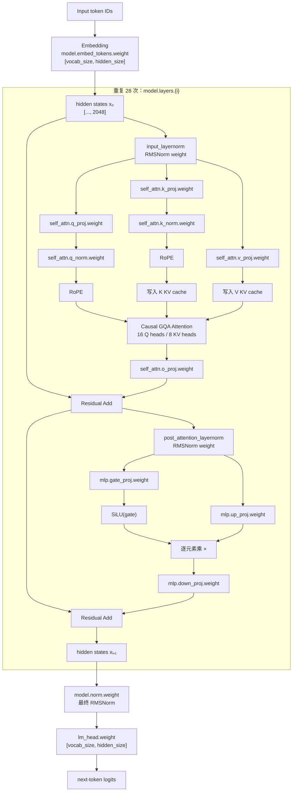

# features
- 在[cutile-grout](../../cutile-grout)基础上，添加上[mini-sglang](../../mini-sglang/)的radix cache功能，这样就能实现一个full-fledged infrence框架，同时性能还不错

# Execution boundary

The request envelope and ownership below follow the Runner template and the
minimal attention implementation. Rust snippets summarize interfaces; kernel
bodies are omitted. Prefix caching, paged storage, and autoregressive sampling
remain future work.

## Visibility boundary

Visibility in the snippets is intentional: no `pub` means private to the module
and its children; `pub(crate)` permits cross-module cooperation inside engine;
`pub` is an embedding/configuration contract. Tests do not justify public APIs.
Trait methods inherit their trait's visibility and do not take a `pub` modifier.

| Visibility | Contracts |
| --- | --- |
| `pub` | Scheduler construction, `execute`, `open_session`, `close_session`, `wait_stopped`; request construction/read-only ID; response fields |
| `pub` | RunnerBuilder/factory configuration and `build`; ModelRunner `run`; RunnerCommand transport type |
| `pub` | Model/KVPool/AttentionBackend extension traits and signature types; KVContext operations; configs, metrics, loader/export APIs |
| `pub` type, private fields | ModelRunner, KVContext, NaiveKVPool, NaiveContextState, NaiveReadView, NaiveWriteView; storage/progress ownership stays encapsulated |
| `pub` type, `pub(crate)` fields | BatchReply channel payload |
| `pub(crate)` | SessionRequest internal ID assignment/access; unsafe read-buffer bridge for internal tensor kernels |
| private | ModelRunner `new`, `open_session`, `close_session`, `execute_batch`, `execute_model_batch`, decoding; Scheduler dispatch/receive and PendingRequest; allocation state |
| `pub(super)` in private kernel modules | Generated launch functions called only by their parent implementation |

Public batch payload types allow the external binary to connect Scheduler and
Runner channels; their bookkeeping fields are not application inputs. Public
factory defaults and extension signature types must stay reachable because they
appear in public generic interfaces. The scalar `forward` and Runner `execute_session` convenience helpers are private
and test-only; production execution uses Model::generate and Runner::execute_batch.

## Architecture



Runner, live contexts, and pool storage stay in the same GPU resource group.
KVManager may be remote but does not participate in per-layer KV reads/writes.
`ExecutionContext` belongs to one submission; Runner stores policy, not a permanent
exec. Scheduler::execute(&self) accepts concurrent callers, while Runner::run
executes received batches serially. Parallel execution of multiple batches on one
Runner and continuous batching between decode steps remain future work.

## Lifecycle

```mermaid
sequenceDiagram
    participant C as Caller
    participant D as Scheduler
    participant R as ModelRunner
    participant S as Session entry
    participant M as Model
    participant K as KVContext / KVPool
    participant A as cuda-async / GPU

    Note over R,K: Startup: initialize model, preallocate pool, retain Runner policy
    opt Explicit persistent session
        C->>D: open_session()
        D->>D: allocate SessionId
        D->>R: OpenSession(id)
        R->>K: KVContext::new(pool)
        R->>S: tokens empty, context, default sampling
        R-->>D: acknowledge creation
        D-->>C: SessionId
    end
    C->>D: execute(SessionRequest)
    D->>R: Execute(candidate batch)
    Note over D,R: Scheduler batches contain unique Some(session_id); repeats stay queued for the next batch
    R->>R: encode prompt deltas
    R->>S: look up entries; acquire participating locks in input order
    Note over R,S: Release directory guards before await; unrelated sessions remain available
    R->>M: validate_input(new token IDs, effective sampling), CPU only
    R->>R: record per-request errors; check full length against context capacity
    loop admitted execution batches
        R->>K: can_append(total uncached tokens, new contexts)
        R->>R: append CPU tokens only for admitted requests
    opt Stateless request
        R->>K: create temporary context
    end
    R->>M: generate(batch of SessionRequest with ModelInput, policy)
    M->>M: trust admitted-input contract; pack suffixes and query ranges
    M->>A: submit one batch DeviceOp using Runner policy
    A->>M: execute operation with one exec
    M->>K: reserve each append; submit mapping updates on exec
    M->>A: packed embedding
    M->>K: obtain pending WriteViews; retain resources on exec
    M->>A: one fused QKV projection; write K/V directly to mapped cache slots
    K-->>M: each request's ReadView
    M->>A: one attention launch; per-query metadata selects history
    M->>A: packed residual and MLP; one result readback
    Note over M,A: Submitted, but ready_len has not advanced
    A-->>M: submission result
    alt submission succeeded
        M->>K: commit every append
    else shared execution failed
        M->>M: attach the error to each affected ModelOutput.result
    end
    M-->>R: one result per input, in input order
    R->>S: restore successful histories; release session locks
    opt Stateless request completes
        R->>K: release temporary context
    end
    end
    R-->>D: BatchReply.results, per-request success or error
    D-->>C: individual LLMResponse or error
    opt Session close
        C->>D: close_session(session_id)
        D->>R: flush earlier batch, then CloseSession(id)
        R->>S: invalidate entry after earlier turns complete
        R->>K: release_state; recycle after last GPU lease
        R-->>D: acknowledge close
        D-->>C: success or error
    end
```

# Request and Runner state and APIs

```rust
pub type RequestId = u64;
pub type SessionId = u64;
pub type SamplingConfig = GenerationConfig; // Reuse the existing configuration struct.

pub struct SessionRequest<T = String> {
    request_id: Option<RequestId>, // Private: None before Scheduler admission.
    pub session_id: Option<SessionId>,
    pub input: T,
    pub sampling: Option<SamplingConfig>,
}
impl<T> SessionRequest<T> {
    /// 创建未提交的请求，不接受调用者指定 request_id。
    pub fn new(session_id: Option<SessionId>, input: T) -> Self;
    /// 只读；提交前为 None，Scheduler 分配后为 Some(id)。
    pub fn request_id(&self) -> Option<RequestId>;
    /// 内部为提交分配 ID，或在转换输入时保留已有 ID。
    pub(crate) fn with_request_id(self, id: RequestId) -> Self;
    pub(crate) fn assigned_request_id(&self) -> RequestId;
}
pub type BatchIn<T = String> = Vec<SessionRequest<T>>;
pub type BatchOut = Vec<(RequestId, Result<LLMResponse, EngineError>)>;
pub struct BatchReply { pub(crate) results: BatchOut }

/// Public for channel wiring; applications call Scheduler instead of sending commands.
pub enum RunnerCommand {
    Execute(BatchIn),
    OpenSession { id: SessionId, reply: oneshot::Sender<Result<(), EngineError>> },
    CloseSession { id: SessionId, reply: oneshot::Sender<Result<(), EngineError>> },
}

struct SessionState<P: KVPool> {
    tokens: Arc<Vec<u32>>,
    kv: KVContext<P>,
    sampling: SamplingConfig,
}

pub struct ModelRunner<M, P: KVPool> {
    command_rx: UnboundedReceiver<RunnerCommand>,
    batch_reply_tx: UnboundedSender<BatchReply>,
    model: M,
    pool: Arc<P>,
    policy: Arc<dyn SchedulingPolicy>,
    sessions: DashMap<SessionId, Arc<Mutex<Option<SessionState<P>>>>>,
}

impl<M: Model<P>, P: KVPool> ModelRunner<M, P> {
    /// 创建空 session；已存在则报错。
    fn open_session(&self, id: SessionId) -> Result<()>;
    /// 校验每个候选请求，按本地 KV 容量选择执行 batch，各自返回成功或错误。
    async fn execute_batch(&self, batch: BatchIn) -> BatchReply;
    /// 等待当前 session 的活动调用，释放状态；旧 entry 的等待者不能复活它。
    async fn close_session(&self, id: SessionId) -> Result<()>;
    /// Process ordered commands; acknowledge session changes and return batch replies.
    pub async fn run(self, cancel: CancellationToken);
}

impl Scheduler {
    /// Allocate a SessionId and return only after Runner creates its state.
    pub async fn open_session(&self) -> Result<SessionId, EngineError>;
    /// Flush preceding requests, then close on Runner and await acknowledgement.
    pub async fn close_session(&self, id: SessionId) -> Result<(), EngineError>;
    /// 每次接收时分配新 request_id；Scheduler clones 共享原子计数器。
    pub async fn execute(&self, request: SessionRequest) -> Result<LLMResponse>;
}
```

Session management and generation share one FIFO command queue. The dispatcher
flushes pending requests before forwarding open/close, and Runner processes commands
serially. Session IDs use a separate counter shared across Scheduler clones.
`None` uses temporary state; `Some(id)` requires an explicitly opened session.
Management methods return Runner errors through oneshot acknowledgements and stop
waiting on Scheduler cancellation or channel closure. Scheduler owns the public
entry points; Runner owns the actual session state and its private lifecycle methods.

`SessionRequest` replaces `SingleRequest + GenerateRequest`; it packages the two
IDs without merging their meanings. `request_id` identifies one invocation/reply,
while `session_id` identifies history across invocations. The public constructor accepts no RequestId. Scheduler assigns a fresh ID to
its owned envelope on every admission, using an atomic counter shared by its
clones; re-admission always gets another ID. The private field is read-only to
callers, while LLMResponse.request_id stays public. Runner/Model trust Scheduler-assigned IDs as an internal invariant; they do not
revalidate missing or duplicate request IDs. No separate request/session ID argument list
is needed.

`session_id=None` creates temporary state. `Some(id)` requires a previously opened
session, appends the prompt delta, and inherits sampling settings unless overridden.
This numerical demo rejects unsupported sampling options. Its scalar output is
encoded for display and is not appended as input history; a future text generator
must save actual generated IDs.

Scheduler guarantees at most one request per `Some(session_id)` in a batch.
On a repeated session it flushes the current batch and carries that request into
the next batch, preserving FIFO order without rejection or loss. `None` is
stateless, so multiple stateless requests may share a batch. Runner trusts this
invariant. These are dispatch candidates, bounded by MAX_DISPATCH_SIZE rather
than a GPU admission promise. Runner validates each request before mutating history,
then chooses execution batches using local pool capacity. It flushes an admitted
group when the next request cannot fit, releases temporary contexts, and retries
that request against current capacity. A request that still cannot fit receives
its own capacity error. Persistent session KV continues to consume capacity.

The first admission policy uses total uncached tokens and additional context rows.
Pool::can_append is a conservative CPU snapshot, not a reservation; actual pool
allocation can still fail. Workspace-based sizing is a future policy refinement.

The directory lock lasts only for lookup/insertion/removal. A session's own lock
covers its turn, including GPU completion. Runner awaits one batch at a time,
so session locks follow input order without sorting. If execution later allows
multiple concurrent batches on one Runner, establish a consistent lock order to
prevent deadlocks. Scheduler channel batches preserve admission order; Model outputs
stay in input order without a reply-sort step.

Runner holds the existing mutex guards, takes their states into local variables,
and puts successful states back explicitly. Sampling overrides are saved only
on success. On an ordinary error with unchanged KV, it truncates CPU tokens to
the original length and restores the state. Changed/pending KV is released.
Cancellation after taking ownership drops local states and leaves session entries
invalid until closed; no custom turn guard or cancellation rollback is implemented.
A successful turn is saved before display decoding or reply delivery. BatchReply
has only per-request results. Validation, unknown-session, capacity, and decoding
errors affect their own request. Shared kernel/stream/submission failures are
copied into each participating request's result; no batch-error field or outer
Model::generate Result is added. Earlier completed execution groups stay saved.

# Model batch state and APIs

```rust
pub struct ModelInput<'a, P: KVPool> {
    pub token_ids: &'a [u32], // Full history; compute only [kv.ready_len()..].
    pub kv: &'a mut KVContext<P>,
}

pub trait Model<P: KVPool>: Send + Sync {
    fn tokenizer(&self) -> &Tokenizer;
    /// CPU 校验新增 token 和生效的采样配置，Runner 在组执行 batch 前调用。
    fn validate_input(&self, new_token_ids: &[u32], sampling: &SamplingConfig) -> Result<(), ModelError>;
    /// 默认拼接未缓存后缀，按模型提供的正数倍数补齐；ranges 不含 padding。
    fn pack_token_ids(batch: &[ModelInput<'_, P>], pad_multiple: usize)
        -> (Vec<i32>, Vec<Range<usize>>);
    /// 默认先 prepare_append，再调用模型回调，等待成功后提交 KV；回调勿重复 prepare。
    /// 回调负责本次 forward 所需的全部 KV cache 更新；cache 与网络层不要求一一对应。
    /// 框架不理解网络拓扑，也不检查回调是否覆盖了全部所需 cache。
    fn execute_append_batch<T: Send>(batch: &mut [ModelInput<'_, P>],
        policy: &Arc<dyn SchedulingPolicy>,
        submit: impl FnOnce(&mut [ModelInput<'_, P>], &ExecutionContext) -> Result<T, ModelError> + Send)
        -> impl Future<Output = Result<T, ModelError>> + Send;
    /// 接收 Runner 已校验的输入；共享 GPU 错误也写入每条 ModelOutput.result。
    fn generate(&self, batch: BatchIn<ModelInput<'_, P>>,
        policy: Arc<dyn SchedulingPolicy>)
        -> impl Future<Output = Vec<ModelOutput>> + Send;
}

pub struct ModelOutput {
    pub request_id: RequestId,
    pub result: Result<Vec<u32>, ModelError>,
}

pub trait AttentionBackend<P: KVPool> {
    /// query_ranges[i] 标识 packed Q 中第 i 个 context 的本次 query 行。
    /// 整个 batch 一起提交 attention；KV 布局仍由关联 ReadView 抽象。
    fn forward(&self, q: Arc<Tensor<f32>>, views: &[P::ReadView<'_>],
        query_ranges: &[Range<usize>], exec: &ExecutionContext)
        -> Result<Arc<Tensor<f32>>, ModelError>;
}
```

Model and AttentionBackend return ModelError; KVContext returns KVContextError;
KVPool returns KVPoolError. Context/model errors retain their typed lower-layer
errors. Runner wraps them in EngineError::Model, EngineError::KVContext, or
EngineError::KVPool for per-request responses, preserving typed error chains.

The envelope's SessionId is routing metadata; Model does not look up session state.
Runner lends the already selected contexts. Runner's policy is passed explicitly
through Model to `.schedule(&policy)`; model weight export policy does not select
inference streams.

```text
A: ready=2, full tokens=[a,b,c,d,e] -> suffix=[c,d,e], query_range=0..3
B: ready=1, full tokens=[x,y]       -> suffix=[y],     query_range=3..4
C: ready=0, full tokens=[m,n]       -> suffix=[m,n],   query_range=4..6

packed tokens: [c,d,e,y,m,n, PAD,PAD]     // One final tile padding, not per request.
embedding / Q: shared batch tensors [8,16]
fused QKV: K/V accumulators -> slots for A/B/C; padding rows never write cache
attention: query metadata selects A/B/C row and each query's causal history end
residual / MLP: shared batch tensors
results: last real query of A, B, C
```

The Naive backend launches one attention kernel for packed queries. It reads
per-query `(context_row, history_start, history_end)` metadata, then follows that context's slot
table. The model/weights are shared; the history and causal boundary differ.
No query can attend to another request's tokens. One fused QKV launch uses packed
(context_row, absolute_token_position) metadata to scatter K/V accumulators directly
into cache. Only Q is materialized as a temporary output; no temporary K/V tensors
or per-request store launches are used by SimpleMLP. Padding has a negative context
row, and masked table loads/cache stores prevent writes for those lanes.

```rust
/// 此函数在一次 DeviceOp 的 execute 中执行，只提交工作，不等待。
fn submit_batch(batch, exec: &ExecutionContext) -> Result<HostResults> {
    // execute_append_batch has already prepared every uncached suffix on exec.
    let x = embed_packed_tokens(batch, exec)?;
    let q = {
        let destinations = batch.iter_mut().map(|input| input.kv.write_view(0, exec)).collect()?;
        fused_qkv_to_cache(&x, &destinations, &query_ranges, exec)?
    }; // Release exclusive CPU borrows; resources remain retained in exec.
    let views = batch.map(|input| input.kv.read_view(0)).collect()?;
    let attention = backend.forward(q, &views, &query_ranges, exec)?;
    mlp_and_readback(x + attention, exec)
}

let (packed_token_ids, query_ranges) = Self::pack_token_ids(batch, model_tile_multiple);
// Model checks layout-specific tensor limits; upload stays in its GPU callback.
let values = Self::execute_append_batch(batch, &policy, |batch, exec| submit_batch(batch, exec)).await?;
```

The current model evaluates one layer/head plus the MLP and returns a scalar per
request. Runner guarantees a nonempty uncached suffix and idle context: it appends
a nonempty prompt delta to accepted history and never reuses a pending/failed context.
Model does not rescan existing history for input validation. Numeric ID constraints
(including the toy tokenizer's UNK=256) are checked through validate_input on new
tokens. Runner checks full-history length against max_seq_len per request.
Cached logits or final-token replay are future work. A real multi-layer model repeats the shared
projection/cache-write/attention/FFN stage per attention layer inside the same execution boundary.

# KV Cache state and APIs

## KVPool: common storage contract

```rust
pub trait KVPool: Sized + Send + Sync {
    type ContextState: Send + Sync;
    type ReadView<'a> where Self: 'a;
    type WriteView<'a> where Self: 'a;

    fn max_seq_len(&self) -> usize;
    fn alloc_state(&self) -> Result<Self::ContextState, KVPoolError>;
    /// 保守判断当前可用容量；tokens 为尚未预留的追加量，new_contexts 为额外行数。
    fn can_append(&self, tokens: usize, new_contexts: usize) -> bool;
    /// 预留物理位置并提交索引更新；返回不表示 GPU 执行完成。
    fn prepare_append(&self, state: &mut Self::ContextState,
        positions: Range<usize>, exec: &ExecutionContext) -> Result<(), KVPoolError>;
    /// 仅接收 backend 自有状态与逻辑 token 读取范围，不依赖整个 KVContext。
    /// 范围可包含同 exec 中已提交的 pending 写入；读取必须排在写入之后。
    fn read_view<'a>(&'a self, state: &'a Self::ContextState, layer: usize,
        read_range: Range<usize>) -> Result<Self::ReadView<'a>, KVPoolError>;
    /// Expose reserved destinations and retain storage/leases on exec; no K/V writes.
    fn write_view<'a>(&'a self, state: &'a mut Self::ContextState, layer: usize,
        positions: Range<usize>, exec: &'a ExecutionContext)
        -> Result<Self::WriteView<'a>, KVPoolError>;
    /// Consume a write view and submit copies on its retained execution context.
    fn store(&self, dst: Self::WriteView<'_>,
        k: TensorView<'_, f32>, v: TensorView<'_, f32>) -> Result<(), KVPoolError>;
    /// 移除 context 的所有权；在途 submission 的 lease 延迟实际 row/slot 回收。
    fn release_state(&self, state: Self::ContextState);
    fn metrics(&self) -> KVPoolMetrics;
}

pub struct KVContext<P: KVPool> {
    pool: Arc<P>,
    state: Option<P::ContextState>,
    ready_len: usize,
    allocated_len: usize,
    pending: Option<Range<usize>>,
}

impl<P: KVPool> KVContext<P> {
    pub fn new(pool: Arc<P>) -> Result<Self, KVContextError>;
    pub fn state(&self) -> &P::ContextState;
    pub fn pending_range(&self) -> Option<Range<usize>>;
    pub fn ready_len(&self) -> usize;
    pub fn allocated_len(&self) -> usize;
    pub fn max_seq_len(&self) -> usize;
    pub fn is_pending(&self) -> bool;
    /// Idle 且 count>0；预留 [ready_len, ready_len+count)，保持 ready_len 不变。
    pub fn prepare_append(&mut self, count: usize, exec: &ExecutionContext) -> Result<(), KVContextError>;
    pub fn read_view(&self, layer: usize) -> Result<P::ReadView<'_>, KVContextError>;
    /// Only the pending append is writable; callers cannot supply a range.
    pub fn write_view<'a>(&'a mut self, layer: usize, exec: &'a ExecutionContext)
        -> Result<P::WriteView<'a>, KVContextError>;
    /// 只向当前 pending 区间写入；借用的 tensor view 可来自 batch 大张量。
    pub fn store(&mut self, layer: usize, k: TensorView<'_, f32>,
        v: TensorView<'_, f32>, exec: &ExecutionContext) -> Result<(), KVContextError>;
    /// 调用者已确认全部层、索引和 KV 写入执行成功，再推进 ready_len。
    pub(in crate::runner) fn commit_append(&mut self) -> Result<(), KVContextError>;
    /// 显式 release 与 Drop 都交还 state；物理回收受在途 lease 保护。
    pub fn release(self);
}
```

| Transition | Progress / ownership |
| --- | --- |
| `new` | `ready=allocated=0`, no pending; one state/row |
| `prepare_append(n)` succeeds | `allocated=ready+n`, pending reserved; ready unchanged |
| `store`, attention submitted | Progress unchanged; same exec orders dependencies |
| Outer Future succeeds, then `commit_append` | `ready=allocated`, pending cleared |
| Partial submission fails or is cancelled | Do not reuse/commit pending context; release it |
| `release_state` / Drop | Context ownership removed; recycle after final GPU lease |

Failed prepare may already have reserved/submitted part of its work. Pending is
set before submission, and failure invalidates that context until release. The
initial interface deliberately excludes abort/truncate, fork, prefix reuse,
prefix publication, and eviction; these are future extensions, not mandatory
unimplemented trait methods.

## 提交与执行完成契约

| Boundary | Meaning |
| --- | --- |
| `prepare_append` / `store` / backend `forward` returns | CPU reservation and GPU submission completed; GPU may still be using resources |
| Outer `.schedule(&policy)?.await` succeeds | Submitted GPU work completed; process inner Result before committing |
| `.sync_on(&stream)` succeeds | Same completion contract with a blocking wait |
| `release_state` returns | Ownership dropped; reuse may be deferred by retained leases |

Mapping updates, stores, attention, and MLP use the same `ExecutionContext`.
Low-level methods never schedule independent dependent operations or wait inside
DeviceOp execution. A round-robin policy may choose different streams between
submissions; the outer boundary must establish ordering between context updates.

Retain both backing storage and logical allocation leases in exec **before**
submission. An `Arc<KVPool>` alone does not prevent a slot from being reused.
The library's submission lifetime also protects dropped futures; errors and
cancellation are not evidence that kernels stopped. No global pool/directory mutex
is held across a GPU await. A completed exec cannot be reused for another submission.

## NaiveKVPool: physical slots and GPU indirection

```rust
pub struct NaiveKVPool {
    /// 单 head 示例使用 [num_slots, head_dim]；通用布局可为 [slots, heads, dim]。
    layers: Vec<(Arc<Tensor<f32>>, Arc<Tensor<f32>>)>,
    slot_table: Arc<Tensor<i32>>, // [context_row, token_position] -> slot.
    config: NaiveKVPoolConfig,
    allocation: Arc<Mutex<Allocation>>,
}
struct Allocation {
    free_rows: Vec<usize>,
    free_slots: Vec<i32>,
    bound_positions: usize,
}
pub struct NaiveContextState { lease: Arc<StateLease> }
struct StateLease {
    row: usize,
    slots: Mutex<Vec<i32>>,
    allocation: Arc<Mutex<Allocation>>,
}
struct LayerStorage<'a> {
    k: &'a Arc<Tensor<f32>>,
    v: &'a Arc<Tensor<f32>>,
    slot_table: &'a Arc<Tensor<i32>>,
    row: usize,
    positions: Range<usize>,
    lease: Arc<StateLease>,
}
pub struct NaiveReadView<'a> { inner: LayerStorage<'a> }
pub struct NaiveWriteView<'a> {
    inner: LayerStorage<'a>,
    exec: &'a ExecutionContext,
}
```

`KVContext` owns logical ready/pending progress. Its read_view covers
`0..allocated_len` (history plus the current append); write_view selects only pending
positions and rejects idle contexts. KVPool receives backend state and logical
positions, and shares a private addressing builder between its read/write methods.
ReadView and WriteView are distinct types, with private fields and controlled
construction. Attention accepts only ReadView; store consumes WriteView. A write
view holds an exclusive context-state borrow and retains buffers/mapping/allocation
leases in its ExecutionContext before returning. It exposes no new GPU work by itself.
The existing KVContext::store remains a convenience path that constructs a write
view and delegates to KVPool::store on that view's execution context.

NaiveReadView's safe API exposes const pointers and read-only metadata. The internal
Tensor-handle bridge is unsafe and permits reads only; it does not give safe callers
writable Tensor handles. NaiveWriteView exposes writable device handles. Consume or
drop write views before constructing attention read views. CPU borrow lifetimes do
not prove GPU completion: stream ordering, retained leases, bounds checks, and the
unsafe kernel contracts still apply. Distinct view types do not statically prove
that every pending token/layer was written or that dynamic GPU indices stay in bounds.

For causal suffix queries the Naive backend computes query start as
`read_view.positions().end - query_count`, reading history from positions.start.
Completed-cache subranges can be read without a pending append. Logical positions
remain independent of physical slots and packed Q query_ranges.

Naive K/V scatter uses `[B, head_dim]` tiles with B=8 and grid
`(ceil(append_tokens/B), 1, 1)`. Table gathers and output scatters mask invalid tail
rows; padded source loads never write slot zero for an inactive lane. This is a
work-granularity choice, not a measured speedup claim.

SimpleMLP now fuses KV addressing/writes into its QKV projection kernel:

```text
SimpleMLP: prepare_append -> WriteViews -> fused QKV -> cache -> attention
Baseline:  prepare_append -> temporary K/V -> KVContext::store -> cache -> attention
```

Both paths reserve slots and update slot_table in prepare_append. The fused kernel
uses WriteView mapping/buffers and per-packed-row metadata to find physical cache
rows. The same ExecutionContext orders mapping updates, projection/cache writes,
and attention. Q remains a temporary tensor; K/V go directly from projection
accumulators into cache. This removes intermediate K/V writes/reads and separate
store launches, not the final cache writes. Addressing is backend-specific: this
fused kernel supports the current single-head, 16-dimensional NaiveKVPool layout.
KVContext::store and KVPool::store remain available as the non-fused baseline.
Correctness is checked against CPU outputs and actual cache contents; no throughput
improvement is claimed without a benchmark.

`StateLease` is private resource retention, not a new public sequence handle.
Its final Drop returns its row and slots. Prefix refcounts/indexes are not present
yet. Borrowed layer views and submitted work retain the lease as needed.

```text
                      token_position
                    0   1   2   3   4
context_row 0      [10, 11, 12, 13,  ?]
context_row 1      [20, 21, 22,  ?,  ?]

logical (context, layer, token_position)
    -> slot_table[context_row, token_position]
    -> layers[layer][slot]
```

按 layer + slot 存储，context 通过映射表寻址，后续可共享前缀。若每个 context
独占连续 KV 区域，fork 就需要复制历史；间接映射解除了这一限制。

`context_row` identifies a logical history, not an attention head. The flat GPU
index is `context_row * max_seq_len + token_position`. Unused table cells are
ignored by logical lengths. Reused rows overwrite newly bound positions before
attention reads them.

## Memory metrics

```rust
pub struct BufferMetrics {
    pub allocated_bytes: usize,
    pub assigned_bytes: usize,
    pub free_bytes: usize,
    pub internal_unused_bytes: usize,
}
pub struct KVPoolMetrics { pub index: BufferMetrics, pub layers: BufferMetrics }
```

`allocated = assigned + free`; `internal_unused` is a subset of assigned, not an
additional term. Free capacity is still GPU allocated. Measurements use CPU
allocation counters, without GPU synchronization or readback. In-flight leases
remain assigned. Weights, workspaces, CPU metadata, and allocator overhead are excluded.

For the naive single-head layout, with `active_rows=rows-free_rows`,
`row_bytes=max_seq_len*4`, and `slot_bytes=layers*2*head_dim*4`:

- Index assigned: `active_rows*row_bytes`; free: `free_rows*row_bytes`.
- Index internal unused: `(active_rows*max_seq_len-bound_positions)*4`.
- K/V assigned: `(num_slots-free_slots)*slot_bytes`; free: `free_slots*slot_bytes`.
- K/V internal unused is zero for this dense per-token allocator.

## Future storage and lifecycle extensions

A paged pool can replace ContextState and read/write views while keeping Runner history
ownership and Model's semantic append lifecycle. Its compatible attention backend
uses block tables rather than per-token slots; shared partial tails may need COW.
FlashAttention and paging are separate choices and require a compatible kernel /
view pair. This does not imply arbitrary kernels can consume arbitrary layouts.

Fork, truncate/abort recovery, prefix matching/publication, and eviction should be
added when their execution/completion contracts are implemented. `release_state`
closes a context; `evict` would remove retained prefix-cache entries, so closing a
session does not require eviction. Publish only completed KV, and do not recycle
shared or in-flight storage. GPU migration and cross-worker KV transfers are deferred.

## Future KVManager: routing metadata inside Scheduler

```rust
struct KVManager {
    runners: HashMap<RunnerId, RunnerReport>,
    session_owner: HashMap<SessionId, (RunnerId, Incarnation)>,
    prefixes: PrefixDirectory, // (model namespace, token path/chained hashes)
                              // -> ready prefix length + Runner/incarnation.
}
impl KVManager {
    fn route(&self, namespace, session_id, prefix_key) -> Result<RunnerId>;
    /// Publish / evict / load updates.
    fn observe(&mut self, report: RunnerReport);
}
// RunnerReport: endpoint, incarnation, event sequence/freshness, free KV, queue load.
```

Scheduler owns final routing decisions; KVManager can be its directory component
and may later run as a separate service. Routing exposes no slots or GPU pointers.
Destination revalidates/protects prefix hits; stale stateless hits can recompute.
Session requests go to their owner;
migration needs history and KV transfer. Namespace separates model/adapter/position
semantics; transfers also check dtype/layout/shards. Prefix routing needs tokenizer
semantics shared with Runner. Remote transfer and step-level continuous batching
remain future extensions. Publish only ready prefixes; evict only unused slots.

# Model loader

## model overview


## model weights
each layer is a mmap file mapping for a file : layer_name => file offset + len => Vec<bf16>+shape => copy to device tensor => tensor.reshape


LayerWeights {
    input_layernorm: Arc<Tensor<f16>>,
    post_attention_layernorm: Arc<Tensor<f16>>,
    q_norm: Arc<Tensor<f16>>,
    k_norm: Arc<Tensor<f16>>,
    qkv_proj: Arc<Tensor<f16>>,
    o_proj: Arc<Tensor<f16>>,
    gate_up_proj: Arc<Tensor<f16>>,
    down_proj: Arc<Tensor<f16>>,
}

model_weights {
    embed_tokens: Arc<tensor>,
    layers: [LayerWeights; 28],
    norm: Arc<tensor>,
    lm_head: Arc<tensor>,
    inv_freq: Arc<tensor>

}
