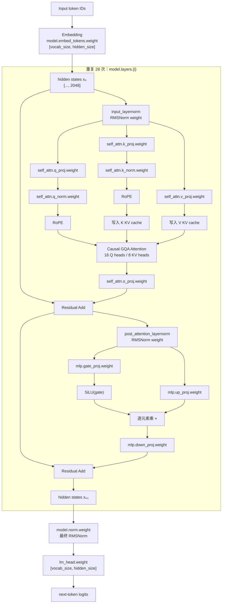

# features
- 在[cutile-grout](../../cutile-grout)基础上，添加上[mini-sglang](../../mini-sglang/)的radix cache功能，这样就能实现一个full-fledged infrence框架，同时性能还不错

## 简化的假设

采用 Mini-SGLang 式的**无状态请求入口 + 请求级执行状态 + 跨请求前缀 KV 复用**。每个请求携带完整 prompt 和生成参数；请求结束后，其有效 KV 前缀可留在 radix cache 中供后续请求复用。第一版不定义跨调用的 session 续写语义，也不做鉴权。

```text
Submit(request_id, prompt, sampling)
  -> tokenize(prompt)
  -> scheduler(request state)
  -> prefill/decode batch -> model
  -> token events(request_id) -> detokenize -> caller

token prefix -> radix cache -> per-token SlotIds
```

`request_id` 用于关联流式输出和取消操作；它不是 session ID。若以后要支持对话 session，由上层把历史消息组装成每个请求的完整 prompt；radix cache 只负责复用相同 token 前缀对应的 KV，不拥有对话语义。

- 非流式输出
- 每个 ReqToTokenTable 项保存一个 token 对应的 SlotId， 每一个slotid对应k/v的heads*dim的值所在的gpu索引位置

# model loader

## model overview


## model weights
each layer is a mmap file mapping for a file : layer_name => file offset + len => Vec<bf16>+shape => copy to device tensor => tensor.reshape


LayerWeights {
    input_layernorm: Arc<Tensor<f16>>,
    post_attention_layernorm: Arc<Tensor<f16>>,
    q_norm: Arc<Tensor<f16>>,
    k_norm: Arc<Tensor<f16>>,
    qkv_proj: Arc<Tensor<f16>>,
    o_proj: Arc<Tensor<f16>>,
    gate_up_proj: Arc<Tensor<f16>>,
    down_proj: Arc<Tensor<f16>>,
}

model_weights {
    embed_tokens: Arc<tensor>,
    layers: [LayerWeights; 28],
    norm: Arc<tensor>,
    lm_head: Arc<tensor>,
    inv_freq: Arc<tensor>

}

# model runner

## 目标与边界

采用 Mini-SGLang 的职责拆分：`Scheduler` 是请求状态的唯一写入者，接收消息、维护请求队列、形成 prefill/decode batch，并调用 `Engine`；`Engine` 持有模型与 GPU 执行资源，对 batch 做前向和采样；`KVCacheManager` 管分配、前缀命中、引用保护和回收。Tokenizer/Detokenizer 将文本 API 与 token ID、token 流互相转换。

第一版先做**单 scheduler、单 Engine、单 GPU 的连续批处理**。请求状态彼此独立；同一个 batch 可以包含多个请求的 prefill 或 decode token。scheduler 对状态和 cache 元数据串行决策；每批等待 Engine 返回已完成的结果，再提交状态转换并调度下一批。GPU stream 可在 Engine 内部异步执行，但下一步不得观察未完成的 K/V 写入。多 GPU tensor parallel、跨批 CPU/GPU overlap、优先级、公平性和抢占策略后续再定。

```text
Caller -> Tokenizer -> Scheduler -> Engine/Backend
   ^          ^            |             |
   |          +-- token ---+<-- logits/tokens
   +--------- Detokenizer <-+

Scheduler -> RequestTable
          -> PrefillQueue / DecodeSet
          -> KVCacheManager -> RadixPrefixCache + KVPool + ReqToTokenTable
```

## 状态

将整个推理服务状态拆为模型执行状态、请求状态和 KV 管理状态。类型声明如下：

```text
type TokenId = u32;
type Position = usize;
#[derive(Clone, Copy, Debug, Eq, Hash, PartialEq)]
struct RequestId(u64);
#[derive(Clone, Copy, Debug, Eq, Hash, PartialEq)]
struct RowId(usize);
#[derive(Clone, Copy, Debug, Eq, Hash, PartialEq)]
struct SlotId(i32);              // physical token KV slot ID
#[derive(Clone, Copy, Debug, Eq, Hash, PartialEq)]
struct RadixNodeId(u64);
#[derive(Clone, Copy, Debug, Eq, Hash, PartialEq)]
struct BatchId(u64);

struct SystemState {
  lifecycle: Lifecycle,
  engine: Option<EngineState>,
  requests: RequestTable,
  prefill_queue: VecDeque<RequestId>,
  decode_set: HashSet<RequestId>,
  kv: Option<KVCacheManager>,
  next_request_id: u64,
  next_batch_id: u64,
}

enum Lifecycle { Ready, Draining, Closed, Failed(RunnerError) }

struct EngineState {
  model: ModelWeights,
  tokenizer: Tokenizer,
  backend: Backend,
  sampler: Sampler,
  max_seq_len: usize,
  eos_token_ids: HashSet<TokenId>,
}

struct RequestState {
  id: RequestId,
  phase: RequestPhase,
  prompt_len: usize,              // prompt is the prefix token_ids[0..prompt_len]
  token_ids: Vec<TokenId>,        // prompt + 已采样输出
  computed_len: usize,             // 全部 layer 的 K/V 已写入的 token 数，exclusive end
  allocated_len: usize,            // exclusive end of logical token positions mapped in req_to_token
  generated_tokens: usize,
  sampling: SamplingConfig,
  rng: StdRng,
  cache_handle: Option<PrefixHandle>,
  row_id: Option<RowId>,
}

enum RequestPhase { Queued, Prefilling, Decoding, Finished, Aborted, Failed(RequestError) }

type RequestTable = HashMap<RequestId, RequestState>;

#[derive(Clone)]
struct SamplingConfig {
  temperature: f32,               // 0 表示 greedy；正值表示 temperature sampling
  top_k: Option<NonZeroUsize>,
  top_p: Option<f32>,              // 有值时范围为 (0, 1]
  ignore_eos: bool,
  max_new_tokens: usize,
  seed: Option<u64>,
}

fn validate_sampling(config: SamplingConfig) -> Result<SamplingConfig, RequestError>;
fn make_request_rng(seed: Option<u64>) -> StdRng; // seeded or StdRng::from_entropy()

struct Sampler;
impl Sampler {
  fn sample(&self, logits: &[f32], config: &SamplingConfig,
            rng: &mut StdRng) -> Result<TokenId, SamplingError>;
}
enum SamplingError { EmptyLogits, NonFiniteLogit, InvalidConfig }

struct KVManagerState {
  kv_pool: KVPool,                // 各 layer 的 K/V 数值
  req_to_token: ReqToTokenTable,
  radix: RadixPrefixCache,        // token prefix -> SlotId sequence
  allocator: KVAllocator,
  row_allocator: RowAllocator,
}

struct KVCacheManager { state: KVManagerState }

struct KVPool {
  key: BackendTensor,             // [num_layers, num_slots, num_kv_heads, head_dim]
  value: BackendTensor,           // same logical shape as key
}

struct ReqToTokenTable {
  device: BackendTensor,           // i32 SlotId per logical token: [row_capacity, padded_max_seq_len]
  row_capacity: usize,             // active rows plus any reserved dummy row
  padded_max_seq_len: usize,       // align_up(max_seq_len, 32)
}

struct DeviceSlotBuffer {
  data: BackendTensor,             // int32 SlotIds on the same device as KVPool
  len: usize,                      // number of SlotIds in data
}

struct ReqToTokenUpdateScratch {
  row_indices: Vec<i64>,           // transient pinned host staging, length = updates.len()
  position_indices: Vec<i64>,     // logical token columns being updated
}

struct KVAllocator {
  free_slots: DeviceSlotBuffer,    // free physical SlotIds
  total_slots: usize,
}

struct RowAllocator {
  free_rows: VecDeque<RowId>,
  owner: HashMap<RowId, RequestId>,
}

struct RunnerConfig {
  model_path: PathBuf,
  max_seq_len: usize,
  max_running_requests: usize,
  max_queued_requests: usize,
  num_slots: usize,
  max_extend_tokens: usize,
  command_capacity: usize,
  event_capacity: usize,
  backpressure: BackpressurePolicy,
  special_token_policy: SpecialTokenPolicy,
}

enum BackpressurePolicy { Wait, Reject }
enum SpecialTokenPolicy {
  TokenizerDefault,               // delegate BOS/EOS insertion to tokenizer defaults
  AddBos,                          // ensure one leading BOS token
  Raw,                             // add no special tokens
}

```

`BackendTensor` 是既有 Engine/Backend 提供的 GPU tensor 类型；此处只规定 KV 的逻辑 shape，不重定义 tensor 或 kernel API。Rust 标准库类型来自 `std::collections::{HashMap, HashSet, VecDeque}`、`std::num::NonZeroUsize`、`std::ops::Range`、`std::path::PathBuf`、`std::sync::Arc`、`std::time::Instant` 等；`StdRng`/`SeedableRng` 使用 `rand` crate；异步 channel 使用 `tokio::sync::mpsc` 与 `tokio::sync::oneshot`（启用 Tokio `sync` feature）。

### 核心 term 定义与 relation

KVPool 以单个 token slot 为分配和寻址单位。请求索引表按每个 logical token 保存一个 `SlotId`；radix cache 保存已计算 token 前缀与其 SlotId 序列：

```rust
struct RadixPrefixCache {
  nodes: HashMap<RadixNodeId, RadixNode>,
  root: RadixNodeId,
  next_node_id: u64,
}

struct RadixNode {
  edge_tokens: Vec<TokenId>,
  edge_slots: DeviceSlotBuffer,   // one SlotId per edge token
  children: HashMap<TokenId, RadixNodeId>,
  parent: Option<RadixNodeId>,
  cached_len: usize,              // cumulative token count from root
  last_access: Instant,
}

struct PrefixHandle {
  node_id: RadixNodeId,
  cached_len: usize,
  _lease: Arc<PrefixLease>,       // keeps matched KV slots from eviction
}
struct PrefixLease;               // opaque RAII lease
struct InsertResult { already_cached_len: usize, handle: PrefixHandle }
```

Radix edge 可在任意 token 位置分叉或结束，edge token 与 SlotId 一一对应：

$$
\begin{aligned}
T(v) &= \mathop{\Vert}_{u\in path(root,v)} edge\_tokens(u),\\
I(v) &= \mathop{\Vert}_{u\in path(root,v)} edge\_slots(u),\\
|T(v)| &= |I(v)| = cached\_len(v),\\
|edge\_tokens(u)| &= edge\_slots(u).len \quad (u\ne root).
\end{aligned}
$$

`ReqToTokenTable` 的矩阵元素是 int32 `SlotId`，shape 为 `[row_capacity, padded_max_seq_len]`；row 是 request，列是 logical token position。该表常驻 GPU，host 只更新新增或变更的映射，不保留完整 CPU 镜像，也不随每个 batch 重传整表。

`KVPool.key/value` 的逻辑布局分别为 `[layer, num_slots, kv_head, head_dim]`。logical position $i$ 对应的物理 K/V 由 table 直接索引：

$$
slot\_id=ReqToTokenTable[row,i],\qquad
K_{l,i,h,:}=KPool[l,slot\_id,h,:],\qquad
V_{l,i,h,:}=VPool[l,slot\_id,h,:].
$$

allocator 直接为本批输入 token 分配 SlotIds；forward kernel 用这些 SlotIds 写入新 K/V。

`ReqToTokenTable` 常驻空间为 $4R S$ bytes，其中 $R=row\_capacity$、$S=padded\_max\_seq\_len$。同等 token 容量下，KV 数值空间为 $2L H_{kv}d b$ bytes/token；BF16/FP16 时索引表与 KV 数值之比约为 $1/(L H_{kv}d)$。若表预留容量 $R S$ 远大于 `num_slots`，仍需单独核算表的显存。host 更新期间只暂存变更的 row/position 索引；SlotId values 和 `write_slots` 在 device 上。

`RadixPrefixCache` 可缓存任意长度的已计算 token 前缀。`PrefixHandle` 持有命中路径的 RAII lease；request 持有期间对应 SlotIds 不可回收，handle drop 后 cache 才能回收。此引用计数是运行时生命周期保护，不是 CUDA host-memory pinning。

`KVCacheManager` 是 `KVPool`、`ReqToTokenTable`、allocator 和 radix cache 的唯一协调者，其 API 为：

```rust
impl KVCacheManager {
fn new(config: &RunnerConfig, backend: &Backend) -> Result<Self, CacheError>;
fn match_prefix(&mut self, token_ids: &[TokenId]) -> PrefixHandle;
fn matched_slots(&self, handle: &PrefixHandle) -> DeviceSlotBuffer;
fn allocate_row(&mut self, request_id: RequestId) -> Result<RowId, CacheError>;
fn bind_slots(&mut self, row: RowId, positions: Range<usize>,
              slots: &DeviceSlotBuffer) -> Result<(), CacheError>;
fn allocate_slots(&mut self, request_id: RequestId, row: RowId,
                   positions: Range<usize>) -> Result<DeviceSlotBuffer, CacheError>;
fn insert_prefix(&mut self, token_ids: &[TokenId], slots: DeviceSlotBuffer)
                 -> Result<InsertResult, CacheError>;
fn cache_request_prefix(&mut self, request_id: RequestId, token_ids: &[TokenId],
                        computed_len: usize, row: RowId,
                        old_handle: Option<PrefixHandle>)
                        -> Result<PrefixHandle, CacheError>;
fn release_request(&mut self, request_id: RequestId, row: Option<RowId>,
                   handle: Option<PrefixHandle>) -> Result<(), CacheError>;
fn evict_slots(&mut self, count: usize) -> Result<DeviceSlotBuffer, CacheError>;
}
```

`bind_slots` 将 radix 命中的 SlotIds 写入 request row。`allocate_slots` 为本批每个逻辑 token 分配一个物理 SlotId，同时更新 table row，并返回本批 `write_slots`。`cache_request_prefix` 插入所有已计算 token/SlotId；若与已有 radix 路径重叠，保留 canonical slots 并回收重复分配的 slots。

| Term | 保存什么 | 映射关系 | 作用 |
|---|---|---|---|
| `KVPool` | 每层每 token 的 K/V 数值 | `SlotId -> K/V vectors` | attention 读写 KV |
| `ReqToTokenTable` | 活动请求每个 logical token 的 SlotId | `(RowId, Position) -> SlotId` | 定位历史 KV |
| `RadixPrefixCache` | token edges、GPU SlotIds 和 lease 状态 | prefix -> `PrefixHandle` -> SlotIds -> `KVPool` | 复用已计算前缀 |
| `KVAllocator` | 尚未分配的 SlotIds | `SlotId -> token 的 K/V 向量` | 分配/回收 token KV slots |
| `RequestState` | 单请求 token 序列、进度、采样参数和资源句柄 | `request_id -> RowId`；handle -> radix path | 跟踪 request 生命周期 |
| `KVCacheManager` | 上述结构的协调操作 | 管理 table、allocator 和 radix cache | lookup、分配、插入、释放、淘汰 |

活动请求可通过 `ReqToTokenTable` 引用 radix-owned SlotIds；request 持有 lease 时它们不可回收。有效映射范围为 $[0,allocated\_len(r))$。Slot 所有权从现有映射推导：

$$
\begin{aligned}
\mathcal{S}_{radix}&=\{s:s\in edge\_slots(v),\ v\in nodes(RadixPrefixCache)\},\\
\mathcal{S}_{row}&=\{req\_to\_token[row(r),j]:r\in ActiveRequests(S),\ 0\le j<allocated\_len(r)\},\\
\mathcal{S}_{active\_private}&=\mathcal{S}_{row}\setminus\mathcal{S}_{radix},\\
\mathcal{S}_{free}&=\operatorname{IDs}(KVAllocator.free\_slots).
\end{aligned}
$$

Root 永不淘汰；`Queued` request 没有 row 或 lease；`Prefilling`/`Decoding` request 持有 row，prefix 命中时还持有 `PrefixHandle` lease。账本守恒为

$$
num\_slots=|\mathcal{S}_{free}|+|\mathcal{S}_{active\_private}|+|\mathcal{S}_{radix}|,
\qquad \mathcal{S}_{active\_shared}\subseteq\mathcal{S}_{radix}.
$$

逻辑位置到 KV 数值的寻址为：

```text
slot_id = req_to_token[row_id, logical_position]
KV = kv_pool[layer, slot_id, kv_head, head_dim]
```

## 动作与 API

外部通过异步消息 API 提交、接收 token 和取消请求；scheduler 内部是唯一可修改请求表、队列及 KV 元数据的组件。请求完成时返回终态事件。

```rust
use tokio::sync::{mpsc, oneshot};

struct GenerateRequest {
    prompt: String,
    sampling: SamplingConfig,
}

enum IngressMessage {
    Submit {
        request: GenerateRequest,
        ack: oneshot::Sender<Result<RequestId, RequestError>>,
    },
    Abort {
        request_id: RequestId,
        ack: oneshot::Sender<Result<(), RequestError>>,
    },
    Shutdown { ack: oneshot::Sender<Result<(), RunnerError>> },
}

enum OutputEvent {
    Token { request_id: RequestId, token_id: TokenId },
    Finished { request_id: RequestId, reason: FinishReason },
    Aborted { request_id: RequestId },
    Failed { request_id: RequestId, error: RequestError },
}

struct RunnerHandle {
    command_tx: mpsc::Sender<IngressMessage>,
    event_rx: mpsc::Receiver<OutputEvent>,
}

async fn start(config: RunnerConfig) -> Result<RunnerHandle, RunnerError>;

trait RunnerApi {
    async fn submit(&self, request: GenerateRequest) -> Result<RequestId, RequestError>;
    async fn next_event(&mut self) -> Result<Option<OutputEvent>, RunnerError>;
    async fn abort(&self, request_id: RequestId) -> Result<(), RequestError>;
    async fn shutdown(&self) -> Result<(), RunnerError>;
}
```

本节使用 `tokio::sync::mpsc` 的有界命令与事件 channel，以及 `tokio::sync::oneshot` 的 submit/abort/shutdown ack；每个 RunnerHandle 有一个 event receiver，调用方按 `request_id` demultiplex 输出。`RunnerConfig` 字段定义为 `model_path: PathBuf`、`max_seq_len`、`max_running_requests`、`max_queued_requests`、`num_slots`、`max_extend_tokens`、`command_capacity`、`event_capacity`、`backpressure` 和 `special_token_policy`。所有容量及运行请求数大于 0，`max_extend_tokens <= max_seq_len`，且 `num_slots <= i32::MAX` 以保证 int32 SlotId 可表示。

`start` 初始化 tokenizer、权重、backend、KV pool、token-to-slot table 和 scheduler；成功后创建 `SystemState { lifecycle: Ready, ... }` 并返回 handle。初始化失败时回收已分配资源并返回 `RunnerError::Init`，不暴露半初始化 handle。`submit` 发送请求并等待 ack；Scheduler 分配单调递增的 `RequestId`，ack 表示已接收，不表示生成完成。queued request 数达到上限时返回 `RequestError::TooManyQueued`。命令 channel 满时按 config 等待或返回 `RequestError::Backpressure`。request 进入终态且终态 event 已进入事件 channel 后，从 RequestTable 删除；ID 永不复用，之后 abort 返回 `RequestError::UnknownId`。`next_event` 在事件 channel 关闭时返回 `Ok(None)`。`shutdown` 发送 Shutdown 和 oneshot ack，等待资源释放后返回。

初始化完成后的初始状态为 `SystemState { lifecycle: Ready, next_request_id: 0, next_batch_id: 0, ... }`。KVAllocator 的 device `free_slots` buffer 初始包含 SlotIds `[0..num_slots)`；RowAllocator 的 free rows 为 `[0..max_running_requests)`；ReqToTokenTable device matrix 初始化为零，但空 row 的项都视为无效，active request 已分配的前 `allocated_len` 个 token 位置有效；RadixPrefixCache 创建空 root（NodeId 0、空 edge、`cached_len=0`，永久受保护），`next_node_id=1`。

自定义错误及终态：

```rust
enum FinishReason { Eos, Length }
enum RequestError {
    InvalidPrompt, InvalidSampling, ContextFull, TooManyQueued, IdExhausted,
    UnknownId, ServiceClosed, Backpressure, Sampling(String),
    Backend(String), Cache(String),
}
enum RunnerError { Init(String), ChannelClosed, IdExhausted, Shutdown(String) }
enum CacheError { UnknownHandle, NoFreeRow, OutOfSlots, NodeIdExhausted, InvalidPrefix, Accounting(String) }
enum BackendError { Execution(String), DeviceLost(String) }
```

`SamplingConfig.max_new_tokens` 是唯一 token 上限，不在 GenerateRequest 重复保存。`seed: Some(s)` 以 `StdRng::seed_from_u64(s)` 初始化请求 RNG；`None` 使用独立熵种子。每请求 RNG 独立，batch 排列不改变其他请求的采样序列。

核心内部接口：

```rust
fn schedule_next_batch(state: &mut SystemState) -> Result<Option<Batch>, RunnerError>;
fn forward(batch: Batch, engine: &mut EngineState, kv: &mut KVCacheManager)
           -> Result<BatchOutput, BackendError>;
fn complete_batch(state: &mut SystemState, output: BatchOutput)
                  -> Result<Vec<OutputEvent>, RunnerError>;
fn release_request(state: &mut SystemState, request_id: RequestId,
                   terminal: RequestPhase) -> Result<(), RunnerError>;
```

`Batch` 与 `BatchOutput` 的数据结构：

```rust
enum BatchPhase { Prefill, Decode }
struct Batch { id: BatchId, phase: BatchPhase, requests: Vec<BatchRequest> }
struct BatchRequest {
    request_id: RequestId,
    row_id: RowId,
    input_ids: Vec<TokenId>,
    start_position: Position,
    write_slots: DeviceSlotBuffer,   // allocator-produced SlotId per input token
    sample_next: bool,
    sampling: SamplingConfig,
    rng: StdRng,                    // request-local RNG snapshot for this forward/sample
}
struct BatchOutput { id: BatchId, results: Vec<BatchItemOutput> }
enum BatchItemOutput {
    Success(RequestOutput),
    Failed { request_id: RequestId, error: RequestError },
}
struct RequestOutput {
    request_id: RequestId,
    computed_end: Position,        // exclusive end of committed K/V positions
    next_token: Option<TokenId>,
    rng_after: Option<StdRng>,      // Some iff sample_next was true
}
```

`write_slots.len() == input_ids.len()`，对应逻辑位置 `[start_position, start_position + input_ids.len())`。prefill chunk 未到 prompt 末尾时 `sample_next=false`；prompt 末尾 prefill 和 decode 都采样一个 next token。scheduler 将 request RNG snapshot 放进 batch，成功完成后只提交对应 `rng_after`，避免失败 batch 消耗随机状态。每个 `BatchItemOutput` ID 在 batch 内唯一，`computed_end` 不超过该 request 当前序列长度；成功结果中 `sample_next` 与 `next_token.is_some()`、`rng_after.is_some()` 等价。

### CUDA kernel 调用时机

CUDA kernel 由 `Engine::forward(batch)` 内的模型执行触发，Scheduler 不直接调用 kernel。按 `cutile-grout/src/model.rs` 的执行方式，Engine 对每种输入序列长度构建或复用 `StepGraph`，逐层执行其中的算子；每个算子在 backend dispatch 时才提交 GPU 工作：

| 模型执行算子 | GPU 调用点（参考 cutile-grout） |
|---|---|
| embedding、norm、RoPE、KV write、attention、激活与 logits reduction | Backend 将对应 CUDA kernel 提交到当前 CUDA stream；cuTile 调用通过 `.execute(ctx)` 发起 |
| linear / LM head 矩阵乘 | 进入 cuBLAS wrapper，在当前 stream 上发起 GEMM/GEMV |
| view、reshape、切片等元数据操作 | 通常只变更 tensor view，不单独启动 kernel |
| sampling（仅当 `sample_next=true`） | 本 spec 的 `Sampler::sample(&[f32], ...)` 在 CPU 执行，Engine 先将 logits 拷回 host；若采用 device argmax，则由 GPU reduction kernel 得到 token |

KVAllocator 在 Scheduler 组 batch 时分配物理 slots、生成本批逐 token `write_slots` 并更新 `ReqToTokenTable`；若 allocator 需要 GPU kernel，该 kernel 在 `Engine::forward` 前调用。Engine forward 消费这些 slots 执行模型层的 KV 写入和 attention；decode CUDA Graph 捕获的是模型执行序列。

一次 prefill `forward` 会对 prompt/chunk 的 token 执行 embedding，并对每层依次执行线性层、attention/KV 写入和 FFN；一次 decode `forward` 对 batch 中每个 request 的一个 token 执行同一层级流程。cuTile kernel 首次遇到新的泛型参数或 shape 时可能触发 JIT；可在开始服务前用 dummy input warmup，warmup 结果不进入 request state。具体融合方式由 backend 决定，例如 Q/K norm、RoPE 与 KV 写入可以是一个 fused kernel。

decode 可采用 `cutile-grout` 的 CUDA Graph 优化：先捕获固定 decode step 的 kernel/cuBLAS 调用序列，后续每个 token 由 host 发起一次 graph launch；graph 内仍执行多个 GPU 操作。未启用 graph 时，host 每个算子分别 dispatch。两种路径的完成契约相同：Engine 等待本批的 GPU 工作和采样结果就绪后才返回 `BatchOutput`，Scheduler 随后提交 `computed_len` 与 token 状态。

### KV cache 与 `forward` 的连接

KV pool 在 `start` 时分配一次。新 request 调度时，KVCacheManager 对 prompt 做 prefix lookup：命中的逐 token SlotIds 由 `bind_slots` 写入 GPU 上该 request 的 `ReqToTokenTable` row；本批未命中位置由 allocator 逐 token 分配 SlotIds。`allocate_slots` 同时更新 table 和返回本批 device `write_slots`；Engine 使用它们写 K/V。命中 KV 不从 CPU 复制，整张 table 也不随每个 batch 重传。

`Engine::forward` 接收每个 request 的 `row_id`、`start_position` 和 device `write_slots`。历史位置 $p$ 直接通过 `req_to_token[row,p]` 取得 SlotId；对应 K/V 是 `KVPool[layer, slot_id, kv_head, head_dim]`。当前层新产生的 K/V 写入 `write_slots`。prefix hit 通过复用 row 中的 SlotIds 让 attention 直接读取缓存 K/V。

新 token 的 SlotId 在 forward 前已分配并写入 table；只有所有层 K/V 成功写完后，该 token 才能作为有效 prefix cache 数据。batch 成功后 Scheduler 更新 `computed_len`；prompt 完成或 request 释放时，KVCacheManager 可将全部已计算的前缀登记到 RadixPrefixCache。RadixPrefixCache 保存复用关系，不复制 K/V 数值；后续命中的 request 将命中 slots 绑定到自己的 row。

## 请求状态转换与数学模型

记状态转移关系为：

$$
\mathcal{R}(S,a,S')
$$

其中 $a$ 表示动作，$S$ 和 $S'$ 分别表示动作前后的系统状态。每个 request 独立保存序列与采样参数，Engine 的权重和 KV pool 在请求之间共享。

对 queued 请求 $r$，prompt token 序列记为：

$$
P_r=(t_0,\dots,t_{n-1}).
$$

排除最后一个 token 做 radix lookup，求最长命中长度：

$$
m_r=\max\left\{m\in \mathbb{N}_{\geq 0}\ \middle|\ 0\le m\le n-1\ \land\ (t_0,\ldots,t_{m-1})\text{ 已缓存}\right\}.
$$

因此待 prefill 的 token 序列为：

$$
(t_{m_r},\ldots,t_{n-1}).
$$

```text
row = kv.allocate_row(request.id)
handle = kv.match_prefix(P_r[0 .. n-1])
matched_slots = kv.matched_slots(handle)
m_r = handle.cached_len
request.computed_len = m_r
request.allocated_len = m_r
request.row_id = Some(row)
request.cache_handle = Some(handle)
kv.bind_slots(row, 0 .. m_r, &matched_slots)
```

查找时排除 prompt 的最后一个 token，以便 prefill 至少计算末 token 的 logits 来采样首个输出 token。Scheduler 为 queued 请求分配 RowId，将命中的逐 token SlotIds 写入新 row；未命中后缀由 allocator 分配 slots 和 SlotIds。若 prefill 超过 token budget，可切 chunk，未完成请求保留在 prefill 队列。

单个位置的模型与采样关系：

$$
\left(\ell_{r,i},K_{r,i+1}\right)=F_{\theta}(t_{r,i},i,K_{r,i}),
$$
其中 $\ell_{r,i}\in\mathbb{R}^{|V|}$ 是 next-token logits，$K_{r,i+1}$ 表示写入位置 $i$ 后的 per-layer KV cache。采样规则为
$$
t_{r,i+1}=\begin{cases}
\operatorname*{argmax}_{v\in V}\ell_{r,i}[v], & \tau_r=0,\\[4pt]
\operatorname{Sample}\!\left(\operatorname{TopPFilter}\!\left(
\operatorname{softmax}\!\left(\operatorname{TopKFilter}\!\left(\ell_{r,i}/\tau_r,k_r\right)\right),p_r\right),\ RNG_r\right), & \tau_r>0.
\end{cases}
$$

`Sampler::sample` 实现以上确定顺序：top-k 先屏蔽低于第 $k_r$ 名的 logits；top-p 再按概率降序保留累计概率首次达到 $p_r$ 的最小 token 集合并重新归一化。$\tau_r=0$ 时直接 argmax，不执行除法或随机抽样。$F_\theta$ 计算当前 token 的各层 K/V 并写入该请求对应 SlotId，attention 读取该请求此前有效的 cache。batch 中请求共享一次模型执行，但位置、token-to-slot table 行和 sampling 参数按请求索引。

### `Submit(request)`

下式表示 tokenizer 已返回 token IDs 后 Scheduler 执行的提交转换；对外 `submit` 通过 oneshot 将分配出的 ID 或错误返回调用方。

```text
P = Tokenizer.encode(request.prompt, config.special_token_policy)
if P.is_empty(): ack(Err(InvalidPrompt))
if P.len() >= config.max_seq_len: ack(Err(ContextFull))
sampling = validate_sampling(request.sampling)?
sampling.max_new_tokens = min(sampling.max_new_tokens, config.max_seq_len - P.len())
if prefill_queue.len() >= config.max_queued_requests: ack(Err(TooManyQueued))
id = RequestId(S.next_request_id)
next_id = S.next_request_id.checked_add(1).ok_or(IdExhausted)?
S.requests[id] = RequestState(phase=Queued, prompt_len=P.len(), token_ids=P,
                              computed_len=0, allocated_len=0, generated_tokens=0,
                              sampling=sampling.clone(), rng=make_request_rng(sampling.seed),
                              cache_handle=None, row_id=None)
S'.prefill_queue.push_back(id)
S.next_request_id = next_id
ack(Ok(id))
```

若 tokenization/验证失败、queue 满、或 `next_request_id` 溢出，则不修改 request map 或队列，ack 对应 `InvalidPrompt`、`TooManyQueued` 或 `IdExhausted`。空 token 序列返回 `InvalidPrompt`；若 $M=0$ 或采样参数无效则返回 `InvalidSampling`；若 $|P|\ge max\_seq\_len$，返回 `ContextFull`。否则将生成上限规范化为
$$
M'=\min\left(M,max\_seq\_len-|P|\right).
$$
`validate` 要求 temperature 为 0 或正有限数，top-p 在 $(0,1]$，top-k 大于 0；无效配置返回 `InvalidSampling`。空前缀可命中 root。每个新 request 独立 RNG。

忽略 channel ack 字段时，成功提交的状态转换满足：
$$
\begin{aligned}
\mathcal{R}(S,Submit(P,\sigma),S')\iff{}&
lifecycle(S)=Ready\land 0<|P|<max\_seq\_len\land |prefill\_queue(S)|<max\_queued\_requests\\
&\land\ ValidSampling(\sigma)\\
&\land\ next\_request\_id(S)<u64_{max}\\
id={}&next\_request\_id(S),\qquad M'=\min(M,max\_seq\_len-|P|),\\
S'.requests={}&S.requests\cup\{id\mapsto R_q\},\\
S'.prefill\_queue={}&S.prefill\_queue\Vert[id],\\
S'.next\_request\_id={}&id+1.
\end{aligned}
$$
其中 $R_q$ 是按以下初值构造的 RequestState：$prompt\_len=|P|$、$token\_ids=P$、$computed\_len=allocated\_len=generated\_tokens=0$、采样配置中的输出上限为 $M'$，RNG 由 seed 初始化。prompt token 只保存在 `token_ids` 一份。其余模型和 KV 状态保持不变。

### `SchedulePrefill / ScheduleDecode`

一次 scheduler tick 至多产出一个 batch：若有可运行 prefill，按队列顺序在 `max_extend_tokens` token budget 和 KV 资源预算内选请求；否则从 decode set 收集仍有生成预算的请求组成 decode batch。资源不足时先淘汰没有活动 lease 的 radix slots；仍不足则本轮不调度，等待资源释放。该 prefill 优先策略可能使 decode 在持续 prefill 压力下等待，首版保留此限制，后续用测量决定是否改为混合或轮转。

被选中的 queued request 首次调度时，Scheduler 分配 RowId，查找并持有 prompt prefix lease，将匹配 slots 写入 row，再把状态从 `Queued` 改为 `Prefilling`。为本批逻辑位置范围分配物理 slots 和逐 token SlotIds 后，Scheduler 将返回的 `DeviceSlotBuffer` 放入 `BatchRequest.write_slots`，并推进 token 单位的 `allocated_len` 至本批输入范围末端；`computed_len` 只在 forward 成功后推进。prefill batch 从 `computed_len` 开始读取 token；对 prompt 长度为 $n_r$、当前已计算长度为 $c_r$、本批剩余预算为 $b$ 的 request，chunk 末端为
$$
e_r=\min(n_r,c_r+b).
$$
prompt prefill 完成后，调用 `cache_request_prefix` 缓存已计算的 prompt prefix 并为该 request 更新 lease，然后转 `Decoding`。每个 decode batch 输入唯一 pending token，其位置为 $computed\_len(r)$。

prefill batch token budget：
$$
\sum_{r\in B_{prefill}}|input\_ids(r)|\le max\_extend\_tokens.
$$
decode batch 对每个选中的 `Decoding` request 恰好包含一个输入 token。对任一 batch request，
$$
\begin{aligned}
input\_end=start\_position+|input\_ids|,\qquad
write\_positions=\{j\in\mathbb{N}\mid computed\_len\le j<input\_end\},\\
slot\_id(j)&=req\_to\_token[row\_id,j]\quad(j\in write\_positions),\\
\forall r\in B_{decode}:\quad phase(r)=Decoding\land |input\_ids(r)|=1.
\end{aligned}
$$

对非溢出的 batch counter：
$$
id_B=next\_batch\_id(S),\qquad next\_batch\_id(S')=id_B+1.
$$
若 counter 溢出，返回 `RunnerError::IdExhausted`，不调度该 batch。

### `ForwardBatch / CompleteBatch`

Engine 对 batch 做前向与采样，完成后 scheduler 对每个 request 执行：

对 `Success(request_output)`，scheduler 提交的 request 状态转换为
$$
\begin{aligned}
c_r' &= \widehat c_r,\\
T_r' &= \begin{cases}T_r\Vert[t],&request\_output.next\_token=\operatorname{Some}(t),\\T_r,&\text{otherwise},\end{cases}\\
g_r' &= \begin{cases}g_r+1,&request\_output.next\_token=\operatorname{Some}(t),\\g_r,&\text{otherwise},\end{cases}\\
\rho_r' &= \begin{cases}request\_output.rng\_after,&request\_output.rng\_after\ne\operatorname{None},\\\rho_r,&\text{otherwise},\end{cases}
\end{aligned}
$$
其中 $\widehat c_r=request\_output.computed\_end$，$T_r$ 是完整 token 序列，$g_r$ 是已采样 token 数，$\rho_r$ 是该 request 的 RNG 状态。

因此 $\mathcal{R}(S,CompleteBatch(B,O),S')$ 对每个成功输出必须满足以上状态更新；对 `Failed` 输出，不提交本批的 token、RNG 和 computed length。

`BatchItemOutput::Failed` 只终止对应 request：标为 `Failed(error)`，不提交该项的 computed_len/RNG/token，发 `Failed` event，并按失败清理路径释放资源。若整个 `forward` 返回 `BackendError`，首版将 batch 中所有参与请求失败处理；等待 kernel 完成/停止后丢弃 batch 私有写页，不把本批新增 KV 插入 radix cache，释放已有 prefix lease 并释放 row。

prefill chunk 未到 prompt 末尾时不采样，只推进 $computed\_len$ 并留在 prefill queue；prompt 末尾 prefill 或 decode 才产生 next token。每次可见 token 发送一个 `Token` event。采样出的 token（包括 EOS）计入 $generated\_tokens$。若本批产生 token $t_r$，令 $has\_sample_r\equiv request\_output.next\_token=\operatorname{Some}(t_r)$，且 $eos_r\equiv t_r\in eos\_token\_ids$。有采样 token 时，终止条件为
$$
terminal_r=has\_sample_r\land\left(
eos_r\land\neg ignore\_eos(r)\quad\lor\quad
g_r\ge max\_new\_tokens(r)\quad\lor\quad
|T_r|\ge max\_seq\_len\right).
$$
若终止，原因优先级为
$$
finish\_reason_r=\begin{cases}
Eos,&eos_r\land\neg ignore\_eos(r),\\
Length,&\text{otherwise}.
\end{cases}
$$
request phase 随之转换为
$$
phase'(r)=\begin{cases}
Prefilling,&batch\_phase=Prefill\land \widehat c_r<prompt\_len(r),\\
Finished,&terminal_r,\\
Decoding,&\text{otherwise}.
\end{cases}
$$
EOS 不作为可见输出 token。

终止时先将 `RequestPhase` 设为 `Finished`，调用 `cache_request_prefix` 插入所有已计算且有效的 token slots 并更新 lease handle，再调用 `release_request` 清 row、释放未缓存 private slots、drop prefix lease，发送带 `FinishReason` 的终态 event，最后从 RequestTable 删除 request。若未终止则转为 `Decoding` 并加入 decode set。

### `Abort(request_id)`

$$
phase(q)\in\{Queued,Prefilling,Decoding\}\ \xrightarrow{Abort(id(q))}\ Aborted.
$$

scheduler 从对应队列或 decode set 移除请求。若请求已分配 row，先调用 `cache_request_prefix` 插入全部已计算且有效的 token 前缀并取得新 handle，再调用 `release_request` 清空 row、释放未缓存的 private slots、drop prefix lease；queued request 没有 row/handle，直接删除状态。未完成/未提交写入不得进入 radix cache。发送 `Aborted` event，再返回 abort ack，之后从 RequestTable 删除请求。

首版 scheduler 在当前 batch 返回后才处理 Abort；因此 Abort ack 到达前，当前 batch 最多还会为该请求提交一个 token event。ack 返回后不再为该 ID 发送 token event。queued request 不会有这段尾部输出。

### Prefix cache lookup / insert / evict

```text
lookup(T) -> PrefixHandle { node_id, cached_len }
matched_slots(handle) -> concat(edge_slots(root..node_id))
match_prefix(T) => return PrefixHandle owning an Arc-backed lease for the matched path
drop(handle) => release the request lease
evict(k slots) => reclaim leaf slots with no active lease; oldest last_access first
```

插入时缓存全部已计算且有效的前缀：
$$
n_{cache}=n_{valid}.
$$

必须始终满足 Slot 账本守恒：

$$
num\_slots=|free\_slots|+|active\_private\_slots|+|radix\_owned\_slots|,
\qquad active\_shared\_slots\subseteq radix\_owned\_slots.
$$
每条被活动请求引用的 radix path 都有对应的存活 lease。

淘汰 prefix cache 不回收活动请求 lease 仍引用的 slots；发生插入重叠时，只保留一份 prefix 所属 slot，其余重复分配页归还 allocator。

### `Shutdown`

进入 `Draining` 后拒绝新请求；当前 batch 完成后将未终止请求转为 `Aborted`，发终态 event 并释放 row/KV 引用，停止 scheduler loop，释放 KV pool、模型/backend 和通信资源，清空 engine/kv，最后进入 `Closed` 并返回 shutdown ack。只接受一次 Shutdown；服务关闭后再次发送会得到 channel closed。

$$
\mathcal{R}(S,Shutdown,S')\Rightarrow lifecycle(S)\in\{Ready,Failed(e)\}\land
lifecycle(S')=Closed,
$$
其中转换过程先进入 $Draining$，排空请求并释放资源。

## Channel、并发与错误边界

```text
Caller -- Submit(prompt, sampling) --------> Tokenizer -- UserMsg(token_ids) --> Scheduler
Caller <-- Ack(request_id) ---------------- Scheduler
Caller <-- Token(id) / Finished(id) ------- Detokenizer <-- DetokenizeMsg(id, token)
Caller -- Abort(id) -----------------------> Scheduler
```

scheduler 是 request table 和队列的唯一写入者；KVCacheManager 是 token-to-slot table、allocator 和 radix nodes 的唯一写入者，且只由 scheduler 同步调用。Engine/GPU stream 执行 scheduler 发出的 batch。`forward` 返回前必须确认该 batch 对应的 K/V 写入和采样已完成，scheduler 才能提交 `BatchOutput`、释放或复用 slot。首版不跨 batch 重叠调度；加入 overlap 时需新增明确的 in-flight batch state 和 in-flight batch lease。request ID 使输出与取消在批处理中仍可关联。event channel 满时不丢弃事件，scheduler 暂停处理下一批并形成背压。

若 event receiver 被关闭，scheduler 不再尝试投递；进入 `Draining`，在当前 batch 完成后释放所有请求资源并关闭 runner。`next_event` 正常读到关闭 channel 时返回 `Ok(None)`。

输入校验错误只失败单个请求。采样/单请求非法状态错误也转为该请求的 `Failed` 并释放其资源。若底层 backend/context 失效或 batch 执行失败，是否影响整批由 backend 保证；无法隔离时将整批相关请求置为 `Failed`，清理/重建受损资源，不能把可能部分写入的 KV 标成 radix cache 命中。Abort 不承诺撤销已提交的 GPU kernel；它在安全的调度边界释放请求，并忽略该 ID 的迟到结果。

## 第一版范围与不变量

- 多个请求可同时处于 queued/prefill/decode 生命周期；只有 scheduler 修改 request control state，只有 KVCacheManager 修改 token-to-slot table/KV ownership/radix metadata。
- 请求 prompt 独立；跨请求复用只通过完整、相同 token 前缀的 radix cache 完成，不隐式拼接不同请求的输出。
- `computed_len` 只覆盖所有层 K/V 已写完的位置；未完成的 partial write 不得进入共享 radix cache。
- 请求终止后释放其活动 row 和私有页；prefix cache 中仍被活动 lease 引用的 SlotId 不得回收。
- 第一版包括单 GPU continuous batching、prefill/decode 队列、slot-indexed KV cache、radix prefix lookup/insert/eviction、流式 token 返回和按 ID abort。
- 第一版暂不包括多 GPU、priority/fair scheduling、抢占、跨机器 KV、host KV offload、结构化输出和多轮 session 管理。
