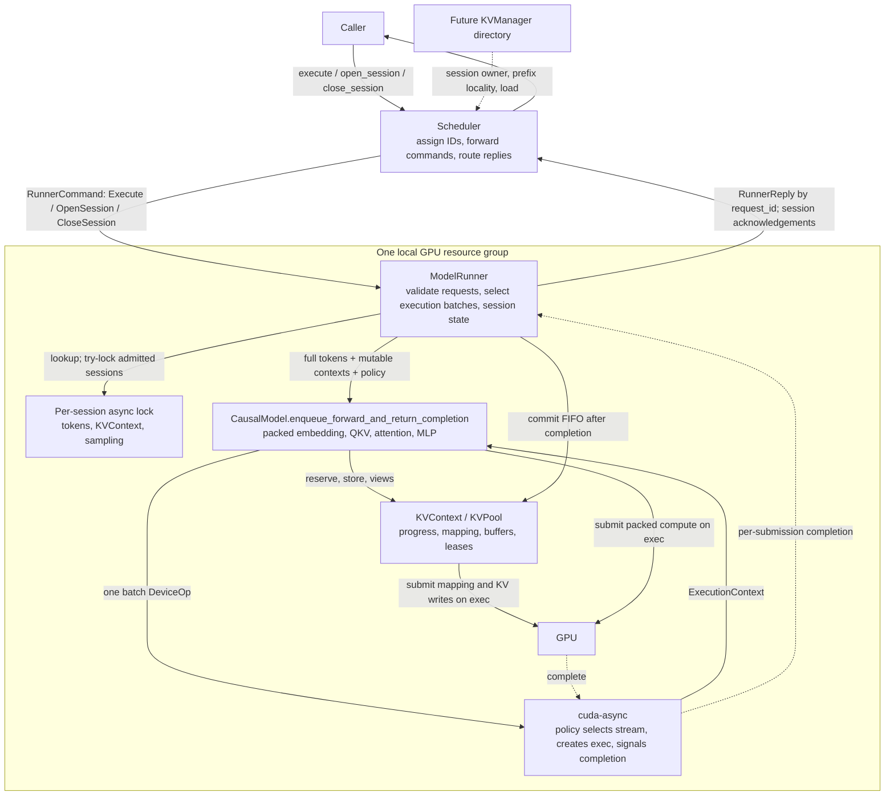
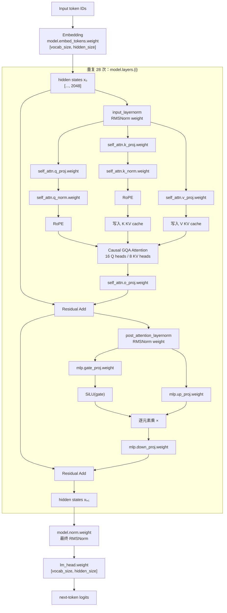

# features
- 在[cutile-grout](../../cutile-grout)基础上，添加上[mini-sglang](../../mini-sglang/)的radix cache功能，这样就能实现一个full-fledged infrence框架，同时性能还不错

# Execution boundary

The request envelope and ownership below follow the Runner template and the
minimal attention implementation. Rust snippets summarize interfaces; kernel
bodies are omitted. Prefix caching, paged storage, and non-greedy sampling
remain future work.

## Visibility boundary

Visibility in the snippets is intentional: no `pub` means private to the module
and its children; `pub(crate)` permits cross-module cooperation inside engine;
`pub` is an embedding/configuration contract. Tests do not justify public APIs.
Trait methods inherit their trait's visibility and do not take a `pub` modifier.

| Visibility | Contracts |
| --- | --- |
| `pub` | Scheduler construction, `execute`, `execute_stream`, `open_session`, `close_session`, `wait_stopped`; request construction/read-only ID; response fields |
| `pub` | RunnerBuilder/factory configuration and `build`; ModelRunner `run`; RunnerCommand transport type |
| `pub` | CausalModel/KVPool/AttentionBackend extension traits and signature types; KVContext operations; configs, metrics, loader/export APIs |
| `pub` type, private fields | ModelRunner, KVContext, NaiveKVPool, NaiveContextState, NaiveReadView, NaiveWriteView; storage/progress ownership stays encapsulated |
| `pub` | RunnerReply channel payload: text deltas and terminal statuses |
| `pub(crate)` | SessionRequest internal ID assignment/access; unsafe read-buffer bridge for internal tensor kernels |
| private | ModelRunner `new`, `open_session`, `close_session`, `enqueue`, `try_admit`, `drive`, ActiveRequest, decoding; Scheduler dispatch/receive and PendingRequest; allocation state |
| `pub(super)` in private kernel modules | Generated launch functions called only by their parent implementation |

Public batch payload types allow the external binary to connect Scheduler and
Runner channels; their bookkeeping fields are not application inputs. Public
factory defaults and extension signature types must stay reachable because they
appear in public generic interfaces. The scalar `forward` and Runner `execute_session` convenience helpers are private
and test-only; production execution uses CausalModel::enqueue_forward_and_return_completion and Runner::drive.

## Routing extension

Scheduler now supports multiple named destinations via `with_routing`, while
`new`/`new_with_observers` preserve the single-Runner construction path.
`RoutingState` owns bounded prefix hints/session placement; `RoutingRuntime`
keeps a destination-to-request-ID reverse index for targeted disconnect cleanup. `RoutingPolicy` reads candidate metadata;
`RequestForwarder` resolves endpoint identity and sends existing RunnerCommand
messages. `Forwarding` supplies source-tagged RunnerReply/disconnect events.
One routing loop serializes transitions; session acknowledgements are polled
without blocking other requests. The gateway retains response/terminal delivery,
including when the caller drops its stream. Engine-local exact token-prefix KV reuse is opt-in on Runner; gateway text hints
remain advisory and do not prove a local cache hit. See [routing state/actions/control](prefix_cache_routing.md) and
[configuration](../rust/engine/README.md#multi-destination-routing).

## Architecture



Runner, live contexts, and pool storage stay in the same GPU resource group.
KVManager may be remote but does not participate in per-layer KV reads/writes.
`ExecutionContext` belongs to one submission; Runner stores policy, not a permanent
exec. Scheduler::execute(&self) accepts concurrent callers. Runner::run submits complete packed forwards onto one ordered compute stream.
Each forward includes all layers, LM head and token selection; request membership
changes only between complete forward submissions, never between layers or CTAs.
One-round lookahead permits two submitted forwards, with GPU execution still ordered:

```text
submit F0([A,B]);
submit F1([A,B,C]); wait/commit/process F0;
submit F2([B,C]);   wait/commit/process F1;
```

The batch is current step membership, not a fixed generation cohort. Waiting for
F0 does not wait for later F1 work. Hidden intermediates belong to their submission;
tokens/KV persist across steps. A request discovered finished while F1 is in flight
leaves after its F1 member drains; that extra prediction is discarded.

## Lifecycle

```mermaid
sequenceDiagram
    participant C as Caller
    participant D as Scheduler
    participant R as ModelRunner
    participant S as Session entry
    participant M as CausalModel
    participant K as KVContext / KVPool
    participant A as cuda-async / GPU

    Note over R,K: Startup: initialize model, preallocate pool, retain Runner policy
    opt Explicit persistent session
        C->>D: open_session()
        D->>D: allocate SessionId
        D->>R: OpenSession(id)
        R->>K: KVContext::new(pool)
        R->>S: tokens empty, context, default sampling
        R-->>D: acknowledge creation
        D-->>C: SessionId
    end
    C->>D: execute_stream(SessionRequest) or execute(SessionRequest)
    D->>R: Execute(candidate batch)
    Note over C,R: Clients await EOF before the next request or close for that session
    R->>R: encode prompt deltas
    loop forward boundaries while requests remain
        R->>R: ingest arrivals; retry capacity-limited candidates
        R->>S: look up entries; try-lock or reject busy sessions
        Note over R,S: Release directory guards before await; unrelated sessions remain available
        R->>R: validate pure greedy sampling and generation budget
        R->>M: validate_input(new token IDs), CPU only
        R->>R: record per-request errors; check full length against context capacity
        R->>K: can_append(uncached input + generated KV budget, new contexts)
        R->>R: append CPU tokens only for admitted requests
    opt Stateless request
        R->>K: create temporary context
    end
    Note over R,D: Zero-output requests finish before the first model step
    Note over R,M: One packed forward for the current active requests
    R->>M: enqueue_forward_and_return_completion(mutable slice of ModelInput, ordered policy)
    M->>M: trust admitted-input contract; pack suffixes and query ranges
    M->>A: submit one batch DeviceOp using Runner policy
    A->>M: execute operation with one exec
    M->>K: reserve each append; submit mapping updates on exec
    M->>A: packed embedding
    M->>K: obtain pending WriteViews; retain resources on exec
    M->>A: one fused QKV projection; write K/V directly to mapped cache slots
    K-->>M: each request's ReadView
    M->>A: one attention launch; per-query metadata selects history
    M->>A: packed residual and MLP; one result readback
    Note over M,A: First poll submits and registers completion; ready_len is unchanged
    M-->>R: owned KV contexts, GPU predictions and completion handle
    R->>M: submit next forward using GPU feedback, without CPU token reads
    R->>A: await previous submission completion
    A-->>R: previous submission result; later work may still run
    alt previous submission succeeded
        R->>K: commit previous members by compute_end, FIFO
    else shared execution failed
        R->>R: mark each affected request failed
    end
    R->>M: read previous prediction on the separate D2H stream
    R->>R: append generated IDs; stop EOS, length-limited or failed items
    R->>R: tokenizer.decode_stream.step(token), library owns buffering
    R-->>D: RunnerReply::Delta(text), when available
    D-->>C: Stream item (execute collects these items)
    opt A request reaches EOS, its budget, or an error
        R->>S: restore accepted state or roll back unchanged KV; unlock
        opt Stateless request completes
            R->>K: release temporary context
        end
        R-->>D: RunnerReply::Finished { request_id, generated_tokens, result }
        D-->>C: end that request's stream or emit error
    end
        R->>R: yield to ingress/reply routing tasks
    end
    opt Session close
        C->>D: close_session(session_id)
        D->>R: CloseSession(id), client has awaited completion
        R->>S: try-lock idle entry; reject busy close
        R->>K: release_state; recycle after last GPU lease
        R-->>D: acknowledge close
        D-->>C: success or error
    end
```

# Request and Runner state and APIs

```rust
pub type RequestId = u64;
pub type SessionId = u64;
pub type SamplingConfig = GenerationConfig; // Reuse the existing configuration struct.

pub struct SessionRequest<T = String> {
    request_id: Option<RequestId>, // Private: None before Scheduler admission.
    pub session_id: Option<SessionId>,
    pub input: T,
    pub sampling: Option<SamplingConfig>,
}
impl<T> SessionRequest<T> {
    /// 创建未提交的请求，不接受调用者指定 request_id。
    pub fn new(session_id: Option<SessionId>, input: T) -> Self;
    /// 只读；提交前为 None，Scheduler 分配后为 Some(id)。
    pub fn request_id(&self) -> Option<RequestId>;
    /// 内部为提交分配 ID，或在转换输入时保留已有 ID。
    pub(crate) fn with_request_id(self, id: RequestId) -> Self;
    pub(crate) fn assigned_request_id(&self) -> RequestId;
}
pub type BatchIn<T = String> = Vec<SessionRequest<T>>;
pub enum RunnerReply {
    Delta(LLMResponse),
    Finished { request_id: RequestId, generated_tokens: usize, result: Result<(), EngineError> },
}

/// Public for channel wiring; applications call Scheduler instead of sending commands.
pub enum RunnerCommand {
    Execute(BatchIn),
    OpenSession { id: SessionId, reply: oneshot::Sender<Result<(), EngineError>> },
    CloseSession { id: SessionId, reply: oneshot::Sender<Result<(), EngineError>> },
}

struct SessionState<P: KVPool> {
    tokens: Arc<Vec<u32>>,
    kv: KVContext<P>,
    sampling: SamplingConfig,
}

pub struct ModelRunner<M, P: KVPool> {
    command_rx: Option<UnboundedReceiver<RunnerCommand>>,
    batch_reply_tx: UnboundedSender<RunnerReply>,
    model: Arc<M>,
    pool: Arc<P>,
    policy: Arc<dyn SchedulingPolicy>,
    sessions: DashMap<SessionId, Arc<Mutex<Option<SessionState<P>>>>>,
}

impl<M: CausalModel<P>, P: KVPool> ModelRunner<M, P> {
    /// 创建空 session；已存在则报错。
    fn open_session(&self, id: SessionId) -> Result<()>;
    /// 校验每个候选请求，按本地 KV 容量选择执行 batch，各自返回成功或错误。
    async fn drive(&self, commands: &mut UnboundedReceiver<RunnerCommand>,
        replies: &UnboundedSender<RunnerReply>);
    /// Release an idle session; clients await their active turn before closing.
    fn close_session(&self, id: SessionId) -> Result<()>;
    /// Admit ready requests between forwards and acknowledge session changes.
    pub async fn run(self, cancel: CancellationToken);
}

impl Scheduler {
    /// Attach synchronous observers for admission, deltas and one terminal event.
    pub fn new_with_observers(cancel: CancellationToken,
        commands: UnboundedSender<RunnerCommand>, replies: UnboundedReceiver<RunnerReply>,
        observers: Vec<Arc<dyn SchedulerObserver>>) -> Self;
    /// Allocate a SessionId and return only after Runner creates its state.
    pub async fn open_session(&self) -> Result<SessionId, EngineError>;
    /// Close an idle session after the client has awaited its prior request.
    pub async fn close_session(&self, id: SessionId) -> Result<(), EngineError>;
    /// Admit a request and return text deltas; normal completion ends the stream.
    pub fn execute_stream(&self, request: SessionRequest)
        -> Result<impl Stream<Item = Result<LLMResponse, EngineError>> + Send + 'static, EngineError>;
    /// Collect execute_stream into one response, using the same generation loop.
    pub async fn execute(&self, request: SessionRequest) -> Result<LLMResponse>;
}
```

SchedulerObserver hooks observe admission, text and completion outside routing-map
locks; they cannot return scheduling decisions. Completion provides RequestStats
with elapsed time, optional first nonempty text latency, and optional generated
token count (unknown on cancellation/disconnection before Runner completion).
MetricsObserver emits standard metrics handles; a completion closure can capture
stats for a caller's summary. Request output TPS includes the entire request;
Qwen prefill/decode and workspace metrics remain below Scheduler. No Runner start
notification is added, so queue time is not separately measured.

Session management and generation share one FIFO transport. Scheduler forwards
commands immediately, without a collection timer. Clients serialize requests and
close for the same session: await Finished before submitting its next turn or close.
Runner rejects accidental overlap with a busy-session error instead of queueing it.
Session IDs use a separate counter shared across Scheduler clones.
`None` uses temporary state; `Some(id)` requires an explicitly opened session.
Management methods return Runner errors through oneshot acknowledgements and stop
waiting on Scheduler cancellation or channel closure. Scheduler owns the public
entry points; Runner owns the actual session state and its private lifecycle methods.

`SessionRequest` replaces `SingleRequest + GenerateRequest`; it packages the two
IDs without merging their meanings. `request_id` identifies one invocation/reply,
while `session_id` identifies history across invocations. The public constructor accepts no RequestId. Scheduler assigns a fresh ID to
its owned envelope on every admission, using an atomic counter shared by its
clones; re-admission always gets another ID. The private field is read-only to
callers, while LLMResponse.request_id stays public. Runner trusts Scheduler-assigned IDs as an internal invariant; it does not
revalidate missing or duplicate request IDs. No separate request/session ID argument list
is needed.

`session_id=None` creates temporary state. `Some(id)` requires a previously opened
session, appends the prompt delta, and inherits sampling settings unless overridden.
Runner supports pure greedy sampling, output-token limits, and optional EOS overrides.
Every generated token is appended to session history; its KV is computed by the next step.

Runner owns continuous batch membership. It encodes incoming prompts once into
`SessionRequest<Encoding>`, retries capacity-limited candidates at each forward boundary,
and keeps one private `ActiveRequest` per admitted turn. The record owns the
session guard, local SessionState, rollback progress, sampling/budget, generated
token count and the tokenizer library's streaming decoder. No sequence handle or
model/backend trait is added.

ActiveRequest layout is compiler-selected (`repr(Rust)`), not a 64-byte ABI.
CPU generation state is grouped separately from KV. Owned submission briefly
takes/returns context ownership; subsequent CPU processing borrows history/decoder
without retaining a ModelInput borrow across GPU completion. No
portable byte-size assertion or fixed alignment is imposed. One Runner owns these
records; consider a hot/cold split only if CPU profiling identifies a bottleneck.

Session locks are acquired with try_lock_owned. Busy requests and close calls fail
immediately when processed; there is no per-session waiting queue or lock-wakeup
mechanism. Completed turns restore/release state and unlock before Finished is
emitted, so a client can safely submit its next turn after EOF. Batch order is
internal; responses remain keyed by request ID.

Admission budgets unallocated KV for every active turn plus the new candidate:
`(tokens.len() + remaining.saturating_sub(1)).saturating_sub(kv.allocated_len())`
per active request,
plus new context rows. This protects future decode growth from new prefills. A
capacity-limited candidate waits while active requests can finish; when there is
no active work that can free capacity, it receives its own capacity error.
Persistent session KV continues to consume capacity after its turn ends.
Pool::can_append is a conservative CPU snapshot, not a physical reservation;
actual allocation can still fail. Workspace-based sizing, preemption and KV
retraction remain future policy refinements.

The directory lock lasts only for lookup/insertion/removal; a session's async
guard covers its turn, including GPU completion. Runner submits one packed forward
at a time. `RunnerBuilder::with_max_batch_tokens(NonZeroUsize)` bounds the sum of
uncached input tokens in that forward (default 512, a policy default rather than
a tuned optimum). Runner's internal `BatchPolicy` selects work without owning or
copying request state. `MixedChunkPolicy` reserves one token for each existing
decode, then attempts prefill chunks in active order using the remaining budget.
Both execute together; without prefill work/budget, the forward contains decode
only. A turn enters decode after its first output token; a one-token prompt is
still prefill. If decodes alone exceed the budget, excess requests wait in active
order. Requests that do not fit keep their state unchanged.
The budget is separate from admission's full-turn KV capacity protection.

```rust
struct ScheduledRequest<'a, 'tok, P: KVPool> {
    request: &'a mut ActiveRequest<'tok, P>,
    /// Exclusive token position to compute up to in this forward.
    compute_end: usize,
}

trait BatchPolicy {
    fn plan<'a, 'tok, P: KVPool>(
        &mut self,
        active: &'a mut [ActiveRequest<'tok, P>],
    ) -> Vec<ScheduledRequest<'a, 'tok, P>>;
}
```

The trait and scheduled requests stay internal to Runner. Admission, KV lifetime,
execution and result settlement remain Runner responsibilities; this policy only
selects work among admitted requests. No RequestView or separate BatchPlan is needed.

Runner passes a shared history prefix ending at compute_end to ModelInput, where
`compute_end = allocated_len + selected_input_tokens`. Every chunk runs all
model layers; subsequent ordered submissions may use its KV before CPU confirmation. If `compute_end < history.len()`,
the returned prediction is discarded: no CPU token append, output delta, EOS check,
or generated-token budget decrement occurs. The last chunk samples the first real
output token; subsequent decode steps compute the last generated token's KV.
Session continuation uses the same rule, including any previously generated
uncached final token. No separate prefill cursor is needed: allocated_len is the reservation cursor,
while ready_len records successfully completed appends.

The existing forward API still computes an unused LM head on intermediate chunks;
Qwen's deferred token readback is never polled for those discarded predictions. This is an initial implementation shortcut; split prefill/sampling execution
only if profiling justifies that extra contract. Chunk size bounds input rows, not
attention latency: long cached histories can still make a chunk expensive. This
does not implement preemption or adaptive fairness/SLO policy.
Each completed step yields to Tokio so
ingress and reply routing progress even for an immediately-ready model future.

Runner holds the existing mutex guards, takes their states into local variables,
and puts successful states back explicitly. Sampling overrides are saved only
on success. On an ordinary error with unchanged KV, it truncates CPU tokens to
the original length and restores the state. Changed/pending KV is released.
Cancellation after taking ownership drops local states and leaves session entries
invalid until closed; no custom turn guard or cancellation rollback is implemented.
Successfully generated history stays saved if display decoding or reply delivery fails.
Runner emits a per-request Finished only after state restoration/release and unlocking. Validation, unknown-session, capacity, and decoding
errors affect their own request. Shared kernel/stream/submission failures are
copied into each participating request's result; no batch-error field or outer
model-wide error result is added. Earlier completed execution groups stay saved.

## Submission-first GPU feedback and CPU result overlap

Implemented using the existing cuda-async 0.4 APIs; no library changes or dependency
migration. CausalModel::forward retains its completion-and-KV-commit contract for
direct callers; default next_tokens calls forward and reads CPU values. Runner uses
the separate enqueue_forward_and_return_completion entry: its default wraps an already completed forward,
while Qwen returns after enqueueing. Request IDs remain outside the model API.

```rust
/// Output from submitted work and its independently awaited GPU completion.
pub struct SubmittedGpuWorkWithCompletion<T = Vec<Result<NextToken, ModelError>>> {
    output: T,
    gpu_completion: GpuWorkCompletionFuture,
    /// Producing stream supplied by queued model submission.
    compute_stream_id: Option<usize>,
}

struct GpuTokenPredictionHandle {
    values: Arc<Tensor<i32>>,
    index: usize,
    position: usize,                 // Absolute sampled-token position, CPU-known.
    /// Producer CUDA stream identity; pending feedback requires this same stream.
    /// None means producer computation already completed.
    producer_stream_id: Option<usize>,
    host: HostTokens,                // Shared producer-then-D2H completion future.
    vocab_size: usize,
}
```

ModelTokens::BorrowedHost borrows a CPU prefix slice; SharedHost holds an Arc
history and exclusive end position for owned submissions. Runner uses SharedHost
without copying history. These input variants do not select the output location:
Qwen returns NextToken::Device for both CPU and GPU input paths.

Execution operations follow their owning contract:

| Owner | Method / responsibility |
| --- | --- |
| SubmittedGpuWorkWithCompletion<T> | submit: construct an owned submission handle without awaiting GPU completion |
| CausalModel<P> | execute_append_batch: prepare, await completion, then commit KV |
| CausalModel<P> | enqueue_append_batch: prepare queued work and restore owners; Runner later awaits and commits |
| ReadbackCache<T> | enqueue: retain copy resources and reuse only buffers without GPU/CPU users |
| GpuTokenReadback | enqueue/predictions: use its pinned cache, copy stream and deferred CPU reads |

The submission-related records have these roles:

| Record | Boundary / responsibility |
| --- | --- |
| SubmittedGpuWorkWithCompletion<T> | Helper/model returns owned output and one shared GPU completion; replaces Submission<T> and SubmittedForward |
| ModelInputsAfterGpuSubmission<P,T> | Private default-method handoff: moved inputs plus owned output; model implementations cannot extract contexts or results from it |
| GpuTokenReadback | Shared-model component: pinned cache, independent D2H stream, readback metrics and deferred token handles |
| RequestForwardAwaitingGpuCompletion | Runner-only identity, KV append end and prediction; replaces BatchMember plus PendingBatch |

SubmittedGpuWorkWithCompletion::submit drives the first DeviceFuture poll and returns
the output/completion handle. CausalModel::enqueue_append_batch is the default model
execution method: it owns selected inputs, checks feedback stream order, reserves
queued KV appends and restores every KVContext before exposing model output. Its callback only submits
model kernels using borrowed ModelInput values and returns an owned Result<T,ModelError>:
no input borrow can escape. The common submission handle carries compute_stream_id;
no model-specific handoff struct is required. Model implementations no longer extract or restore KV owners manually.
Callback-level errors restore contexts too; outer submission errors or cancellation
invalidate moved contexts and retain the existing safe release behavior. Qwen then
returns the same generic container with token predictions as its output. Runner consumes
that vector into its per-request records;
wait_commit_kv_and_forward awaits shared GPU completion, commits KV,
and accepts/emits tokens. Request IDs stay entirely in Runner.

The default enqueue_append_batch method moves selected KVContext owners into an owned
DeviceOp and shares Host histories through Arc (borrowed direct callers are copied), and creates temporary ModelInput
borrows only inside execute. After mapping/layer submissions, it hands contexts and
GPU predictions back through an internal oneshot. The engine polls the normal
DeviceFuture once before consuming that handoff, so its completion marker is already
registered before the next forward can submit. Immediate Ready/error cases are
preserved and the Future is never polled again after Ready. The Future, not an
externally managed context, owns retained resources and releases them at completion.
Cancellation uses the library's existing safe drain-on-drop behavior; that drain can
block the host and is not an asynchronous cancellation primitive.

Runner owns the model through Arc and fixes one compute stream, choosing its device
through the configured policy. Queued GPU feedback must use that same stream;
stream order covers previous KV writes as well as sampled token reads. This initial
implementation does not support queued cross-compute-stream forward execution.

```text
submit F0 -> return contexts, prediction C, completion F0
submit F1(C)
    -> await F0 -> FIFO KV commit -> D2H C -> CPU history/EOS/text
submit F2(D)
    -> await F1 -> FIFO KV commit -> D2H D -> CPU history/EOS/text
```

Runner keeps the prior results in `pending` and the newly submitted results in
`current`; at most these two forwards are unsettled. CPU processing provides backpressure;
it cannot grow an unbounded GPU queue. Runner keeps a Vec of
RequestForwardAwaitingGpuCompletion: each record combines request_id, compute_end,
produces_output_token, prediction and the batch's shared gpu_completion. There is
no separate BatchMember/PendingBatch pair or parallel metadata/prediction arrays.
The shared completion is evaluated once; each successful request commits its own append. Default completed models
have already committed and are not committed twice. The overlap setting alone
selects the execution path: overlap submits current before processing pending, then
retains current for the next iteration. Serial execution calls next_tokens, waits
for CPU token IDs and accepts them immediately, without pending completion records.
Host-only SimpleMLP callers explicitly disable overlap. GpuTokenReadback lives under
model/readback.rs and owns reusable pinned buffers, an independent SingleStream and
an injected duration histogram. predictions() returns GPU handles sharing one lazy
producer-completion-then-D2H future. Qwen uses this component for direct and queued
forwards; new models reuse it without owning CUDA copy/cache logic. GPU consumers
do not wait for D2H or CPU decoding. Common readback logs use engine::model; histogram
names and model-instance labels remain supplied by the model.

KV ready_len records completed progress; allocated_len() derives the reservation
cursor from pending_ends.back(), or ready_len when idle. Only append ends are stored:
ready_len=10 with ends=[14,15] represents [10..14,14..15]. The pending FIFO holds at most
two appends. Boundaries are recorded before backend preparation; after a preparation
failure they still describe attempted work, and the context must be released.
Normal prepare_append still requires idle state; internal prepare_queued_append_batch reserves from
allocated_len. Write views expose the newest append; attention reads the history
through that append, ordered on the compute stream. commit_completed_append(compute_end)
verifies/populates FIFO progress only after the matching completion succeeds.

| Boundary | ready_len | allocated_len() | pending_ends | CPU history |
| --- | ---: | ---: | --- | --- |
| Submit F0([A,B]), predict C at position 2 | 0 | 2 | [2] | [A,B] |
| Submit F1(C) | 0 | 3 | [2,3] | [A,B] |
| Complete F0/read C | 2 | 3 | [3] | [A,B,C] |
| Submit F2(D at position 3) | 2 | 4 | [3,4] | [A,B,C] |

GPU token position, not CPU-history/ready_len equality, identifies a pending sample.
Admission subtracts already allocated positions from the full remaining KV budget.
The final budgeted sample is settled without another append. EOS/readback/decode
failures stop future selection; an already submitted extra member drains and its
prediction is discarded before Finished/session restoration. Unchanged valid KV
can roll back CPU history; advanced, pending or invalidated contexts are released.

Mixed/reordered embeddings retain one embedding_gather launch per forward. The
cached u64 table stores [GPU address, inline Host ID] per packed row (16 bytes);
zero address selects the inline ID. Addressed owners remain retained through
submission completion. Pure Host and contiguous GPU inputs keep table-free paths.

RunnerBuilder::with_overlap(false), exposed as Qwen --disable-overlap, keeps the
serial baseline. This implementation does not batch text into 64/128-token chunks,
add CUDA Graph replay or quantization. Native BF16 is supported independently.

Validation includes a gated owned-handoff/resource-reclamation test, a Runner
completion that only the next submission can release, and Qwen queued mixed/reordered
numerical equivalence/FIFO commit checks. EOS/limits, readback failures, cancellation,
continuous batching, chunked prefill and session continuation remain regression targets.
The earlier external-context probe rejected only an event-plus-context-drop adapter:
it is superseded by this owned DeviceFuture handoff.

# CausalModel batch state and APIs

```rust
pub struct ModelInput<'a, P: KVPool> {
    pub token_ids: ModelTokens<'a>, // Host history prefix or one GPU feedback token.
    pub kv: &'a mut KVContext<P>,
}

pub trait CausalModel<P: KVPool>: Send + Sync {
    /// Borrow the matching tokenizer; Runner controls encoding and decoding.
    fn tokenizer(&self) -> &Tokenizer;
    /// Validate new IDs before admission; Runner validates sampling separately.
    fn validate_input(&self, new_token_ids: &[u32]) -> Result<(), ModelError>;
    /// 默认拼接未缓存后缀，按模型提供的正数倍数补齐；ranges 不含 padding。
    fn pack_token_ids(batch: &[ModelInput<'_, P>], pad_multiple: usize)
        -> (Vec<i32>, Vec<Range<usize>>);
    /// 默认先 prepare_append，再调用模型回调，等待成功后提交 KV；回调勿重复 prepare。
    /// 回调负责本次 forward 所需的全部 KV cache 更新；cache 与网络层不要求一一对应。
    /// 框架不理解网络拓扑，也不检查回调是否覆盖了全部所需 cache。
    fn execute_append_batch<T: Send>(batch: &mut [ModelInput<'_, P>],
        policy: &Arc<dyn SchedulingPolicy>,
        submit: impl FnOnce(&mut [ModelInput<'_, P>], &ExecutionContext) -> Result<T, ModelError> + Send)
        -> impl Future<Output = Result<T, ModelError>> + Send;
    /// Complete computation and KV commit; CPU readback may remain pending.
    /// Required implementation; return ready Host or deferred Device results.
    fn forward(&self, batch: &mut [ModelInput<'_, P>],
        policy: Arc<dyn SchedulingPolicy>)
        -> impl Future<Output = Vec<Result<NextToken, ModelError>>> + Send;
    /// Default completes forward; Qwen returns after enqueue and Runner settles KV.
    fn enqueue_forward_and_return_completion(self: Arc<Self>, batch: &mut [ModelInput<'_, P>],
        policy: Arc<dyn SchedulingPolicy>) -> impl Future<Output = SubmittedGpuWorkWithCompletion> + Send;
    /// Default convenience API: forward, then await CPU values in input order.
    fn next_tokens(&self, batch: &mut [ModelInput<'_, P>],
        policy: Arc<dyn SchedulingPolicy>)
        -> impl Future<Output = Vec<Result<u32, ModelError>>> + Send;
    fn is_eos(&self, token: u32) -> bool;
}

pub trait AttentionBackend<P: KVPool> {
    /// query_ranges[i] 标识 packed Q 中第 i 个 context 的本次 query 行。
    /// 整个 batch 一起提交 attention；KV 布局仍由关联 ReadView 抽象。
    fn forward(&self, q: Arc<Tensor<P::Element>>, views: &[P::ReadView<'_>],
        query_ranges: &[Range<usize>], exec: &ExecutionContext)
        -> Result<Arc<Tensor<P::Element>>, ModelError>;
}
```

CausalModel and AttentionBackend return ModelError; KVContext returns KVContextError;
KVPool returns KVPoolError. Context/model errors retain their typed lower-layer
errors. Runner wraps them in EngineError::Model, EngineError::KVContext, or
EngineError::KVPool for per-request responses, preserving typed error chains.

The envelope's SessionId is routing metadata; CausalModel does not look up session state.
Runner lends the already selected contexts. Runner's policy is passed explicitly
through CausalModel to `.schedule(&policy)`; model weight export policy does not select
inference streams.

```text
A: ready=2, full tokens=[a,b,c,d,e] -> suffix=[c,d,e], query_range=0..3
B: ready=1, full tokens=[x,y]       -> suffix=[y],     query_range=3..4
C: ready=0, full tokens=[m,n]       -> suffix=[m,n],   query_range=4..6

packed tokens: [c,d,e,y,m,n, PAD,PAD]     // One final tile padding, not per request.
embedding / Q: shared batch tensors [8,16]
fused QKV: K/V accumulators -> slots for A/B/C; padding rows never write cache
attention: query metadata selects A/B/C row and each query's causal history end
residual / MLP: shared batch tensors
results: last real query of A, B, C
```

The Naive backend launches one attention kernel for packed queries. It reads
per-query `(context_row, history_start, history_end)` metadata, then follows that context's slot
table. The model/weights are shared; the history and causal boundary differ.
No query can attend to another request's tokens. One fused QKV launch uses packed
(context_row, absolute_token_position) metadata to scatter K/V accumulators directly
into cache. Only Q is materialized as a temporary output; no temporary K/V tensors
or per-request store launches are used by SimpleMLP. Padding has a negative context
row, and masked table loads/cache stores prevent writes for those lanes.

```rust
/// 此函数在一次 DeviceOp 的 execute 中执行，只提交工作，不等待。
fn submit_batch(batch, exec: &ExecutionContext) -> Result<HostResults> {
    // execute_append_batch has already prepared every uncached suffix on exec.
    let x = embed_packed_tokens(batch, exec)?;
    let q = {
        let destinations = batch.iter_mut().map(|input| input.kv.write_view(0, exec)).collect()?;
        fused_qkv_to_cache(&x, &destinations, &query_ranges, exec)?
    }; // Release exclusive CPU borrows; resources remain retained in exec.
    let views = batch.map(|input| input.kv.read_view(0)).collect()?;
    let attention = backend.forward(q, &views, &query_ranges, exec)?;
    mlp_and_readback(x + attention, exec)
}

let (packed_token_ids, query_ranges) = Self::pack_token_ids(batch, model_tile_multiple);
// CausalModel checks layout-specific tensor limits; upload stays in its GPU callback.
let values = Self::execute_append_batch(batch, &policy, |batch, exec| submit_batch(batch, exec)).await?;
```

SimpleMLP retains its one-layer scalar core and maps its output to a numeric token.
Qwen supplies real vocabulary logits and greedy argmax. Runner guarantees a nonempty uncached suffix and idle context: it appends
a nonempty prompt delta to accepted history and never reuses a pending/failed context.
CausalModel does not rescan existing history for input validation. Numeric ID constraints
(including the toy tokenizer's UNK=256) are checked through validate_input on new
tokens. Runner checks full-history length against max_seq_len per request.
Cached logits or final-token replay are future work. A real multi-layer model repeats the shared
projection/cache-write/attention/FFN stage per attention layer inside the same execution boundary.

## Unified model and greedy lifecycle

RunnerBuilder's model factory returns only the model. CausalModel owns and exposes
its matching tokenizer through a borrowed accessor; Runner controls encoding and decoding. Runner owns
request IDs, session history, sampling, and output-token budgets. It repeatedly calls
CausalModel::forward on unfinished inputs, appends CPU-observed tokens, and removes
EOS/length-limited/error items from later steps. Default max_new_tokens is 1.
Runner uses tokenizer.decode_stream(true) directly. After each step it forwards
Some(text) as Delta and continues on None. The tokenizer library owns buffering,
UTF-8 assembly, and context-sensitive spacing. Runner does not maintain decoder
internals, call decode again at completion, or synthesize replacement characters.
If generation stops while a fragment is still buffered, only the already-emitted
chunks form the response; this can differ from batch decoding of incomplete UTF-8.
CPU token history is retained independently of displayed text.
RunnerReply::Finished carries one request ID, actual generated_tokens, and Result<(), EngineError> after
that request's state cleanup. Stopped requests, including zero-output requests,
finish before any peer's next step; temporary KV and session locks are released
at that boundary. Validation/admission errors finish individually. drive returns
unit: all text and terminal results travel through
the supplied reply channel, with no full-response intermediate. Scheduler routes
text unchanged and ends each stream or emits one terminal error; it does not decode
text or maintain decoder tails. Partial text already delivered cannot be retracted on failure.
Scheduler::execute collects this same stream into one final response. Streams are
buffered, not GPU backpressure: dropping a consumer stops delivery but does not
cancel generation. Scheduler/Runner shutdown still cancels outstanding work.

Admission checks full input length plus max_new_tokens - 1 against sequence and pool
capacity. Waiting candidates are retried between steps after completed requests
release temporary KV. Pure greedy options are validated before history mutation. Cancellation
can interrupt a running turn and releases its retained contexts.

After a nonzero greedy generation, KV covers the last step's input history. The newly selected token is
appended only to CPU history, so budget exhaustion normally leaves
`tokens.len() == kv.ready_len() + 1`. An EOS lookahead may already have computed
the accepted EOS token's KV, leaving `tokens.len() == kv.ready_len()`.
A continuation computes that suffix along with any subsequently appended input.
The caller owns history/context and releases it; the model owns read-only weights.
Generation loops live only in Runner; models expose completed and submission-first batch-step entry points.
Single-input callers pass `&mut [ModelInput { token_ids, kv }]` without an input Vec.
Dropping an in-flight step can leave KV pending, requiring release; GPU leases remain retained.

The Qwen example uses Scheduler -> Runner -> CausalModel; diagnostic logits remain a direct model call. It loads
weights directly into its selected BF16/FP32 storage, implements its GQA backend through the
existing AttentionBackend trait, and uses NaiveKVPool with a flat per-token KV
vector of `kv_heads * head_dim` elements (128 for two 64-dimensional heads).
Token/logit D2H copies use reusable pinned host buffers retained by ExecutionContext.
Submission only enqueues the copies; the outer Future awaits successful completion,
commits KV, and then exposes host values. Cancellation retains in-flight resources;
neither stack destinations nor explicit stream synchronization are used for readback.
KVPool::Element binds storage, store inputs and attention tensor types at compile time. Its eager cuTile kernels provide the real
model correctness baseline. Qwen executes ragged suffixes in a single packed
forward. Per-token context/position metadata is uploaded once and reused across
layers; final hidden rows and argmax preserve request order. Invalid inputs are
filtered while valid peers remain batched. Contexts in one append batch must share
a KV pool. Continuous batching and Qwen graph capture remain subsequent work.
The eager workspace is keyed by packed token count, batch size and device. Each
forward owns an exclusive lease and reuses disjoint scratch regions across all
decoder layers on the same stream.
Outputs fully overwrite their regions without zero-fill kernels. Scratch allocation
checks its exact byte budget against available device/pool memory; completion and
escaped-handle leases prevent early recycling, including on failure/cancellation.
Qwen execution totals use Counter/Histogram handles directly; no parallel
Qwen2Metrics accumulator or last-step timing is maintained. workspace_metrics()
returns only shared model-wide current/peak resource ownership. Benchmark timing
belongs to its own awaited calls; shared-counter deltas cannot identify a batch.
The private StepOutput returns host_submit_seconds with this invocation's outputs,
without an out-parameter. step_wall_seconds includes GPU/D2H completion and KV
commit; host_submit_seconds covers synchronous host preparation/enqueueing only.
They overlap GPU execution and cannot be subtracted to obtain pure kernel time.
The application chooses a recorder before model load; no exporter is installed.
Optional structured `tracing` events are enabled by the application subscriber.

# KV Cache state and APIs

## KVPool: common storage contract

```rust
pub trait KVPool: Sized + Send + Sync {
    type Element: DType;
    type ContextState: Send + Sync;
    type PrefixState: SplitPrefix + Send + Sync;
    /// Transfer committed private slots into a uniquely owned cache segment.
    fn take_prefix(&self, state: &mut Self::ContextState, positions: Range<usize>)
        -> Result<Self::PrefixState, KVPoolError>;
    /// Install canonical slots and path protection; return the previous lease for
    /// dropping outside the tree lock. Publication also frees duplicate private slots.
    fn bind_prefix(&self, state: &mut Self::ContextState,
        segments: &[&Self::PrefixState], lease: &PrefixLease)
        -> Result<Option<PrefixLease>, KVPoolError>;
    type ReadView<'a> where Self: 'a;
    type WriteView<'a> where Self: 'a;

    fn max_seq_len(&self) -> usize;
    fn alloc_state(&self) -> Result<Self::ContextState, KVPoolError>;
    /// 保守判断当前可用容量；tokens 为尚未预留的追加量，new_contexts 为额外行数。
    fn can_append(&self, tokens: usize, new_contexts: usize) -> bool;
    /// 预留物理位置并提交索引更新；返回不表示 GPU 执行完成。
    fn prepare_append(&self, state: &mut Self::ContextState,
        positions: Range<usize>, exec: &ExecutionContext) -> Result<(), KVPoolError>;
    /// 仅接收 backend 自有状态与逻辑 token 读取范围，不依赖整个 KVContext。
    /// 范围可包含同 exec 中已提交的 pending 写入；读取必须排在写入之后。
    fn read_view<'a>(&'a self, state: &'a Self::ContextState, layer: usize,
        read_range: Range<usize>) -> Result<Self::ReadView<'a>, KVPoolError>;
    /// Expose reserved destinations and retain storage/leases on exec; no K/V writes.
    fn write_view<'a>(&'a self, state: &'a mut Self::ContextState, layer: usize,
        positions: Range<usize>, exec: &'a ExecutionContext)
        -> Result<Self::WriteView<'a>, KVPoolError>;
    /// Consume a write view and submit copies on its retained execution context.
    fn store(&self, dst: Self::WriteView<'_>,
        k: TensorView<'_, Self::Element>, v: TensorView<'_, Self::Element>) -> Result<(), KVPoolError>;
    /// 移除 context 的所有权；在途 submission 的 lease 延迟实际 row/slot 回收。
    fn release_state(&self, state: Self::ContextState);
    fn metrics(&self) -> KVPoolMetrics;
}

pub struct KVContext<P: KVPool> {
    pool: Arc<P>,
    state: Option<P::ContextState>,
    /// Successfully completed and committed prefix end.
    ready_len: usize,
    /// At most two FIFO append ends; starts follow ready_len or the previous end.
    /// ready_len=10, ends=[14,15] represents [10..14,14..15].
    pending_ends: VecDeque<usize>,
}

impl<P: KVPool> KVContext<P> {
    pub fn new(pool: Arc<P>) -> Result<Self, KVContextError>;
    pub fn state(&self) -> &P::ContextState;
    /// Transfer only idle, committed positions to the cache.
    pub(crate) fn take_prefix(&mut self, positions: Range<usize>) -> Result<P::PrefixState, KVContextError>;
    /// Install a protected path, preserving ready_len for existing contexts.
    pub(crate) fn bind_prefix(&mut self, segments: &[&P::PrefixState], lease: &PrefixLease)
        -> Result<Option<PrefixLease>, KVContextError>;
    pub fn pending_range(&self) -> Option<Range<usize>>;
    pub fn ready_len(&self) -> usize;
    pub fn allocated_len(&self) -> usize;
    pub fn max_seq_len(&self) -> usize;
    pub fn is_pending(&self) -> bool;
    /// Idle 且 count>0；预留 [ready_len, ready_len+count)，保持 ready_len 不变。
    pub fn prepare_append(&mut self, count: usize, exec: &ExecutionContext) -> Result<(), KVContextError>;
    pub fn read_view(&self, layer: usize) -> Result<P::ReadView<'_>, KVContextError>;
    /// Only the newest pending append is writable; callers cannot supply a range.
    pub fn write_view<'a>(&'a mut self, layer: usize, exec: &'a ExecutionContext)
        -> Result<P::WriteView<'a>, KVContextError>;
    /// 只向当前 pending 区间写入；借用的 tensor view 可来自 batch 大张量。
    pub fn store(&mut self, layer: usize, k: TensorView<'_, P::Element>,
        v: TensorView<'_, P::Element>, exec: &ExecutionContext) -> Result<(), KVContextError>;
    /// 调用者已确认全部层、索引和 KV 写入执行成功，再推进 ready_len。
    pub(in crate::runner) fn commit_append(&mut self) -> Result<(), KVContextError>;
    /// Internal ordered path: reserve from allocated_len; max two pending appends.
    pub(in crate::runner) fn prepare_queued_append_batch(appends, exec) -> Result<(), KVContextError>;
    /// Verify the FIFO front and commit only this completed append.
    pub(in crate::runner) fn commit_completed_append(&mut self, compute_end: usize) -> Result<(), KVContextError>;
    /// 显式 release 与 Drop 都交还 state；物理回收受在途 lease 保护。
    pub fn release(self);
}
```

| Transition | Progress / ownership |
| --- | --- |
| `new` | `ready=allocated=0`, no pending; one state/row |
| `take_prefix(range)` | Transfer private committed slots into a unique tree-owned segment |
| `bind_prefix(path, lease)` | Empty context starts at hit length; existing context keeps progress and adopts canonical slots |
| `prepare_append(n)` succeeds | `allocated=ready+n`, pending reserved; ready unchanged |
| `store`, attention submitted | Progress unchanged; same exec orders dependencies |
| Matching completion succeeds, then FIFO commit | ready advances to that append end; later pending work remains |
| Partial submission fails or is cancelled | Do not reuse/commit pending context; release it |
| `release_state` / Drop | Context ownership removed; recycle after final GPU lease |

Failed prepare may already have reserved/submitted part of its work. Pending is
set before submission, and failure invalidates that context until release. The
interface includes immutable prefix retention/reuse. Abort/truncate, explicit
session fork and automatic cache eviction remain deferred.

## Engine-local radix prefix cache

The reusable `radix_tree` module has no KV, GPU, counters or eviction policy.
Its compressed paths and split algorithm adapt patricia_tree 0.10.2; the original
MIT notice is in `rust/engine/src/radix_tree/LICENSE`. Safe iterative arena storage
replaces the upstream recursive/unsafe layout. There is no crate dependency.

```rust
trait SplitPrefix { fn split_prefix(&mut self, len: usize) -> Self; }
struct RadixTree<K, V> { /* arena nodes, parent IDs, compressed labels */ }
struct CacheEntry<S> {
    slots: S,           // Unique ownership of this edge's KV slots.
    lock_ref: usize,    // Active protected paths through this node, not slot refs.
}
struct CacheTree<S> {
    index: RadixTree<u32, CacheEntry<S>>,
} // Cache-specific pin/unpin and segment traversal live here.
struct PrefixCache<P: KVPool> {
    tree: Arc<Mutex<CacheTree<P::PrefixState>>>,
    pool: Arc<P>,
    config: PrefixCacheConfig,
}
struct PrefixMatch<S: SplitPrefix> {
    tree: Arc<Mutex<CacheTree<S>>>,
    node: NodeId,
    token_len: usize,
} // Returned in Arc; final Drop unpins the path. Context PrefixLease shares this Arc.

struct PrefixCacheConfig {
    max_prefix_tokens: NonZeroUsize, // Default 4096; model/pool limits still apply.
    max_cached_tokens: NonZeroUsize, // Default 4096 unique tree-owned tokens.
}
```

```text
new request / first turn of an empty session
  -> exact u32 token-prefix lookup, capped at prompt_len - 1
  -> split a partially matched edge; keep its suffix node ID stable
  -> protect the matched node-to-root path
  -> context adopts canonical slot IDs + a shared path lease
  -> normal append/packed/chunked forward, optional overlap and CUDA Graph
  -> complete GPU work -> commit KV -> accept CPU tokens -> drain pending work
  -> publish: transfer only new private KV to tree ownership
              return duplicate private slots and repoint to canonical cached slots
              acquire the new path protection, then release the old protection
  -> restore session or release the temporary context row/private suffix
```

CacheTree wraps the reusable index and owns cache-specific path operations;
PrefixCache controls find/reuse/publish, and PrefixMatch protects an active path.
Cached-token accounting comes from the index's total edge
key elements, maintained on append/removal and unchanged by splits/merges. There
is no separate CacheState wrapper or second CachedPathPin guard; PrefixMatch is
the RAII guard. CacheTree uses the index through its public API, without adding
cache methods or policy to RadixTree. Its private index and node payload live in
`runner/prefix_cache/cache_tree.rs`; callers use CacheTree methods only.

When splitting A's 100-token edge at 50, A's node ID continues to identify the
50-token suffix. A new 50-token parent inherits A's lock_ref. A's existing pin now
walks through that parent; B can pin just the first 50 tokens. Repeating at 20
handles C without per-slot counters. Prefix payload splitting moves disjoint slot-ID
vectors and copies no K/V. The Vec splitter keeps allocation with the larger half
and bounds spare capacity, avoiding quadratic retained capacity under either
ascending or descending split boundaries.

```text
Context ─────────┐
GPU submission ──┴─> Arc<StateLease>
                       -> mapping IDs + private slots
                       -> PrefixLease -> shared PrefixMatch -> tree/node ID

final StateLease Drop:
  return row + private slots under allocation lock
  release allocation lock
  drop prefix protection -> walk node-to-root and decrement lock_ref
```

Cache node payloads contain allocation ownership only, never a row lease or path
lease: tree -> node -> path pin -> tree would form an Arc cycle.

The lock order matters: tree operations may call the allocator; returning a row
must release the allocation mutex before unpinning. Old protection is returned by
bind_prefix and dropped outside the tree mutex. Zero lock_ref permits future
node eviction; it does not itself free cached slots. Dropping the cache wrapper
while contexts/GPU work remain keeps the tree alive until their leases finish.

Only committed KV with known CPU IDs is publishable; pending contexts are rejected.
A post-transfer binding failure invalidates the context rather than resuming it
with unowned slots. Concurrent cold requests may compute the same prefix: publication
returns duplicate slots and adopts the existing path. If this changes a live
session's mapping, its next append uploads the canonical row before GPU accesses.
Views may be constructed earlier for graph metadata; constructing a view reads no KV.

Runner opts in with `with_prefix_cache(config)`; default execution stays cold.
The cache belongs to one Runner/model/pool, so weights/tokenizer/layout namespaces
cannot mix. Existing nonempty sessions use their own history rather than rematching
deltas. Even a full hit recomputes the last prompt token because KV has no final
hidden state/logits. Context writes remain restricted to pending through KVContext;
direct backend callers must preserve this append-only contract.

The budget counts unique tokens owned by tree edges, not full path lengths per
request. When full, new KV publication stops; existing paths can still match,
split and deduplicate. Automatic eviction and a public cache-clear command remain
deferred. Pool capacity must include retained cache plus active suffixes/cold
requests. Gateway hints remain advisory rather than a synchronized KV inventory.

Node protection is O(compressed path depth), including a linear worst case.
Slot-ID copies, duplicate-slot return and mapping upload still process token arrays;
this change does not make the whole request path O(1). SGLang reference:
`radix_cache.py::inc_lock_ref/dec_lock_ref/_split_node`, local revision
`0263fdacb223e92035ebc947f098ba724ee5634f`.

## 提交与执行完成契约

| Boundary | Meaning |
| --- | --- |
| `prepare_append` / `store` / backend `forward` returns | CPU reservation and GPU submission completed; GPU may still be using resources |
| Outer `.schedule(&policy)?.await` succeeds | Submitted GPU work completed; process inner Result before committing |
| `.sync_on(&stream)` succeeds | Same completion contract with a blocking wait |
| `release_state` returns | Ownership dropped; reuse may be deferred by retained leases |

Mapping updates, stores, attention, and MLP use the same `ExecutionContext`.
Low-level methods never schedule independent dependent operations or wait inside
DeviceOp execution. A round-robin policy may choose different streams between
submissions; the outer boundary must establish ordering between context updates.

Retain both backing storage and logical allocation leases in exec **before**
submission. An `Arc<KVPool>` alone does not prevent a slot from being reused.
The library's submission lifetime also protects dropped futures; errors and
cancellation are not evidence that kernels stopped. No global pool/directory mutex
is held across a GPU await. A completed exec cannot be reused for another submission.

## NaiveKVPool: physical slots and GPU indirection

```rust
pub struct NaiveKVPool<T: DType = f32> {
    /// 单 head 示例使用 [num_slots, head_dim]；通用布局可为 [slots, heads, dim]。
    layers: Vec<(Arc<Tensor<T>>, Arc<Tensor<T>>)>,
    slot_table: Arc<Tensor<i32>>, // [context_row, token_position] -> slot.
    config: NaiveKVPoolConfig,
    allocation: Arc<Mutex<Allocation>>,
}
struct Allocation {
    free_rows: Vec<usize>,
    free_slots: Vec<i32>,
    bound_positions: usize,
}
pub struct NaiveContextState { lease: Arc<StateLease> }
struct StateLease {
    row: usize,
    slots: Mutex<ContextSlots>,
    allocation: Arc<Mutex<Allocation>>,
}
struct ContextSlots {
    mapping: Vec<i32>,         // Logical row, including cached aliases.
    owned: Vec<i32>,           // Only private slots; transferred segments are removed.
    prefix: Option<PrefixLease>,
}
struct LayerStorage<'a, T: DType> {
    k: &'a Arc<Tensor<T>>,
    v: &'a Arc<Tensor<T>>,
    slot_table: &'a Arc<Tensor<i32>>,
    row: usize,
    positions: Range<usize>,
    lease: Arc<StateLease>,
}
pub struct NaiveReadView<'a, T: DType = f32> { inner: LayerStorage<'a, T> }
pub struct NaiveWriteView<'a, T: DType = f32> {
    inner: LayerStorage<'a, T>,
    exec: &'a ExecutionContext,
}
```

`KVContext` owns logical ready/pending progress. Its read_view covers
`0..allocated_len` (history plus the current append); write_view selects only pending
positions and rejects idle contexts. KVPool receives backend state and logical
positions, and shares a private addressing builder between its read/write methods.
ReadView and WriteView are distinct types, with private fields and controlled
construction. Attention accepts only ReadView; store consumes WriteView. A write
view holds an exclusive context-state borrow and retains buffers/mapping/allocation
leases in its ExecutionContext before returning. It exposes no new GPU work by itself.
The existing KVContext::store remains a convenience path that constructs a write
view and delegates to KVPool::store on that view's execution context.

NaiveReadView's safe API exposes const pointers and read-only metadata. The internal
Tensor-handle bridge is unsafe and permits reads only; it does not give safe callers
writable Tensor handles. NaiveWriteView exposes writable device handles. Consume or
drop write views before constructing attention read views. CPU borrow lifetimes do
not prove GPU completion: stream ordering, retained leases, bounds checks, and the
unsafe kernel contracts still apply. Distinct view types do not statically prove
that every pending token/layer was written or that dynamic GPU indices stay in bounds.

For causal suffix queries the Naive backend computes query start as
`read_view.positions().end - query_count`, reading history from positions.start.
Completed-cache subranges can be read without a pending append. Logical positions
remain independent of physical slots and packed Q query_ranges.

Naive K/V scatter uses `[B, head_dim]` tiles with B=8 and grid
`(ceil(append_tokens/B), 1, 1)`. Table gathers and output scatters mask invalid tail
rows; padded source loads never write slot zero for an inactive lane. This is a
work-granularity choice, not a measured speedup claim.

SimpleMLP now fuses KV addressing/writes into its QKV projection kernel:

```text
SimpleMLP: prepare_append -> WriteViews -> fused QKV -> cache -> attention
Baseline:  prepare_append -> temporary K/V -> KVContext::store -> cache -> attention
```

Both paths reserve slots and update slot_table in prepare_append. The fused kernel
uses WriteView mapping/buffers and per-packed-row metadata to find physical cache
rows. The same ExecutionContext orders mapping updates, projection/cache writes,
and attention. Q remains a temporary tensor; K/V go directly from projection
accumulators into cache. This removes intermediate K/V writes/reads and separate
store launches, not the final cache writes. Addressing is backend-specific: this
fused kernel supports the current single-head, 16-dimensional NaiveKVPool layout.
KVContext::store and KVPool::store remain available as the non-fused baseline.
Correctness is checked against CPU outputs and actual cache contents; no throughput
improvement is claimed without a benchmark.

`StateLease` is private resource retention, not a new public sequence handle.
Its final Drop returns its row/private slots and releases the cached path protection.
Tree edges own cached slots. Borrowed views and submitted work retain the row lease
as needed; there is no per-slot reference-count array.

```text
                      token_position
                    0   1   2   3   4
context_row 0      [10, 11, 12, 13,  ?]
context_row 1      [20, 21, 22,  ?,  ?]

logical (context, layer, token_position)
    -> slot_table[context_row, token_position]
    -> layers[layer][slot]
```

按 layer + slot 存储，context 通过映射表寻址，后续可共享前缀。若每个 context
独占连续 KV 区域，fork 就需要复制历史；间接映射解除了这一限制。

`context_row` identifies a logical history, not an attention head. The flat GPU
index is `context_row * max_seq_len + token_position`. Unused table cells are
ignored by logical lengths. Reused rows overwrite newly bound positions before
attention reads them.

## Memory metrics

```rust
pub struct BufferMetrics {
    pub allocated_bytes: usize,
    pub assigned_bytes: usize,
    pub free_bytes: usize,
    pub internal_unused_bytes: usize,
}
pub struct KVPoolMetrics { pub index: BufferMetrics, pub layers: BufferMetrics }
```

`allocated = assigned + free`; `internal_unused` is a subset of assigned, not an
additional term. Free capacity is still GPU allocated. Measurements use CPU
allocation counters, without GPU synchronization or readback. In-flight leases
remain assigned. Weights, workspaces, CPU metadata, and allocator overhead are excluded.

For the naive single-head layout, with `active_rows=rows-free_rows`,
`row_bytes=max_seq_len*4`, and `slot_bytes=layers*2*head_dim*4`:

- Index assigned: `active_rows*row_bytes`; free: `free_rows*row_bytes`.
- Index internal unused: `(active_rows*max_seq_len-bound_positions)*4`.
- K/V assigned: `(num_slots-free_slots)*slot_bytes`; free: `free_slots*slot_bytes`.
- K/V internal unused is zero for this dense per-token allocator.

## Future storage and lifecycle extensions

A paged pool can replace ContextState and read/write views while keeping Runner history
ownership and CausalModel's semantic append lifecycle. Its compatible attention backend
uses block tables rather than per-token slots; shared partial tails may need COW.
FlashAttention and paging are separate choices and require a compatible kernel /
view pair. This does not imply arbitrary kernels can consume arbitrary layouts.

Explicit session fork, truncate/abort recovery and automatic eviction remain
future work. Exact local prefix matching/publication and shared slots are implemented. `release_state`
closes a context; `evict` would remove retained prefix-cache entries, so closing a
session does not require eviction. Publish only completed KV, and do not recycle
shared or in-flight storage. GPU migration and cross-worker KV transfers are deferred.

## Future KVManager: routing metadata inside Scheduler

```rust
struct KVManager {
    runners: HashMap<RunnerId, RunnerReport>,
    session_owner: HashMap<SessionId, (RunnerId, Incarnation)>,
    prefixes: PrefixDirectory, // (model namespace, token path/chained hashes)
                              // -> ready prefix length + Runner/incarnation.
}
impl KVManager {
    fn route(&self, namespace, session_id, prefix_key) -> Result<RunnerId>;
    /// Publish / evict / load updates.
    fn observe(&mut self, report: RunnerReport);
}
// RunnerReport: endpoint, incarnation, event sequence/freshness, free KV, queue load.
```

Scheduler owns final routing decisions; KVManager can be its directory component
and may later run as a separate service. Routing exposes no slots or GPU pointers.
Destination revalidates/protects prefix hits; stale stateless hits can recompute.
Session requests go to their owner;
migration needs history and KV transfer. Namespace separates model/adapter/position
semantics; transfers also check dtype/layout/shards. Prefix routing needs tokenizer
semantics shared with Runner. Remote transport, engine-confirmed cache inventory synchronization and KV transfer
remain future extensions; local advisory prefix routing is implemented. Publish only ready prefixes; evict only unused slots.

# Model loader

## model overview


## model weights
each layer is a mmap file mapping for a file : layer_name => file offset + len => Vec<bf16>+shape => copy to device tensor => tensor.reshape


LayerWeights {
    input_layernorm: Arc<Tensor<f16>>,
    post_attention_layernorm: Arc<Tensor<f16>>,
    q_norm: Arc<Tensor<f16>>,
    k_norm: Arc<Tensor<f16>>,
    qkv_proj: Arc<Tensor<f16>>,
    o_proj: Arc<Tensor<f16>>,
    gate_up_proj: Arc<Tensor<f16>>,
    down_proj: Arc<Tensor<f16>>,
}

model_weights {
    embed_tokens: Arc<tensor>,
    layers: [LayerWeights; 28],
    norm: Arc<tensor>,
    lm_head: Arc<tensor>,
    inv_freq: Arc<tensor>

}
