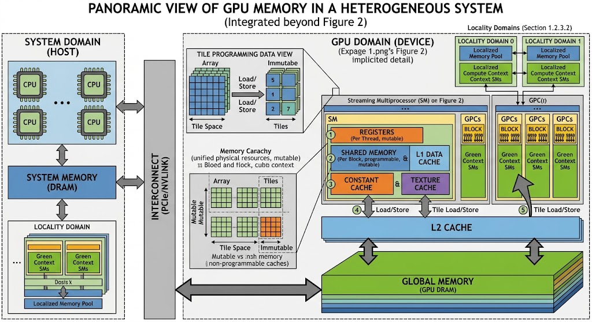

# GPU Memory：分类、容量与程序控制

写 CUDA kernel 时，程序既要决定大数组放在哪里，也要决定每个线程保留多少临时值、一个线程块共享多少数据。这些选择分别涉及显存、寄存器和 shared memory；执行时，硬件缓存又会参与数据访问。因此，理解 GPU memory 需要同时回答三个问题：**数据实际存在哪里、哪些线程能访问、程序能控制到什么程度。**

本文以 NVIDIA 独立 GPU 和 CUDA C++ 为范围，先区分物理存储与编程模型，再列出容量，最后用一个 kernel 说明控制方式。SM（Streaming Multiprocessor，流式多处理器）是执行线程块的硬件单元；一个 GPU 有多个 SM，一个 SM 可以同时驻留多个线程块，每个线程块又包含多个线程。

# GPU 存储层级与 CUDA 地址空间

## GPU 存储的物理层级

GPU 的主要数据存储可以按位置分为以下层级：



| 物理存储 | 所在位置与共享范围 | 容量量级 | 管理方式 |
| --- | --- | --- | --- |
| Register file（寄存器堆） | 每个 SM 内，分配给驻留线程 | 每 SM 数百 KiB | 编译器分配寄存器，硬件按执行资源限制驻留线程 |
| Shared memory / L1 / texture 的统一存储资源 | 每个 SM 内 | 每 SM 一百到数百 KiB | Shared 部分由程序使用，cache 部分由硬件维护 |
| Constant cache（常量缓存） | SM 内 | 数 KiB | 硬件缓存常量读取 |
| L2 cache | GPU 片上，供各 SM 访问 | 整 GPU 数 MiB 到上百 MiB | 硬件维护，可提供部分缓存策略提示 |
| Device DRAM（显存） | GPU 计算芯片之外；采用 HBM 或 GDDR | 整 GPU 数 GiB 到数百 GiB | 程序通过 CUDA 分配、释放和传输数据 |

其中，寄存器堆、shared memory、SM 内的缓存和 L2 都是片上存储；global memory 所在的 Device DRAM 则位于 GPU 计算芯片之外。片上资源离执行单元更近，但容量远小于 Device DRAM。HBM 即使与 GPU 处于同一封装内，仍属于片外的 Device DRAM。上表是量级说明，具体产品的数值见后文。[CUDA 内存空间与物理位置](https://docs.nvidia.com/cuda/cuda-c-best-practices-guide/index.html#device-memory-spaces)

这些容量也不能全部相加当作“可用显存”：cache 保存的是后备存储中数据的缓存副本，寄存器和 shared memory 则服务于正在执行的 kernel，不能拿来分配一个长期保存模型权重的大数组。

## CUDA 地址空间决定可见性与使用方式

CUDA 中的 global、local、shared、constant 等名称，说明程序如何访问数据。它们与物理存储的对应关系如下，表中的 shared 先按普通线程块讨论。

| CUDA 概念 | 通常由什么物理资源承载 | 谁能访问 | 生命周期与程序入口 |
| --- | --- | --- | --- |
| Global memory | Device DRAM，访问可经过 L1/L2 | 持有有效地址的 GPU 线程 | 例如 `cudaMalloc` 分配至 `cudaFree` 释放；设备全局变量另有其生命周期 |
| Registers | SM 内的寄存器堆 | 所属线程 | 线程执行中的临时值，由编译器分配 |
| Local memory | Device DRAM，访问可被缓存 | 所属线程 | 编译器为线程的局部数组、栈或寄存器溢出值安排存储 |
| Shared memory | SM 内的 shared SRAM | 同一线程块中的线程 | 随线程块存在；通过 `__shared__` 声明 |
| Constant memory | Device DRAM，读取经 constant cache | GPU 线程可读，host 可通过 API 更新 | `__constant__` 声明，生命周期属于 CUDA context |
| Texture / surface | 绑定的设备内存资源，如 CUDA array | 持有相应对象的线程 | 程序创建资源及对象；texture 提供采样读取，surface 支持读写 |

最容易混淆的是 local memory：**local 指线程私有，不代表位于 SM 内。** 一个局部变量可能被优化掉、放进寄存器，也可能落到 local memory；不能仅凭它写在函数体内就判断物理位置。同样，C++ 的 `const` 只约束修改行为，不能代替 `__constant__` 指定 CUDA constant 地址空间。[CUDA 各地址空间的作用域与生命周期](https://docs.nvidia.com/cuda/cuda-programming-guide/02-basics/writing-cuda-kernels.html#gpu-device-memory-spaces)

Host memory（CPU 内存）、pinned memory（页锁定的 CPU 内存）和 Unified Memory 则属于主机与设备之间的分配、访问及迁移机制。`cudaMallocManaged` 提供统一访问的分配，其物理驻留和迁移依赖平台；它不会增加 GPU 的片上 SRAM。这部分涉及数据传输，本文不展开。[CUDA Unified Memory](https://docs.nvidia.com/cuda/cuda-programming-guide/02-basics/understanding-memory.html#unified-memory)

# 容量：先确定按线程、线程块还是整张 GPU 计数

同一个 kernel 会同时受到几种限制：单线程寄存器上限、单线程块 shared memory 上限、每 SM 可供所有驻留线程块使用的资源，以及整张 GPU 的显存容量。每个 SM 的容量不能直接当成每个线程块的容量。

下表选取几个具体架构配置。CC（Compute Capability，计算能力版本）用于区分 CUDA 硬件能力；即使属于同一代架构，不同 CC 的资源也可能不同。片上容量统一用 KiB，$1\,\mathrm{KiB}=1024\,\mathrm{B}$；这些架构文档通常把相应数值记作 KB。

| 资源及计数范围 | Ampere A100，CC 8.0 | Ampere，CC 8.6 | Hopper H100，CC 9.0 | Blackwell B200，CC 10.0 |
| --- | ---: | ---: | ---: | ---: |
| 寄存器 / SM | 65,536 × 32 bit = 256 KiB | 256 KiB | 256 KiB | 256 KiB |
| 寄存器 / 线程上限 | 255 个 32-bit 寄存器 | 255 个 | 255 个 | 255 个 |
| L1 / texture / shared 统一资源 / SM | 192 KiB | 128 KiB | 256 KiB | 256 KiB |
| Shared memory / SM 上限 | 164 KiB | 100 KiB | 228 KiB | 228 KiB |
| Shared memory / 线程块上限，需 opt-in | 163 KiB | 99 KiB | 227 KiB | 227 KiB |

数据来源：[Ampere Tuning Guide](https://docs.nvidia.com/cuda/ampere-tuning-guide/index.html#occupancy)、[Hopper Tuning Guide](https://docs.nvidia.com/cuda/hopper-tuning-guide/index.html#occupancy)、[Blackwell Tuning Guide](https://docs.nvidia.com/cuda/blackwell-tuning-guide/index.html#occupancy)。寄存器按 32-bit 单元计数，例如一个 64-bit 值通常需要两个这样的单元。

以 H100 为例，**256 KiB 是整个统一资源的容量，228 KiB 是其中最多可配置给 shared memory 的容量，227 KiB 是一个线程块最多可寻址的 shared memory。** CUDA 还会为每个线程块保留 1 KiB shared memory；228 与 227 的差额属于这项保留，不能解释成“剩余部分都留给 L1”。[H100 的 L1/shared 划分与保留空间](https://docs.nvidia.com/cuda/hopper-tuning-guide/index.html#unified-shared-memory-l1-texture-cache)

其余容量要用各自的计数范围理解：

| 资源 | 容量示例或上限 | 如何理解 |
| --- | --- | --- |
| Constant 地址空间 | 上述 CC 配置为每设备 64 KiB | 用户常量数据的总空间，不是每线程或每 SM 各有 64 KiB |
| Constant cache 工作集 / SM | 上述 CC 配置为 8 KiB | 是缓存工作集，不能与 64 KiB constant 空间混为一谈 |
| Local memory / 线程 | 架构限制为最多 512 KiB | 不是预先为每个线程分配 512 KiB；实际占用由编译结果决定，还受运行时栈限制等约束 |
| L1 / texture cache | 随架构与 shared carveout 改变 | 在这些架构上使用统一资源，不能再额外加上一块固定大小的 texture cache |
| L2 / 整 GPU | A100 为 40 MiB；H100 为 50 MiB | 是具体 GPU 的缓存容量，不是每个 SM 的容量 |
| Device DRAM / 整 GPU | A100 有标称 40 GB 的型号；H100 有标称 80 GB 的型号 | 产品容量保留厂商 GB 标法；程序可见字节数与当前可分配空间应查询运行时 |

常量、local 及缓存限制见 [CUDA Compute Capabilities](https://docs.nvidia.com/cuda/cuda-programming-guide/05-appendices/compute-capabilities.html)；L2 与显存示例见 [A100 Memory System](https://docs.nvidia.com/cuda/ampere-tuning-guide/index.html#memory-system) 和 [H100 Memory System](https://docs.nvidia.com/cuda/hopper-tuning-guide/index.html#memory-system)。这些示例不代表所有 Ampere、Hopper 或 Blackwell 产品的容量范围。

容量之外，访问时间还取决于缓存命中、访问合并、shared memory 的 bank conflict（同一存储分组上的访问冲突）等因素。因此，不宜给每种 memory 写一个通用的固定周期数；应针对具体 GPU 与访问模式测量。[CUDA 内存访问性能](https://docs.nvidia.com/cuda/cuda-c-best-practices-guide/index.html#memory-optimizations)

# 程序控制：显式分配、影响编译、提供缓存提示

硬件容量固定，但程序使用它们的方式不同。“可以控制”需要进一步区分为：能指定字节数和内容、能影响编译器分配，还是只能给缓存策略提供提示。

| 资源 | 程序可以控制什么 | 控制边界 |
| --- | --- | --- |
| Global memory | `cudaMalloc` / `cudaFree` 控制分配生命周期；kernel 和拷贝 API 控制内容 | 不能扩大物理显存，也不能决定每次访问是否命中 cache |
| Shared memory | 静态声明数组大小；启动时指定动态 shared 字节数；显式读写和同步 | 每线程块请求必须满足上限，同一 SM 上的驻留块还会共同消耗资源 |
| Registers | 调整临时值数量、存活区间、展开程度；用 `-maxrregcount` 等约束编译 | 普通 CUDA C++ 不能像 `malloc` 一样申请寄存器，也不能保证某个变量始终位于寄存器 |
| Local memory | 改写局部数组和临时值以减少占用；必要时配置线程栈上限 | 具体放置由编译器决定；设置栈上限不会把 local memory 变成片上存储 |
| Constant memory | `__constant__` 声明，host 用 `cudaMemcpyToSymbol` 更新 | kernel 只读；constant cache 的填充与替换由硬件处理 |
| L1 / texture cache | 影响访问模式；对支持的架构设置 shared/L1 划分偏好 | 不能直接分配 cache 数组，也不能锁定某条数据始终留在 L1 |
| L2 cache | 支持时设置 persisting L2 的预留量与 access policy window | 是保留优先级提示，不是显式放置或保证命中 |

寄存器与 local memory 的编译控制见 [CUDA Registers / Local Memory](https://docs.nvidia.com/cuda/cuda-programming-guide/02-basics/writing-cuda-kernels.html#registers)。L2 的策略通过 `cudaDeviceSetLimit(cudaLimitPersistingL2CacheSize, ...)` 和 stream 等对象上的访问策略窗口配置，且有设备及运行模式限制，例如 MIG（Multi-Instance GPU，多实例 GPU）模式下不支持 L2 set-aside。[CUDA L2 Cache Control](https://docs.nvidia.com/cuda/cuda-programming-guide/04-special-topics/l2-cache-control.html)

## Shared memory 的三个设置各有含义

Shared memory 的空间配置涉及三个层面：本次启动为每个线程块申请多少动态空间、kernel 允许使用的动态空间上限，以及 SM 内 shared 与 L1 的资源划分偏好。程序主要通过下面三个设置分别影响这些层面；它们作用不同，不能互相替代：

| 设置 | 含义 |
| --- | --- |
| `kernel<<<grid, block, dynamic_bytes>>>(...)` | 这次启动中，**每个线程块**申请的动态 shared 字节数；静态 shared 占用另计 |
| `cudaFuncAttributeMaxDynamicSharedMemorySize` | 为这个 kernel 请求更高的动态 shared 使用上限；它本身不构成本次启动的实际分配 |
| `cudaFuncAttributePreferredSharedMemoryCarveout` | 对 SM 内 shared/L1 资源划分提出偏好；驱动可调整，且只能采用硬件支持的配置 |

上述架构中，使用超过 48 KiB shared memory 的线程块需要动态 shared memory 和显式 opt-in。例如，一个没有静态 shared 声明、需要 64 KiB 动态 shared 的 kernel，要先通过 `cudaFuncSetAttribute` 将 `cudaFuncAttributeMaxDynamicSharedMemorySize` 设为至少 `64 * 1024`，再在启动的第三个参数传入 `64 * 1024`。仅设置 carveout 偏好并没有完成这两步。

程序应检查 API 返回值，并保证“静态 shared + 请求的动态 shared”不超过设备的 opt-in 上限。[CUDA 执行控制 API](https://docs.nvidia.com/cuda/cuda-runtime-api/cuda_runtime_api/group__CUDART__EXECUTION.html)

## 一个 kernel 中的数据分别放在哪里

下面的 kernel 把输入按每 256 个元素分块，在块内倒序并乘以一个系数。它用 shared memory 展示线程间的数据交换；示例关注存储关系，不表示这是该运算的最优实现。

```cpp
#include <cuda_runtime.h>

constexpr int kThreads = 256;
__constant__ float scale;

__global__ void reverse_tiles(const float* input, float* output) {
    extern __shared__ float tile[];
    const int t = threadIdx.x;
    const int base = blockIdx.x * blockDim.x;

    const float value = input[base + t];
    tile[t] = value;
    __syncthreads();

    output[base + t] = scale * tile[blockDim.x - 1 - t];
}
```

以下为 host 端调用片段。将元素总数记作 $N$，host 代码中的变量 `count` 保存这个数；`input` 和 `output` 分别指输入、输出数组。假设 `count` 为正数且是 256 的整数倍，两个数组已在设备上分别分配至少 `count * sizeof(float)` 字节，且输入已初始化。完整程序还需检查 CUDA API 返回值及 kernel 执行错误，并在读取结果前等待 kernel 完成。

```cpp
const float host_scale = 2.0f;
cudaMemcpyToSymbol(scale, &host_scale, sizeof(host_scale));
const int blocks = count / kThreads;
reverse_tiles<<<blocks, kThreads, kThreads * sizeof(float)>>>(input, output);
```

根据这个元素总数和 kernel 启动配置，可以算出不同范围的占用：

- `input`、`output` 的数组内容位于 global memory，各占 $4N$ 字节；指针变量本身不等于数组内容。
- `tile` 是每个线程块独立的一份 shared memory，占 $256\times4=1024$ 字节。`__syncthreads()` 保证块内所有线程写完后再读取其他线程的元素。
- `t`、`base`、`value` 等线程临时值由编译器安排，通常使用寄存器；准确数量要看编译结果，不能简单按源代码变量数计算。
- `scale` 占 4 字节 constant 地址空间。一个 warp（32 个线程组成的执行组）读取相同常量地址时可以利用广播；读取多个不同地址时，请求会按不同地址拆分。
- 对 `input` 的读取可由 cache 命中来服务，也可能需要访问显存。代码没有为 L1/L2 分配副本，cache 的填充与替换由硬件管理。

常量广播机制见 [CUDA Constant Memory](https://docs.nvidia.com/cuda/cuda-c-best-practices-guide/index.html#constant-memory)。例子也说明，“shared 是程序管理的”具体意味着程序决定搬入哪些值、如何索引以及何时同步；硬件 cache 则根据普通内存访问自动工作。

# 资源占用会限制同一 SM 上的并发

前面介绍的寄存器和 shared memory 控制项会影响同一 SM 的并发度：驻留线程块共同消耗这两类资源，一个线程块用量越大，可能同时驻留的线程块就越少。因此，减少对显存的重复读取可能以降低并发度为代价，需要一起衡量。

例如，假设每 SM 有 65,536 个 32-bit 寄存器，每块 256 个线程，编译结果为每线程 64 个寄存器。暂不考虑分配粒度，仅按寄存器预算计算：

$$
R_{\mathrm{block}}=256\times64=16{,}384,\qquad
B_{\mathrm{registers}}=\left\lfloor\frac{65{,}536}{16{,}384}\right\rfloor=4.
$$

这只说明寄存器预算允许最多 4 个这样的块；实际驻留数还要满足 shared memory、线程数、warp 数、block 数及硬件分配粒度等限制。可以用 `cudaOccupancyMaxActiveBlocksPerMultiprocessor` 查询给定 kernel 和启动配置下的驻留块数。Occupancy 指活跃 warp 数相对硬件上限的比例，并不等于计算单元利用率或性能。[CUDA Occupancy](https://docs.nvidia.com/cuda/cuda-c-best-practices-guide/index.html#occupancy)

强行降低寄存器上限可能使部分值溢出到 local memory，增加访存。因此，“寄存器越少越快”并不成立。较新的 CUDA 还支持显式启用 shared memory spilling；这会消耗 shared memory，需要单独计入资源预算。[CUDA shared memory spilling](https://developer.nvidia.com/blog/how-to-improve-cuda-kernel-performance-with-shared-memory-register-spilling/)

# 查询实际设备与 kernel 的用量

上一节用寄存器预算估算了驻留块数，并指出实际结果还取决于 shared memory、线程数和硬件分配粒度等约束。要把这个估算用于具体 kernel，需要查询目标设备的资源上限和 kernel 编译用量；若还要判断大数组能否分配，则需另外查询当前可用显存。

| 要确认的信息 | CUDA 查询入口或字段 | 单位 / 含义 |
| --- | --- | --- |
| 当前设备及 CC | `cudaGetDevice`；`cudaGetDeviceProperties` 的 `name`、`major`、`minor` | 明确正在查询哪张卡 |
| 设备总显存与当前空闲量 | `totalGlobalMem`；`cudaMemGetInfo` | 字节；空闲量会随其他分配变化 |
| 寄存器上限 | `regsPerMultiprocessor`、`regsPerBlock` | 32-bit 寄存器数量，不是字节 |
| Shared 上限 | `sharedMemPerMultiprocessor`、`sharedMemPerBlock`、`sharedMemPerBlockOptin` | 字节；分别区分每 SM、普通每块限制和 opt-in 每块限制 |
| L2 与 constant 容量 | `l2CacheSize`、`totalConstMem` | 字节；后者是 constant 地址空间容量 |
| Kernel 编译用量 | `cudaFuncGetAttributes` 的 `numRegs`、`sharedSizeBytes`、`localSizeBytes` | 分别是每线程寄存器数量、每块静态 shared 字节数、每线程 local 字节数 |
| 本次动态 shared 用量 | kernel 启动的第三个参数 | 每块字节数；需与静态 shared 一起考虑 |

字段定义见 [cudaDeviceProp](https://docs.nvidia.com/cuda/cuda-runtime-api/cuda_runtime_api/structcudaDeviceProp.html)、[cudaFuncAttributes](https://docs.nvidia.com/cuda/cuda-runtime-api/cuda_runtime_api/structcudaFuncAttributes.html)；编译时也可以用 `nvcc --ptxas-options=-v` 查看寄存器与 spill 等报告。这些信息说明资源分配，不直接证明 cache 命中率或运行速度，后两者需要针对实际执行进行测量。

有两类扩展不应硬塞进上述普通线程块模型：Hopper 的 distributed shared memory 允许 cluster 内的线程块访问彼此的 shared memory，仍使用各块已有的 shared 资源；Blackwell SM100 的 Tensor Memory 是供特定 Tensor Core 操作使用的专用片上存储，有专门的分配与访问指令。它们分别扩展协作范围和矩阵计算数据路径，本文不展开其编程方式。[Hopper Thread Block Clusters](https://docs.nvidia.com/cuda/hopper-tuning-guide/index.html#thread-block-clusters)、[CUTLASS Blackwell SM100](https://docs.nvidia.com/cutlass/4.2.1/media/docs/cpp/blackwell_functionality.html)

判断一个 CUDA 数据对象时，可以依次检查：它使用哪个地址空间、背后是哪种物理资源、容量按什么范围计数，以及程序能控制的是内容和分配，还是编译与缓存策略。这样就能把“显存够不够”“每块 shared 是否超限”“寄存器是否限制并发”和“cache 是否有效”分成可分别验证的问题。
