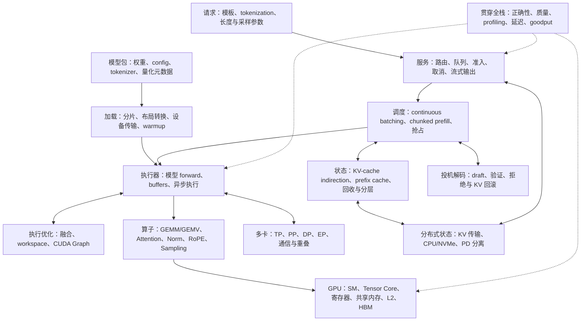

# LLM Inference 学习路线图

更新日期：2026-10-31。资料优先采用官方文档、原始论文和项目源码；文档中的 `latest` / `main` 会变化，做实验时固定实际使用的版本或 commit。

## Current checkpoint and next work

Qwen2.5-0.5B-Instruct runs through Scheduler -> Runner -> CausalModel with packed
ragged GPU batches, streaming greedy generation, session continuation, reusable
scratch and metrics. Continuous batching and token-budgeted chunked prefill are
implemented. Qwen supports native BF16/mixed precision and FP32, with eager execution and an optional decode CUDA Graph path in W8.

### Immediate target: a comparable Qwen benchmark against SGLang

The three comparison-alignment tasks are GPU token feedback/CPU overlap,
Qwen CUDA Graph, and native BF16 execution. The first task initially proposed CPU
decoding every 64/128 tokens; we instead chose asynchronous readback and one-round
submission-first overlap, preserving per-token EOS and continuous scheduling.

| Alignment item | Current state | Remaining acceptance |
| --- | --- | --- |
| GPU feedback and submission-first overlap | Implemented; Runner A/B matrix and all 12 Nsight captures validated | Extend to mixed arrivals and other dtypes; the current fixed-cohort speedup is workload-dependent |
| Native BF16 storage and computation | Implemented; BF16 weights, activations and KV with FP32 reductions/accumulation/logits | Numerical/memory smoke checks passed; broader quality/performance and quantization remain separate |
| Qwen CUDA Graph option | Implemented opt-in decode replay; prefill remains eager | Exact eager/replay logits, in-flight ownership and session release validated; matched Graph comparison complete, GPU performance gaps remain |

BF16 is a lower-precision floating-point execution path. It is separate from the
INT8/INT4/FP8 or KV quantization experiment: loading BF16 weights into FP32 tensors
is not BF16 execution, and BF16 support must not mark quantization complete.

### Overlap: implementation and fixed-cohort performance validation complete

- Runner submits F(N) before waiting/committing/processing F(N-1), using one ordered
  compute stream. GPU token handles feed the next forward without a CPU-ID/H2D round trip.
- CausalModel::enqueue_append_batch handles stream checks, queued KV reservation
  and context restoration. KVContext stores ready_len plus at most two pending_ends;
  FIFO commit follows the matching completion, never submission alone.
- GpuTokenReadback provides one shared deferred D2H per output batch on an independent
  stream, with reusable pinned buffers. CPU token acceptance, EOS and text decoding
  still happen per token; there is no fixed 64/128-token CPU blackout or unbounded GPU queue.
- Qwen enables overlap by default; [the example](rust/engine/examples/qwen2.rs) exposes
  --disable-overlap for the serial baseline. EOS can leave one extra submitted step,
  which drains before cleanup. Gate tests cover handoff/lifetime behavior and regressions
  cover FIFO, mixed/reordered feedback, streaming and session continuation.
- Latest release regression evidence: 82 engine tests and 3 compile-fail doc tests
  passed; the real-checkpoint opt-in test is excluded from that count. Earlier real-weight
  serial/overlap smoke runs separately matched the FP32 CPU reference and released KV.

[Runner benchmark](rust/engine/benches/qwen2_runner.rs) and
[comparison/Nsight analyzer](rust/engine/benches/qwen2_runner_compare.py) now measure
serial and overlap on identical cohorts. The local
[report](rust/profiling/qwen2/runner-overlap/RESULTS.md) preserves commands, native
samples, memory and profiler captures: three independent processes per mode/case,
batch 1/2/4, input 32/4096, 64 outputs. Short batch 2 improves about 8% by process
medians; other cases are small/noisy or approximately flat. Every overlap trace
completes the next submission before the previous D2H in 63/63 adjacent pairs;
serial is 0/63. CPU accept and D2H genuinely intersect subsequent GPU work.

Keep the measurement boundaries separate: [benches/qwen2.rs](rust/engine/benches/qwen2.rs)
retains its per-step CPU-readback baseline and now supports --gpu-feedback for
static model comparisons. That mode uses forward().await, keeps predictions on
GPU, checks final IDs against an untimed host-feedback control and reads final IDs
outside timers. It does not exercise Runner serving overlap. The official SGLang
static loop likewise synchronizes after each step; its serving scheduler is separate.

The BF16 static comparison is reproducible with:

```bash
/usr/bin/python3 rust/engine/benches/qwen2_sglang_compare.py --model-dir MODEL_DIR --include-rust-graph --include-sglang-graph
```

This runs eager against eager and Rust decode Graph against SGLang decode Graph;
B=1/2/4, input=32/4096, 64 outputs, two warmups, three measured samples and three
independent process repetitions. Engine order rotates and GPU jobs run sequentially.
Both use the same snapshot and 16640 physical KV token slots for this matrix.
Raw samples, frozen sources/binary, backend/capture logs and version/hardware metadata
are retained with the local [static comparison report](rust/profiling/qwen2/sglang-comparison/RESULTS.md).
The completed Runner A/B is not a SGLang serving-performance result.

Initial measured result: eager short-context decode is 26-31% lower latency in
Rust, but 4K prefill is about 12x slower than SGLang FlashInfer. SGLang decode Graph
is faster still; Qwen decode Graph is an opt-in W8 extension. Three independent process
repetitions per case support the observed directions, not serving or quality claims.
A separate Nsight capture confirms 64 Rust forwards followed by one final 4-byte
D2H, with no per-step readback. Profile BF16 long prefill next to distinguish
attention from linear cost before selecting kernel changes.

Follow-up release/Nsight work closes the BF16 eager 4K prefill gap: repeated-token
B1/B2/B4 medians are 92.36/182.32/366.40 ms versus SGLang 94.68/184.42/369.93 ms.
A second three-process matrix with varied ramp IDs also reaches parity. The isolated
changes are attention MMA, finite linear M/N buckets, GQA reuse, bounded pointwise
row tiles and up/SwiGLU fusion; small/FP32 paths and model/KV APIs are retained.
See the [experiment summary](rust/profiling/qwen2/bf16-eager-tuning/SUMMARY.md) for
protocol, raw artifacts, validation, allocator scopes and the retained BF16 argmax-tie
case. This establishes static-model prefill parity on this GPU, not serving or
quality equivalence. Adaptive split-KV decode and optional Qwen CUDA Graph replay are part of W8.

### Next sequence and comparison protocol

1. Completed: Runner serial/overlap release comparison and Nsight validation with
   fresh KV, exact full-batch assertions, stable output text/counts and scratch/KV
   release checks. See the benchmark header or run:
   /usr/bin/python3 rust/engine/benches/qwen2_runner_compare.py --model-dir MODEL_DIR --dtype f32 --profile.
   Native timing determines speedup; separate captures validate ordering and overlap.
   Retain the serial mode and evaluate mixed arrivals/chunk budgets separately.
2. Completed: profile and optimize BF16 long prefill against SGLang eager at B1/2/4.
   Completed: matched Rust/SGLang eager and Graph comparison. Graph improves our
   own decode by16–25%, but 4K Graph remains13%/37%/58% slower than SGLang at
   B1/B2/B4 in the initial comparison. Grouped decode MMA, packed QKV and skinny
   down-projection split-K are now implemented; retain the controls and compare their new measurements separately.
3. Implemented: native BF16 Qwen execution (pulled forward into W7). Keep FP32 as the
   numerical reference; validate BF16 tolerances and accumulation rather than
   requiring every generated token to match FP32 bit-for-bit.
4. Static BF16 comparison implemented; retain fixed versions, model revision, dtype,
   graph mode, batch/lengths, stopping/cache policy and timing boundaries. Alternate
   engines and collect at least three independent runs before drawing conclusions.
   Label FP32-vs-BF16 or mismatched-readback results as diagnostic. Align counts:
   Runner output_tokens = SGLang output_len; the older Rust model bench uses
   decode_steps = output_len - 1 (64 outputs means 63 decode steps after prefill).
5. Use those measurements to choose further kernel work. Radix prefix caching is
   now W9; a true quantization path remains a separate W7 follow-up. Mixed long/short
   arrival interference and budget tuning remain open. Adaptive split-KV decode is implemented in W8; its static-model gains do not establish serving gains.

### SGLang benchmark recipe and measurement boundary

Reference entry: installed SGLang **0.5.9**, sglang.bench_one_batch. Use our
[adapter](rust/engine/benches/sglang_qwen2.py), which replaces synthetic input
preparation and repeated sampling but leaves SGLang model kernels unchanged.
Version changes require rechecking the adapter; use the same HF snapshot/revision
as Rust. The matrix driver above is the preferred measured protocol; the following runs the SGLang adapter alone.

```bash
# Run from the repository root; replace with the same local checkpoint used by Rust.
MODEL_DIR=/absolute/path/to/Qwen2.5-0.5B-Instruct/snapshot
RESULT_DIR=rust/profiling/qwen2/sglang-comparison
mkdir -p "$RESULT_DIR"
CUDA_HOME=/usr/local/cuda HF_HUB_OFFLINE=1 ~/.venvs/py3.12/bin/python \
  rust/engine/benches/sglang_qwen2.py \
  --model-path "$MODEL_DIR" --dtype bfloat16 --mem-fraction-static 0.5 \
  --context-length 8192 --disable-cuda-graph \
  --batch-size 1 2 4 --input-len 32 4096 --output-len 64 \
  --comparison-warmup 2 --comparison-iterations 3 \
  --result-filename "$RESULT_DIR/sglang-bf16-eager.jsonl"
```

For a separate graph-enabled baseline, omit --disable-cuda-graph and use a different
result filename, such as sglang-bf16-graph.jsonl. Record the actual graph capture/
replay shapes and attention backend in addition to the requested setting. Result files
are appended; use a new filename/run directory for each independent experiment.

| Setting | SGLang adapter | Rust comparison requirement |
| --- | --- | --- |
| Inputs | Every request uses token ID 9707 repeated to input_len; batch 1/2/4, length 32/4096 | Same token IDs, batch sizes and cached-prefix state |
| Generation | Greedy temperature=0; one prefill plus output_len-1 decode steps; fixed loop without EOS early exit | Equal number of forwards and actual outputs; output_len=64 matches decode_steps=63 |
| Cache/warmup | Fresh Req objects and cleared request/KV allocation state per run; weights and runtime caches stay warm | Fresh request KV for every warmup/measured sample; keep weights/workspaces warm |
| Samples | Two adapter warmups and three measured runs per configuration; upstream also has a first-case warmup | Separate warmup and measurement; repeat at least three independent process runs |
| Precision/graphs | BF16; explicit eager baseline, then a separate graph-enabled run | Native BF16 required for matched-dtype claims; graph modes must match |
| Scope | One fixed batch through ModelRunner, no HTTP, request queue or text decode | Compare to a model-level path first; serving latency is a separate experiment |

**What the upstream timer measures:** latency_test_run_once clears both
req_to_token_pool and token_to_kv_pool_allocator. Prefill and every decode step
use device synchronization around a host perf_counter interval. The measured wall
time includes CPU step preparation/submission and GPU completion; it is not pure
CUDA-event kernel time. The latency loop passes sampled IDs directly on GPU:

```python
next_token_ids, _, batch = extend(reqs, model_runner)
# decode() assigns batch.output_ids = next_token_ids before preparing the next step.
next_token_ids, _ = decode(next_token_ids, batch, model_runner)
```

extend() constructs ScheduleBatch with **enable_overlap=False**, and the latency
loop synchronizes after each step. Consequently this benchmark does not exercise
SGLang's serving overlap scheduler, continuous arrivals, cancellation or text D2H/
decoding. It cannot establish whether our Runner overlap matches SGLang serving.
For a later serving A/B, compare the resolved default overlap configuration against
--disable-overlap-schedule, keeping graph/dtype/workload settings identical and
checking the actual timeline; do not substitute this static benchmark for that test.
Keep two experiments distinct: model-step timing with GPU-resident sampled IDs,
and an independent Runner/server serial-vs-overlap test with matching delivery policy.
The direct Rust benchmark defaults to pinned D2H per step. The comparison driver
explicitly selects --gpu-feedback to exclude per-step D2H in its static model timings.

**Results to retain:** adapter output includes version/dtype/graph settings, batch/
input/output lengths, warmup/iteration counts and raw samples. prefill_mean_seconds
is the mean prefill latency; decode_median_seconds is the median of per-run median
decode latencies. output_len=1 has no decode and reports null. Upstream decode
throughput is batch_size / median_decode_latency; overall_throughput uses
(input_len + output_len) * batch_size / total_latency, counting input and output
tokens together. Compare that only with the same definition; Runner output tokens/s
and request/first-text latency are separate metrics. Preserve raw JSONL and launch
settings under rust/profiling/qwen2/sglang-comparison; disable profiling/tracing for
latency samples and capture a separate diagnostic run when needed.

### Completed kernel groundwork

Packed Qwen profiling is recorded in the local
[packed report](rust/profiling/qwen2/packed-nsys/RESULTS.md). The initial
[attention tiling](rust/profiling/qwen2/attention-tiling/RESULTS.md) diagnostic reduced
B1/4K prefill from 32.86 s to 5.78 s and decode from 45.19 ms to 17.28 ms/step.
Subsequent [batch tuning](rust/profiling/qwen2/batch-tuning/RESULTS.md) covers
32/4096-token inputs at batch 1/2/4: linear uses 16x64 tiles for at least 16 packed
rows and 4x32 otherwise; SM120 occupancy targets are 2 for linear and 4 for attention.
These historical FP32 kernel comparisons do not establish an overlap or SGLang speedup.

Unit labels describe implementation/learning milestones. W4 establishes Graph
foundations; W8 extends them to Qwen and groups real-model kernel optimization; BF16 alignment is prioritized before W9 prefix caching. W10 onward
remains unchanged.

## 1. 目标、投入与学习边界

**Goal: learn inference mechanisms by extending one working engine: start with the smallest MLP, validate execution and state-management techniques on that model, then support Qwen2.5-0.5B-Instruct. Each phase leaves a reproducible baseline; production completeness and performance records are not required.**

已有基础：Rust / 系统性能优化经验；熟悉推理主链路；已有 [llm-inference-calculator](https://github.com/pochenai/llm-inference-calculator)，理解 roofline、显存容量、KV 和并行布局等静态成本模型。因此不从 Transformer 入门课程重新开始。

- 时间：**15 周，每周 20–30 小时，总计约 300–450 小时**。周数表示学习单元，可按验收情况调整，不要求连续租 GPU。
- Hardware: use the existing single-GPU environment for the toy engine and initial Qwen2.5-0.5B-Instruct validation. Rent a larger GPU only for a specific experiment; W12–W14 can use two GPUs as originally planned. Record memory capacity and topology for comparisons.
- 深度：每类抓住 2–4 个核心概念，完成一个代表性实验。能解释、能定位源码、能复现现象，即可进入下一类。
- 产出：每周一个轻量实验产物和一页结论。博客、公开代码、issue / PR 都可由它们自然产生，**不要求每周发布，也不要求发现创新点**。
- 选题：使用现有项目时记录问题，学完一轮后再讨论是否值得做开源项目。

### 学明白的统一标准

对每项核心技术，能不看资料回答四个问题：

1. 它解决什么问题？什么 workload 下问题最明显？
2. 它改变了计算量、数据流量、容量、调度或通信中的哪一项？
3. 它引入什么成本，什么时候可能没有收益或变慢？
4. 它在现有引擎的什么位置，如何设计实验验证？

通过当周验收后，把进一步优化记到兴趣清单，避免一个 kernel 或框架细节占据数周。

## 2. 整个技术栈地图



The first eight units follow the current implementation sequence. Unit labels
represent learning units rather than calendar weeks; historical commits retain
their original labels.
Profiling and correctness checks apply throughout rather than occupying a separate
prerequisite week.

| Unit | Main change | Evidence / acceptance |
| --- | --- | --- |
| W1 | Model loader: formats, Safetensors, config/tokenizer, host/device storage | Load and round-trip deterministic model weights |
| W2 | Scheduler/Runner framework + minimal MLP; GEMM/ReLU kernels | Concurrent requests, request IDs, channel lifecycle, CPU/GPU agreement |
| W3 | KVPool/KVContext + KV-cache indirection; attention and KV-write kernels | Session continuation, cache addressing, typed views, fused writes, release |
| W4 | CUDA Graph foundations and reusable execution buffers (SimpleMLP) | Pooled replay, dynamic inputs and mapped output; Qwen extension belongs to W8 |
| W5 | Qwen2.5-0.5B-Instruct baseline — Done | Reference logits/tokens, sessions/streaming, scratch reuse, metrics and benchmark |
| W6 | Continuous batching, chunked prefill and submission-first overlap | Implemented; fixed-cohort Runner A/B and Nsight complete; mixed-arrival evaluation pending |
| W7 | Native BF16 Qwen, then a separate quantization path | BF16 implemented; true quantization acceptance remains separate |
| W8 | Qwen kernel and execution optimization, beginning at 52f19b0 | KV-tile/GQA reuse, finite shape buckets, fusion/swizzle, split-KV and optional decode Graph; matched eager/Graph measurements |
| W9 | Radix prefix caching, sharing/reclamation, and cache-aware routing | Cold/hot cache comparison, prefix hits, shared ownership, routing decisions |
| W10 | Speculative decoding | Original plan retained |
| W11 | MLA, MoE, and hybrid state | Original plan retained |
| W12 | Multi-GPU execution | Original plan retained |
| W13 | Distributed KV and prefill/decode disaggregation | Original plan retained |
| W14 | Distributed routing, SLO, and serving semantics | Original plan retained; extends W9's cache-locality routing |
| W15 | End-to-end synthesis | Original plan retained |

Current checkpoint: loader, Scheduler/Runner, KV/attention, SimpleMLP CUDA
Graph and Qwen FP32 generation are implemented. Graph caching uses exact shapes;
Qwen uses eager execution with packed ragged GPU batches. Runner now interleaves
chunked prefill with decode under a token budget and overlaps submission with prior
CPU results; fixed-cohort overlap measurements are complete. Qwen replay,
mixed-arrival evaluation and prefix sharing remain open; BF16 is implemented. See the [engine guide](rust/engine/README.md) for
commands and metric contracts.

多模态编码器、LoRA 服务、structured output、弹性伸缩在扩展表中了解位置；本轮主线覆盖文本自回归 LLM inference，不要求深入所有相邻工作负载。

## 3. 固定学习与实验方式

### 3.1 One implementation spine

- Main implementation: `rust/engine`, using Rust, cuTile, and cuda-async. Keep shared Scheduler/Runner/KV contracts; use Qwen for subsequent performance, scheduling, prefix reuse and quantization experiments.
- Main model progression: deterministic MLP -> MLP with causal attention/KV -> [Qwen2.5-0.5B-Instruct](https://huggingface.co/Qwen/Qwen2.5-0.5B-Instruct). Qwen is now the performance baseline; keep the toy model as a fast regression fixture without a separate synthetic-generation project.
- References: use the local SGLang and vLLM source trees for focused interface/control-flow comparisons. Their production architecture is a reference, not a requirement to reproduce every subsystem.
- Python/PyTorch or Transformers provide independent numerical references and evaluation. Triton/CUDA kernels are optional comparison baselines. Mojo/MAX and torch.compile remain optional follow-up references rather than parallel required implementations.
- Preserve public request/session semantics while changing model/backends. Scheduler handles ingress/routing; Runner owns local session state and execution resources. Add an abstraction when the next concrete implementation requires it.
- Add profiling with each performance experiment: warmup, explicit synchronization/completion boundaries, CUDA events, host submission time, and Nsight Systems/Compute as needed. Keep capture/JIT/initialization separate from steady state.
- Pin source/model revisions and record hardware, dtype, shapes, cache state, and sampling settings. Read only the documentation and source required for the current phase.

### 3.2 每周时间预算

| 工作 | 20 小时版本 | 30 小时版本 |
|---|---:|---:|
| 读资料与源码 | 5h | 7h |
| 跑实验 / 写简单代码 | 10h | 16h |
| 解释结果、整理图表与周记 | 3h | 4h |
| 回答验收问题、记录疑问 | 2h | 3h |

30 小时版本增加重复验证和一个选做项，不增加一整条学习支线。环境排障连续超过约 4 小时，应先尝试官方固定版本示例，或把学习实验缩小；把未完成项如实记录，不能把“读过”算成“跑通”。

### 3.3 每周最低产出

- **一个证据产物**：脚本 / notebook / 运行配置 / 小 patch / 明确标注假设的模拟器，至少选一种。
- **一页结论**：问题、实验设置、结果图或表、原因解释、限制、剩余问题。
- **完成当周验收**：能解释核心机制；需要实测的项目应有原始结果。

“开源项目产出”也可以是使用现有项目的复现配置、源码阅读图或小修复，不等于新建产品仓库。公开博客和 PR 都是可选发布形式；每周的必交项是学习证据。

## 4. Implementation phases and acceptance criteria

```text
model loader
  -> Scheduler / Runner + minimal MLP (GEMM, ReLU)
  -> KVPool / KVContext + token-slot indirection + attention / cache writes
  -> CUDA Graph on SimpleMLP
  -> Qwen2.5-0.5B-Instruct + shared causal steps / Runner streaming
  -> scratch reuse + metrics / benchmarks
  -> profile and optimize Qwen + packed batch execution
  -> continuous batching / chunked prefill / submission-first overlap (implemented)
  -> Runner overlap measurement (validated) -> native BF16 (implemented)
  -> W8: Qwen kernel/split-KV optimization + optional decode CUDA Graph
  -> matched eager/Graph SGLang performance comparison
  -> radix prefix reuse + cache-aware routing; separate quantization follow-up
  -> W10 onward: revisit when these foundations are validated
```

### Phase A: establish the smallest working engine (W1–W3)

#### W1: model loader and storage lifecycle

**Focus**

- Model package boundaries: tensor names/shapes/dtypes, config, tokenizer, and optional generation settings.
- Safetensors, mmap ownership, authoritative shard indexes, host/device loading, and dtype conversion. Loader dtype support does not imply kernel dtype support.
- Retain the earlier format experiments as evidence; use the engine's deterministic tiny weights for execution checks.

**References**

1. [Safetensors documentation](https://huggingface.co/docs/safetensors/index).
2. Local [engine loader](rust/engine/src/runner/loader.rs) and [format experiment](d1_model_formats/README.md).

**Acceptance**

- [ ] Verify single-file/sharded loading, tensor metadata, round-trip serialization, and ownership lifetimes.
- [ ] Compare loaded values against fixtures and report file/storage/device byte counts separately.
- [ ] Missing model directories and existing invalid model directories have distinct behavior; never silently replace invalid checkpoints.

#### W2: Scheduler/Runner framework and the minimal MLP

**Focus**

- Request admission -> candidate batching -> Runner -> Model -> per-request response; independent component construction and shutdown.
- RequestId per invocation, SessionId across invocations, concurrent `&self` APIs, cancellation, and error boundaries.
- Implement the smallest embedding/MLP path with GEMM/GEMV and ReLU; understand tiles, padding, stream submission, and completion.
- Keep CPU weights/references deterministic. Understand allocator and buffer ownership before adding more model operators.

**References**

1. [Engine interfaces and lifecycle](design/spec.md), [engine implementation](rust/engine/README.md), local SGLang Scheduler/ModelRunner, and local vLLM interfaces.
2. [cuTile tutorials](rust/cutile-tutorials) and [Triton matrix multiplication](https://triton-lang.org/main/getting-started/tutorials/03-matrix-multiplication.html) for operator comparisons.
3. [Nsight Systems](https://docs.nvidia.com/nsight-systems/UserGuide/index.html) and [Nsight Compute](https://docs.nvidia.com/nsight-compute/NsightCompute/index.html) when interpreting a concrete trace/kernel.

**Acceptance**

- [ ] CPU/GPU MLP outputs agree for individual and ragged batches, including padding.
- [ ] Concurrent callers receive their own results/errors; IDs, cancellation, and shutdown behave as specified.
- [ ] Explain DeviceOp construction, GPU submission, Tensor handles, stream ordering, and execution completion using one actual call chain.

#### W3: KV architecture, indirection, and attention on the toy model

**Focus**

- KVPool owns physical storage/allocation; KVContext owns ready/pending progress; Runner owns sessions. Logical `(context_row, token_position)` maps through slot_table to physical KV storage.
- Incremental token-slot allocation, typed ReadView/WriteView, in-flight leases, initialization/append/read/write/release, and per-layer cache indexing.
- Add Q/K/V projection, causal attention with online softmax, residual, and KV writes to the MLP. Fuse K/V addressing/writes into projection while retaining the standalone store baseline.
- Token slots and multi-token pages are alternative allocation granularities. The current token-slot implementation already validates non-contiguous KV access; a separate PagedKVPool is optional.

**References**

1. [Current KV contracts](design/spec.md), local SGLang [ReqToTokenPool](../sglang/python/sglang/srt/mem_cache/memory_pool.py) and token/page allocators.
2. [PagedAttention paper](https://arxiv.org/abs/2309.06180) for indirection, sharing, and allocation tradeoffs; [SGLang backend matrix](https://docs.sglang.io/docs/advanced_features/attention_backend) for compatible layouts.
3. [Triton fused attention](https://triton-lang.org/main/getting-started/tutorials/06-fused-attention.html) and [Flash-Decoding](https://pytorch.org/blog/flash-decoding/) for numerical/parallelism references; production-grade kernel tuning is optional.

**Acceptance**

- [ ] Full prefill, chunked appends, and one-token appends match an independent CPU reference; actual K/V entries match projected values.
- [ ] Different sessions remain isolated; nonzero append positions, fragmented slots, and padding do not overwrite another context.
- [ ] Read/write view misuse fails to compile; dynamic bounds and missing pending state fail at runtime. Release waits for in-flight GPU resource ownership.
- [ ] Report pool allocation/mapping bytes and free/assigned capacity. Prefix sharing and radix indexing remain W9 work.

### Phase B: real-model baseline and execution improvements (W4–W9)

#### W4: CUDA Graph and reusable execution buffers

Status: implemented for SimpleMLP; Qwen uses eager execution. See [engine execution notes](rust/engine/README.md),
[graph implementation](rust/engine/src/runner/model/simple_mlp/graph.rs), and the
local [profiling results](rust/profiling/simple_mlp_attn/RESULTS.md). Recent source
milestones include `24a6ce6` (pooled scoped capture) and `60dd84a` (mapped output).

**Focus**

- Separate per-call CPU preparation/KV allocation, graph-replayable GPU computation, and result readback/commit.
- Preallocate tokens, metadata, activations, and output workspace. Keep addresses stable; update per-request contents without recapture.
- Initialize GEMM/GEMV accumulators independently of previous workspace contents. Keep synchronous host readback outside capture.
- Manage pool/weight/workspace lifetime separately from each replay's session leases. Order metadata updates and replay on the same execution stream.
- Current replay is cached by exact packed geometry, KV backing storage, and weight identity. Warmup/capture are separate from steady state; fixed buckets and padding policy can be added with W6 scheduling.

**References**

1. [CUDA Graphs](https://docs.nvidia.com/cuda/cuda-programming-guide/04-special-topics/cuda-graphs.html).
2. Local [cuTile graph example](rust/cutile-tutorials/examples/cuda_graphs.rs), cuda-async 0.4.0 graph implementation, and [vLLM graph design](https://docs.vllm.ai/en/latest/design/cuda_graphs/).

**Completed baseline and evidence**

- [x] Pooled graph instances own fixed input/scratch buffers and mapped host output; concurrent executions use separate instances.
- [x] Replay accepts changed tokens, context rows, slots, and history positions through the uploaded payload; graph tests cover eager agreement, padding, reuse, and lifetime boundaries.
- [x] Per-batch allocation/clearing and separate scalar DtoH commands are removed from the retained graph path. CPU reservation/upload and per-request KV leases remain outside capture.
- [x] Local profiling records startup versus steady state and short/long workloads. The selected implementation bounds inline completion polling at 2 ms and falls back to DeviceFuture completion.

Performance conclusions distinguish graph replay from workspace, upload, mapped
output, and completion-policy changes. Eager and the final graph path have different
host transfer/completion behavior, so their whole-path latency difference must not
be reported as an isolated graph-launch speedup. Bucketed graph replay with changing
membership remains follow-up work; Runner dynamic membership is implemented in W6.

#### W5: Qwen2.5-0.5B-Instruct baseline

Status: Done. The FP32 numerical/lifecycle baseline is implemented. The real
checkpoint uses the shared CausalModel/Runner path. Reusable scratch removes
per-layer temporary accumulation and redundant zero fills. Scheduler observers
report request/first-text timing and actual generated tokens; model counters and
histograms and pool gauges handle concurrent observations without attributing
shared totals to one batch. Packed GPU batches support ragged prefill and decode;
Qwen graph replay, prefix sharing and quantized execution remain open.

**Focus**

- Treat real-model support as architecture integration: config-driven dimensions, repeated decoder layers, GQA, normalization, positions, vocabulary logits, and tokenizer/chat-template/stopping semantics.
- Add the operators missing from the toy model: RMSNorm, RoPE, Q/K/V projection biases, attention output projection, gated SiLU/SwiGLU MLP, final normalization, and tied embedding/LM-head handling as defined by the checkpoint.
- Use the actual config/checkpoint as the authority. The published model has 24 layers and 14 query heads / 2 KV heads; do not generalize the toy model's single head or 16-wide vectors.
- Bring up a supported floating-point compute path first, then enable earlier graph/cache/scheduling and quantization features one at a time. Loading BF16 weights alone does not prove BF16 kernel support.
- Keep the toy model as the fast architecture/lifecycle fixture. Fix interface assumptions exposed by a real model instead of duplicating the whole serving stack.

**References**

1. Official [model card](https://huggingface.co/Qwen/Qwen2.5-0.5B-Instruct), [config](https://huggingface.co/Qwen/Qwen2.5-0.5B-Instruct/blob/main/config.json), tokenizer, and generation settings; pin a revision.
2. The pinned Transformers Qwen2 implementation for independent logits/token references, and local SGLang/vLLM Qwen2 model implementations for execution organization.

**Acceptance**

- [x] Load the real checkpoint and compare final logits/greedy token IDs with an independent Transformers FP32 reference.
- [x] Full/chunked prefill logits, cached decode, reference token IDs, session continuation and KV release are validated.
- [x] Qwen-only benchmark covers fresh-KV warmup/samples, prefill/decode timings, scratch ownership and CUDA-pool peaks; no serving throughput claim is implied.

**Follow-up work (outside W5 acceptance)**

- [x] Profile the release packed GPU path for short/long prefill and decode at batch sizes 1 and 4; separate wall time, kernel time, host submission and readback.
- [x] Add KV-block attention, compare block sizes/occupancy targets, and validate ragged/causal/cache behavior against CPU and real-model references.
- [x] Compare prefill linear tiles and attention occupancy at batch sizes 1, 2 and 4; retain measured improvements with CPU/checkpoint regressions and unchanged workspace capacity.
- [x] Improve long-context decode parallelism against the recorded release baseline.
  W8 shares the prefill GQA/MMA tile with long BF16 decode and merges bounded
  split-KV states; short histories and FP32 retain scalar paths. Continue inspecting
  compiler-generated warp mapping and reductions: source-level tiles do not establish
  FlashInfer's explicit `NUM_WARPS_KV` layout. Keep intra-CTA warp partitioning
  distinct from cross-CTA splitting, and measure each change separately.
- [x] Port optional Qwen CUDA Graph as the comparison-alignment follow-up in W8;
  W6 already supports changing membership and chunked prefill using the packed executor.

#### W6: step-level generation, continuous batching, and chunked prefill

Status: minimal continuous batching, token-budgeted chunked prefill and submission-first
overlap implemented; fixed-cohort Runner serial/overlap measurements and Nsight are
complete, while mixed-arrival workload evaluation remains open.
Runner admits requests at forward boundaries, dynamically changes packed batch membership,
protects active requests' future KV budget, and rejects accidental same-session overlap
under the client-serialized session contract.
Runner's internal MixedChunkPolicy reserves decode tokens and fills the remaining
budget with prefill chunks. It returns borrowed ScheduledRequest entries through
BatchPolicy::plan; intermediate prefill chunks commit KV without
emitting or counting their discarded prediction. The default budget is 512 input
tokens per forward and is configurable through RunnerBuilder. The existing model
API computes an unused LM head on intermediate chunks; measure before separating it.

**Focus**

- Reuse packed Qwen through the completed next_tokens path for serial execution and
  enqueue_forward_and_return_completion for overlap; keep Runner greedy/EOS/length
  handling, per-request errors and completion-before-KV-commit.
- Move from batching whole requests to scheduling model steps: waiting/running requests, token budgets, arrivals, completions, cancellation, and local KV admission.
- Interleave chunked prefill with decode. Maintain the invariant between accepted tokens, computed KV, and any last generated token whose KV is not computed yet.
- Keep Runner lifecycle independent from the ingress Scheduler. Place execution-batch decisions where local KV/workspace capacity is known.

**References**

1. Local SGLang scheduling paths, [vLLM architecture](https://docs.vllm.ai/en/latest/design/arch_overview/), and [nano-vllm](https://github.com/GeeeekExplorer/nano-vllm).
2. [Sarathi-Serve](https://arxiv.org/abs/2403.02310) for chunked-prefill scheduling and latency/throughput tradeoffs.
3. Reuse [inference-perf](https://github.com/kubernetes-sigs/inference-perf) or a bounded synthetic arrival trace as appropriate; no separate benchmark framework is required.

**Acceptance**

- [x] Runner token stepping, EOS/length stopping, session continuation, streaming and independent request completion are covered by regressions.
- [x] Packed and serial Qwen execution agree for ragged prefill, different cached-prefix lengths and decode.
- [x] Dynamic arrivals and session continuations agree with serial generation; existing packed Qwen numerical checks remain required.
- [x] New requests join ongoing decodes, completed requests release resources independently, and shutdown cancellation releases active/pending work. Per-request cancellation remains deferred.
- [x] One-round lookahead, GPU feedback, FIFO KV commits and safe extra-step draining
  are covered by submission/lifetime and Runner regressions.
- [x] Runner serial vs overlap measured under identical fixed-cohort settings;
  36 native processes and 12 Nsight captures validate output, release and ordering.
  Speedup depends on the workload; mixed arrivals are not covered by this result.
- [ ] Compare at least two prefill budgets on the same mixed long/short workload; report request/first-text latency, per-step latency and throughput. Add an explicit Runner-start event before claiming exact queue time.
- [ ] CUDA Graph bucket selection and dynamic metadata remain correct when batch membership changes.

#### W7: native BF16 Qwen and a separate quantization path

Status: Native BF16/mixed precision implemented. Quantization remains planned;
BF16 completion does not satisfy the quantization items below.

**Focus**

- Implement BF16 weight/activation/KV storage and cuTile computation where appropriate;
  document FP32 accumulation and operations kept in FP32. Existing loader dtype support
  is reused; Qwen kernels and NaiveKVPool now support typed BF16/FP32 storage.
- Select one small weight-only or KV quantization path. Understand scale granularity, packing, dequantization, and the kernel/layout contract before adding algorithms.
- Keep quantization algorithm, checkpoint representation, and execution kernel separate; smaller storage does not establish faster inference.
- Measure tensor/logit error and held-out generation quality against the working Qwen FP32 baseline.
- Keep the floating-point path available for Qwen numerical comparisons and regression tests; quantization is a selectable backend rather than a required correctness baseline.

**References**

1. [vLLM quantization](https://docs.vllm.ai/en/latest/features/quantization/) and [quantized KV cache](https://docs.vllm.ai/en/latest/features/quantization/quantized_kvcache/).
2. [Marlin](https://github.com/IST-DASLab/marlin) as an optional example of weight packing/dequantization in compute kernels.

**Acceptance**

- [x] Validate native BF16 prefill/decode against Transformers BF16/CUDA SDPA;
  English/Chinese fixture text, ragged/cached/chunked KV and serial/overlap checks pass.
  At batch 4 / 4096 input tokens, scratch is about 638 MiB vs 1274 MiB in FP32.
  See the local [BF16 validation report](rust/profiling/qwen2/bf16/RESULTS.md) for
  errors, memory and short latency samples; held-out generation quality remains unmeasured.
- [ ] Quantize/dequantize a small linear layer or KV tensor; compare at least two scale granularities with independently computed reference values.
- [ ] Integrate one path into Qwen and compare quality, storage/traffic, workspace and steady-state latency for at least two shapes.
- [ ] State which operations remain floating point and where extra conversion occurs; reuse cache/graph tests for the selected path.

#### W8: Qwen kernel and execution optimization

Status: Kernel optimizations and optional decode Graph implemented and validated.
Matched SGLang Graph comparison is complete; GPU performance gaps remain for review.
This unit starts at `52f19b0d734c1526a3e5be9ee23df6d00f152829`.

**Focus**

- Reuse prefill KV tiles across query rows and GQA heads with BF16 MMA/FP32 accumulation.
  This is within-kernel reuse; cross-request prefix caching remains W9.
- Use finite shape buckets for linear/pointwise tiles and CTA swizzling. Preserve
  small-input/FP32 paths; retain changes based on isolated correctness and timing.
- Fuse projection bias and FFN epilogues, specialize causal K loops, and evaluate
  query ordering, early V loads, FMA and exp2/FTZ with explicit numerical contracts.
- Split long decode histories across CTAs, then stably merge FP32 partial states.
  Fixed split buckets1/2/4/8/16 and bounded per-forward scratch support Graph replay.
- Offer opt-in decode CUDA Graphs through Qwen/Scheduler/Runner and benchmark CLIs.
  Fixed GPU/pinned input buffers carry dynamic row/position/token-address metadata.
  Reuse the eager Transformer stages; never capture request/session leases.
- Separate capture/warmup cost, native latency, GPU kernel attribution, graph cache
  residency and KV release. Compare eager/eager and Graph/Graph on identical settings.

**References**

1. [NVIDIA cuTile flash-attention tuning](https://developer.nvidia.com/blog/tuning-flash-attention-for-peak-performance-in-nvidia-cuda-tile/).
2. [NVIDIA TileGym split-KV decode](https://github.com/NVIDIA/TileGym/blob/main/src/tilegym/ops/cutile/flash_decode.py) and stable split reduction.
3. [NVIDIA cuTile matrix multiply](https://developer.nvidia.com/blog/how-to-write-high-performance-matrix-multiply-in-nvidia-cuda-tile/) for CTA rasterization/swizzling.
4. Existing SimpleMLP Graph implementation and the installed cuda-async capture/replay APIs.

**Acceptance**

- [x] Independent all-query/head CPU attention oracles, partial-tile/sentinel checks,
  cached/ragged/fragmented KV and native BF16 execution pass without relaxed tolerances.
- [x] Three-process BF16 4K prefill/decode experiments at B1/B2/B4; preserve raw
  commands, source/binary hashes and separate Nsight captures under local profiling.
- [x] Optional Graph matches eager logits/tokens on identical real BF16 histories;
  Gate tests cover in-flight instance ownership, and session release restores KV capacity.
- [x] Complete matched eager/Graph SGLang comparison and record per-case gaps honestly.
  The initial Graph comparison is retained as a baseline; grouped GQA decode MMA,
  packed QKV and skinny down-projection split-K reduce the remaining GPU gap.
  Nsight verifies63 Graph launches,413 nodes/launch and one final D2H per measured cohort.
- [x] Reuse GQA packing/MMA for long decode; pack small-M QKV and split skinny
  down-projection K work. B2/B4 linear latency remains a profiling follow-up;
  do not assume additional CPU scheduling can remove kernel time.
- [ ] Evaluate mixed arrivals and held-out generation quality before claiming serving
  throughput or text-quality equivalence. BF16/fast-math argmax changes remain explicit.

#### W9: radix prefix caching, shared ownership, and cache-aware routing

Status: Planned; follows W8 optimization and comparison review.

**Focus**

- Cache identity uses token IDs plus execution namespace, not raw text alone. Match/publish only computed KV and keep cached ownership separate from active-request ownership.
- Add radix prefix lookup, prefix reuse/publication, reference counts, eviction, and shared-state lifecycle; add fork/truncate/COW only where the chosen sharing path requires them.
- Start with one Runner: repeated prefixes avoid repeated prefill. Then route by cached-prefix locality while accounting for load and ownership freshness.
- Prefix lookup/routing must not enter per-layer GPU KV reads/writes. W14 retains the broader distributed routing/SLO plan.

**References**

1. Local SGLang radix cache and scheduler integration; [SGLang paper](https://arxiv.org/abs/2312.07104).
2. [vLLM prefix caching](https://docs.vllm.ai/en/latest/design/prefix_caching/) and its [usage examples](https://docs.vllm.ai/en/latest/features/automatic_prefix_caching/).

**Acceptance**

- [ ] Compare cold/hot cache and unrelated/shared prefixes with identical token histories and model settings; verify exact computed-token savings and outputs.
- [ ] Shared prefixes survive closing one session; eviction cannot reclaim referenced or in-flight KV; final release restores capacity.
- [ ] A small controlled multi-owner routing experiment chooses the appropriate cached owner and handles misses/stale hints; label any mock routing as simulation.
- [ ] Distinguish hit rate, prefill work saved, latency, and throughput rather than treating them as interchangeable.

### Phase C: later algorithms and model families (W10–W11; existing plan retained)

#### W10：投机解码——正确性与收益条件

**重点**

- Draft / verify、接受长度、拒绝采样、目标分布，以及被拒绝 token 对应的 KV 回滚。
- 验证阶段本身有计算成本；接受率高不等于加速比高。
- 了解独立 draft、n-gram、EAGLE 和 MTP 的差别；工程实践只选一种支持良好的方案。
- 理解 batch、输出长度、draft 成本和验证长度如何影响收益。

**资料**

1. 主资料：[Fast Inference from Transformers via Speculative Decoding](https://arxiv.org/abs/2211.17192)。读算法与正确性推导，不只读接受率公式。
2. 主资料：[vLLM Speculative Decoding](https://docs.vllm.ai/en/latest/features/speculative_decoding/)。选择文档中与当前模型匹配的示例。
3. 选读：[EAGLE-3 官方算法说明](https://docs.vllm.ai/projects/speculators/en/latest/user_guide/algorithms/eagle3/)。MTP 的模型侧设计在 W11 的 DeepSeek-V3 报告中查阅。

**产出与验收**

- [ ] 用小词表概率分布实现一次接受 / 拒绝流程，多次采样比较目标频率；写清采样误差，不能把经验频率相近当作数学证明。
- [ ] 对一种现成方案测低 / 较高并发下的速度、接受长度和 draft / verify 开销；与关闭投机的同模型配置比较。
- [ ] 能解释一个低收益场景，并说清保证目标分布的验证逻辑与普通 greedy 对齐有什么区别。

博客候选：**《接受率很高，投机解码为什么仍可能不划算？》**。不训练自己的 draft，不实现多种 tree attention 变体。

#### W11：MLA、MoE 与混合状态模型

**重点**

- MLA 的压缩状态、RoPE 相关部分与执行方式：它不只是把 GQA 的 KV head 数改小。
- MoE 的总参数 / 活跃参数、top-k routing、token dispatch / combine、grouped GEMM 与专家负载不均。
- 了解滑窗、线性 attention / SSM 和混合架构如何改变状态大小与计算路径。
- 区分本周的模型内 expert routing 与 W14 的请求副本路由。

**资料**

1. 主资料：[DeepSeek-V2](https://arxiv.org/abs/2405.04434)。只读 MLA 与 MoE 架构相关部分。
2. 主资料：[DeepSeek-V3 Technical Report](https://arxiv.org/abs/2412.19437)。只读专家负载、推理部署和 MTP 相关部分，跳过训练工程细节。
3. 概览选读：[Mamba-2 / Structured State Space Duality](https://arxiv.org/abs/2405.21060)。只理解状态与执行方式，不要求推导完整算法。

**产出与验收**

- [ ] 画一张 MHA / GQA / MLA / 滑窗 / recurrent state 的状态与成本表，写明各估算的前提；混合模型按层求和。
- [ ] 小模拟：生成均匀与偏斜的 expert assignment，统计每个专家的 token 数和工作量；或用小张量比较逐专家 linear 与批量组织。
- [ ] 能解释为什么“MoE 只有少量活跃参数”不能直接推出权重常驻显存很小，为什么 batch 会改变专家覆盖。

博客候选：**《从 Dense 到 MoE / MLA，原来的推理成本模型哪里需要改？》**。无需租大集群运行完整 DeepSeek。

### 阶段 D：多卡与分布式服务（W12–W14）

#### W12：并行策略、通信与拓扑

**重点**

- TP 切 tensor、PP 切层、DP 做副本、EP 分专家；理解各自的状态与通信。
- All-reduce、all-gather、reduce-scatter、all-to-all、P2P 的数据语义。
- 小消息的启动延迟、大消息的带宽、通信 / 计算重叠、PP bubble 和专家不均衡。
- Sequence / context parallelism 的术语依实现而异：明确究竟切的是 token、激活还是 KV，不把训练中的 sequence parallel 与长上下文推理分片混为一谈。

**资料**

1. 主资料：[vLLM Parallelism and Scaling](https://docs.vllm.ai/en/latest/serving/parallelism_scaling/)。读布局选择与多卡执行约束。
2. 主资料：[NCCL Collective Operations](https://docs.nvidia.com/deeplearning/nccl/user-guide/docs/usage/collectives.html)，配合 [nccl-tests](https://github.com/NVIDIA/nccl-tests)。

**产出与验收**

- [ ] 记录两卡拓扑，对至少四个消息大小测通信；区分测试报告中的 algorithm bandwidth 与 bus bandwidth。
- [ ] 选择单卡能装下的模型，对照单卡、TP=2 和两个单卡副本；固定总 GPU 数比较时，以 TP=2 对两个副本为主。
- [ ] 画一层 TP 的切分与 collective 图，再用一个小张量例子验证等价性；PP / EP 本轮理解数据流即可。

博客候选：**《同样两张 GPU，TP=2 和两个推理副本有什么不同？》**。不手写 NCCL、不优化 all-reduce kernel。不能用 PCIe 测量结论代表 NVLink 集群。

#### W13：分布式 KV、分层存储与 Prefill / Decode 分离

**重点**

- KV 在 GPU、CPU、NVMe 和远端之间的存储 / 传输；区分容量收益与访问延迟。
- 分清模型权重 offload、KV offload、跨请求 KV 复用和 PD 之间的 KV 交接。
- PD 分离消除部分阶段干扰，但引入传输、额外资源配置和负载平衡问题。
- 了解 connector、传输完成通知、目标端容量与失败处理；状态交接不只是发送一个裸指针。

**资料**

1. 主资料：[DistServe](https://arxiv.org/abs/2401.09670)。读资源分离、通信约束与 goodput 目标。
2. 主实践二选一：[vLLM Disaggregated Prefilling](https://docs.vllm.ai/en/latest/features/disagg_prefill/)；或 [LMCache Quickstart](https://docs.lmcache.ai/getting_started/quickstart.html)。
3. 查表选读：[NIXL](https://github.com/ai-dynamo/nixl)、[Mooncake](https://github.com/kvcache-ai/Mooncake)。只看架构与传输层职责，不同时部署多套系统。

**产出与验收**

- [ ] 跑通一条真实数据路径：两卡 PD 交接，或 GPU ↔ CPU 的 KV offload / reuse。记录字节数、传输或加载耗时、TTFT 与状态一致性证据。
- [ ] 画出另外一种机制的数据流，并用实际 KV 大小和可用链路带宽估算成本；明确哪些数字是测量、哪些是估算。
- [ ] 如运行 PD，对照相同 GPU 总数的共置部署；如运行 offload，对照同一预算下的无 offload 配置。能说明收益发生的条件。

博客候选：**《KV 应该重算、保留还是搬运？一次成本对照》**。NVMe、跨机 RDMA 与复杂多层淘汰策略只作概览，不要求全跑。

#### W14：分布式路由、SLO 与服务语义

**重点**

- 同模型多副本的 round-robin、power-of-two、load-aware、prefix / cache-aware 路由。
- 队列、准入、缓存亲和与负载均衡；TTFT / ITL SLO、goodput 和公平性。
- 状态延迟、派发后的负载记账、worker 失效；请求取消、流式背压与重试边界。
- 路由器选择 worker，引擎调度器选择下一步运行的 token；二者需要区分。

**资料**

1. 主实现二选一：[SGLang Model Gateway](https://github.com/sgl-project/sglang/tree/main/sgl-model-gateway)；或 [Dynamo Routing Concepts](https://docs.nvidia.com/dynamo/dev/knowledge-base/modular-components/router/routing-concepts)。读策略入口、worker 状态和请求结束记账，不通读整个网关。
2. 对照阅读：[llm-d Token-Aware Routing](https://llm-d.ai/blog/sticky-until-saturated-token-aware-routing)。理解缓存亲和在什么条件下让位于负载。
3. Reuse W6's inference-perf / arrival-trace tooling; no new benchmark framework is required.

**产出与验收**

- [ ] 两个单卡副本，同模型同配置，比较一个简单策略与一个缓存 / 负载策略；至少覆盖无共享前缀和热点前缀两种请求流。
- [ ] 一张结果表：offered load、完成 / 拒绝 / 失败量、TTFT / ITL、goodput、各 worker 负载；不要只报告缓存命中率。
- [ ] 跑一次请求取消或 worker 停止的小实验，画出负载记账与清理流程；记录实际观察到的服务行为。

博客候选：**《缓存亲和与负载均衡，怎样一起影响请求延迟？》**。本周是使用和理解现有 router，**不要求开发自己的 router 或提出新算法**。

### 阶段 E：综合验收与兴趣选择（W15）

#### W15：把技术栈串成一份端到端报告

**重点**

- 同时看到硬件下界、kernel、执行开销、队列、缓存与分布式通信。
- 认识优化交互：量化会改变容量和 batch；batch 改变 kernel 效率；缓存改变 prefill；调度改变 ITL。
- 区分有效的消融结论与仅有相关性的观测。

**资料**

- 不增加新论文。回看 W1–W14 的图表、原始结果、疑问与固定版本源码。
- 用 [自己的 calculator](https://github.com/pochenai/llm-inference-calculator)辅助提出预测，明确静态假设；不要求修改项目或将所有实测现象塞进公式。

**产出与验收**

- [ ] 选择一个已跑通的模型 / 硬件 / workload，固定基线后做三次单因素改动，例如 batch budget、prefix cache、KV 精度；再选其中两项做一次组合实验。
- [ ] 提交一份短报告：环境与复现、性能分解、原始结果、质量 / 正确性检查、最主要的收益与代价、不能推论的范围。
- [ ] 不看资料讲解一个请求经过整个栈的过程；为技术栈地图的每一层指出一个实现位置和一个实验证据，未实测的层明确标注。
- [ ] 列出最感兴趣的三个方向及原因；整理使用现有项目时的具体不便。是否做项目，留到这里再讨论。

博客候选：**《从权重加载到请求完成：一次 LLM inference 全栈实验复盘》**。可以由之前周记合并而成，不要求再做一轮大型研究。

## 5. 资料与原始清单的取舍

第一轮覆盖基础机制；以下主题保留入口，**不形成额外必做清单**。

| 原始 / 扩展主题 | 本轮处理 | 后续深入触发条件 / 入口 |
|---|---|---|
| GPT 架构、LLM workload、KV | 利用已有基础快速核对，贯穿实测 | 模型实现或成本推导出现具体疑问 |
| GEMM/ReLU, attention/softmax, RMSNorm/GEMV | W2 MLP, W3 attention, W5 real-model operators | 某算子在 profile 中占据显著时间 |
| FlashAttention、Flash-Decoding | W3 numerical/parallelism references; mature-kernel integration optional | 对 Attention kernel 感兴趣时，再读 [FlashAttention 实现](https://github.com/Dao-AILab/flash-attention)及硬件专项优化 |
| ChunkAttention | 暂不要求；不等于 chunked prefill | 需要研究共享前缀的 attention 计算复用时再读原论文 |
| KV-cache indirection, allocation granularity, prefix cache | W3 mapping/allocation; W9 radix sharing/reuse and routing | PagedAttention is a paged example; [vAttention](https://arxiv.org/abs/2405.04437) compares a virtual-memory approach |
| 分布式 / 异构 KV | W13 核心，跑一条路径 | 在 CPU / NVMe / RDMA 的实际瓶颈出现后再扩展 |
| TP、PP、EP、DP、all-reduce | W12 核心，TP 与 DP 实测 | 实际受通信限制后再考虑 custom collective、拓扑调优 |
| 序列并行、序列流水并行 | W12 了解划分对象与通信 | 长上下文成为主兴趣后深入具体 context parallel / pipeline 实现 |
| 分离式架构 | W13 学一次交接与成本 | 需要研究资源配比、多机容错时再深入 |
| 异步调度、NanoFlow | W2 submission/completion, W4 replay, W6 step scheduling; NanoFlow optional | 对算子级流水与资源重叠感兴趣时读 [NanoFlow](https://arxiv.org/abs/2408.12757) |
| Weight-only、W8A8、FP8 | W7 one Qwen path against the W5 FP32 reference | 质量 / 性能出现具体差异后再深挖 AWQ、GPTQ、SmoothQuant 等 |
| torch.compile、CUDA Graph | W4 CUDA Graph; torch.compile is an optional reference comparison | 产生编译瓶颈后再学 Inductor / Triton / MLIR 细节 |
| Lookahead、tree attention | W10 理解其在 draft / verify 中的位置 | 投机解码成为兴趣方向后再专门实现 |
| MoE、MLA、混合状态模型 | W11 补齐现代模型差异 | 不要求每种模型都部署完整规模 |
| Sampling、structured output | W5 Qwen/Runner greedy generation; W6 step scheduling; W10 rejection sampling | 需要语法约束输出时读 [vLLM Structured Outputs](https://docs.vllm.ai/en/latest/features/structured_outputs/) |
| LoRA、多模态、RL rollout serving | 了解额外状态 / 编码 / 权重版本会影响调度 | 遇到相关使用场景时选择一条支线，不同时展开 |
| Mojo / MAX | Optional language/runtime comparison; Rust/cuTile remains the implementation spine | Revisit one validated operator if the language/runtime itself becomes a research question |
| 本地模型托管 | 不列为本轮必做周任务 | 未来本地部署的参考：[Strata](https://github.com/Niko1221/Strata) |
| 自动伸缩、Kubernetes、跨地域服务 | 了解所属服务层 | 有真实部署问题后再学，不作为理解 GPU inference 的前置条件 |

## 6. 通用实验规范

### 6.1 每次至少记录

- 模型 ID / revision、tokenizer / template、精度 / 量化配置、采样与 stopping 条件。
- 引擎 / backend / 编译模式及版本；GPU 型号、显存、拓扑、驱动与 CUDA 版本。
- 输入与输出长度分布、到达率或固定并发、共享前缀比例、冷 / 热缓存、warmup 与测量窗口。
- 配置文件、运行命令、原始 CSV / JSON、随机种子；实际生成长度也要保存。
- 是否启用 profiler、是否有其他进程竞争资源；不知道的环境条件如实注明。

性能实验至少做三次独立运行检查稳定性。小样本可以观察趋势，但不足以支撑稳定的 P99 结论；尾延迟分析需要报告样本量并扩大请求数。对照实验交替运行，减少机器状态随时间变化的偏差。

### 6.2 统一指标含义

| 指标 | 本路线中的含义 |
|---|---|
| TTFT | 从请求开始到首个输出 token 的时间；注明客户端 / 服务端口径和是否包含排队 |
| ITL | 相邻输出 token 之间的间隔分布；SSE chunk 不一定恰好是一个 token，客户端测量需注明限制 |
| TPOT | 每请求首 token 后的平均每 token 时间；不是所有请求 ITL 的尾部分布。只有一个输出 token 时该值不定义 |
| 吞吐 | 单位时间的请求或 token 数；注明输入 / 输出 token、统计窗口与 GPU 总数 |
| Goodput | 单位时间内满足预先定义 SLO 的完成请求数；同时报告总到达、完成、失败与拒绝量 |
| Kernel 延迟 | 指定 shape / dtype / 语义下的设备执行时间，与端到端延迟分开 |
| 质量 | 同一评价数据上的指标与误差；量化前后、不同采样方式比较时明确各自的正确性标准 |

固定并发与固定到达率回答不同问题。学习时先用固定并发理解执行效率，再用固定到达率观察排队与服务饱和。不能把改变 batch / 输出长度 / 缓存状态后的结果直接当成某个 kernel 的加速。

### 6.3 避免无效工作

- 小 tensor correctness 用可信参考实现比较；整模型不以“生成了一段看起来合理的话”作为唯一验收。
- 量化比较先保证模型来源、数据与配置可比；做校准时避免使用评价集。
- 不为学习脚本搭建复杂框架，不用代码行数、读完论文数、star 或 PR 数衡量进度。
- 不要求每周一定变快。稳定复现“没有收益”并解释原因，同样算完成。
- 多卡与模拟结果注明拓扑和假设；模拟不能替代真实 serving 验证。

## 7. 周记、博客与问题清单

### 7.1 周记模板

```markdown
# Wxx：本周主题

## 想回答的问题
一个核心问题；实验前的预测是什么？

## 实现位置与资料
主资料链接、固定版本 / commit、关键模块或函数。

## 实验
环境、模型、负载、对照组、变化因素、正确性检查、复现命令。

## 结果
一张图或表＋原始数据路径。标明实测 / 估算 / 模拟。

## 解释与边界
为什么这样？还有什么其他解释？哪些配置没有验证？

## 本周验收
- [ ] 有可重跑的实验产物
- [ ] 能回答本周核心问题
- [ ] 已写明限制与未完成部分

## 后续兴趣 / 使用问题
具体观察与相关链接；暂不扩展成项目方案。
```

### 7.2 什么时候值得写公开博客

不要仅因为别人写过这个主题就放弃，也不必为每个已学概念重新写教程。满足以下任意一项即可考虑发布：

- 有可复现的实验，使某个原理更容易验证。
- 原资料的结论在自己的配置下不同，并找到了原因。
- 给出了适用边界、负例或多个优化之间的取舍。
- 有清楚的源码导航、小工具、修复或一张有信息量的图。

纯知识整理留作短笔记。整个周期可选择约 3–5 篇最有证据的周记展开，**不是硬性数量要求**。每篇控制编辑投入，优先引用原资料，保留作者归属和实验版本。

### 7.3 使用现有项目时的问题记录

| 项目 / 版本 | 具体场景与复现 | 实际不便或瓶颈 | 当前 workaround | 证据 / issue 链接 | 自己是否感兴趣 |
|---|---|---|---|---|---|
| 待填写 |  |  |  |  |  |

先区分配置误用、文档不足、版本限制、bug 与真实能力缺口。W15 再整理反复出现、值得继续研究的问题；这轮学习不要求提前证明哪个方向值得做开源。

## 8. 最终完成清单

- [ ] 能从模型文件一路解释到请求返回，并定位主要实现层。
- [ ] 能独立做 Systems 时间线诊断，并对一个热点使用 Compute 深入分析。
- [ ] 能解释 Attention、KV、调度、编译、量化与投机各自的收益和代价。
- [ ] 有两卡通信 / 并行实验，以及一条 KV 分层或交接实验。
- [ ] 有两副本路由实验，能区分路由器和引擎调度器。
- [ ] 每周有轻量代码 / 配置 / 模拟或源码证据与结论，未实测项目清楚标注。
- [ ] 最终选择三个真正想深入的方向，并能说明兴趣来自哪次实验或使用体验。

本轮完成后，再依据这些证据安排专项学习或讨论开源项目。
